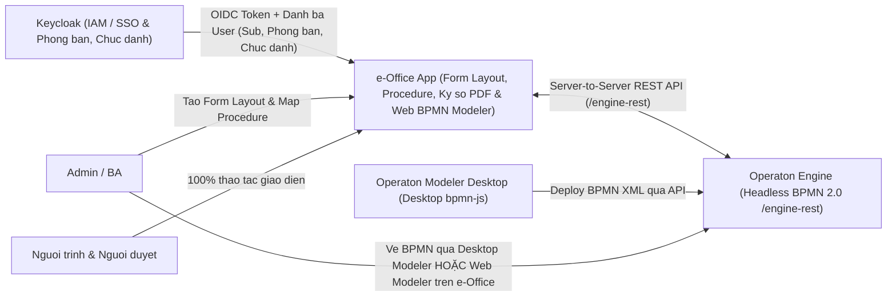

# 01 — Tầm nhìn Hệ thống & Kiến trúc 3 Trụ cột

**Trạng thái:** `APPROVED` (Phase 0)

---

## 1. Mục tiêu chuyển đổi kiến trúc

Mục tiêu của lộ trình mới là nâng cấp **GAFOOD E-Office** từ một ứng dụng đơn khối tự quản lý đăng nhập cục bộ, biểu mẫu một cột và luồng duyệt tuyến tính thành hệ sinh thái chuyên biệt gồm **3 trụ cột độc lập nhưng tương thích tốt**:

### Phân tách trách nhiệm rạch ròi

| Trụ cột | Hệ thống / Công nghệ | Chịu trách nhiệm | KHÔNG làm |
|---|---|---|---|
| **Định danh (IAM)** | **Keycloak** | SSO OIDC, quản lý tài khoản nhân sự, thuộc tính **Phòng ban** & **Chức danh**, nhóm quyền | Không lưu biểu mẫu, không điều phối luồng ký |
| **Workflow Engine** | **Operaton** (`operaton/operaton` image Docker) | Lưu & chạy sơ đồ **BPMN 2.0** (tuần tự, song song `Parallel Gateway`, rẽ nhánh điều kiện `Exclusive Gateway`), dùng chung cho nhiều khối (`e-Office`, `Sales Marketing`, `Customer Service`). Chạy headless qua REST API `/engine-rest`. | Không có giao diện cho nhân viên cuối, không chứa layout form, không lưu file PDF hay chữ ký số. (Lưu ý: Engine không có sẵn canvas vẽ trên web, xem [05-operaton-workflow-architecture-and-modeler.md](./05-operaton-workflow-architecture-and-modeler.md) & [ADR-006](./adr/ADR-006-operaton-deployment-and-modeler-strategy.md)). |
| **Workflow Designer** | **Operaton Modeler** (Desktop) & **`bpmn-js`** (Web nhúng e-Office) | Cung cấp canvas kéo thả thiết kế sơ đồ BPMN 2.0 chuẩn quốc tế, gắn biến `var_*`, tác nhân `actor_*` / `actorList_*` và xuất/deploy file BPMN XML sang Operaton Engine. | Không lưu trữ trạng thái chạy của quy trình, không can thiệp ký số. |
| **Nghiệp vụ E-Office** | **e-Office** (`NestJS` + `Next.js` + `PostgreSQL`) | Xây dựng Form & **Layout linh hoạt**, Web Modeler nhúng (`bpmn-js`), cầu nối **`Procedure`**, lưu dữ liệu yêu cầu (`FormResponseValue`), **kéo thả vị trí & ký số PDF**, bình luận, xem trước & **tùy biến tác nhân**, giao diện chuẩn GAFOOD × RAMP. | Không tự hardcode engine rẽ nhánh BPMN. |

---

## 2. Hai Module trung tâm ở tầng nghiệp vụ

1. **Module Tạo Biểu mẫu linh hoạt (`e-Office Form + Layout Engine`)**
   - Tách **Data Schema** (định nghĩa các trường dữ liệu, kiểu, validation) khỏi **Layout Schema** (cấu trúc Section, chia cột Grid, Bảng con/Repeater, ẩn/hiện có điều kiện, Slot tệp đính kèm).
   - Thay đổi giao diện biểu mẫu hoàn toàn độc lập với Operaton và giữ nguyên tính đọc lại được của dữ liệu cũ.
2. **Module Tạo Workflow (`Operaton`) & Lớp cầu nối `Procedure`**
   - Workflow được vẽ chuẩn BPMN 2.0 (thông qua Desktop Modeler hoặc Web Modeler `bpmn-js` nhúng trực tiếp trên e-Office) và deploy sang Operaton Engine với nhãn nhóm `category="e-Office"`.
   - Trên e-Office, **`Procedure`** đóng vai trò "bản thiết kế thủ tục hoàn chỉnh" (ví dụ: *Yêu cầu mua sắm*), ghép nối:
     - **1 `FormVersion`** (biểu mẫu + layout linh hoạt)
     - **1 `ProcessDefinition` từ Operaton** (kéo qua REST API lọc `category=e-Office`)
     - **Bảng Map Tham số**: nối `field` trên Form vào biến điều kiện của Gateway trên Operaton (`field A` -> `giá trị`), tự động ép kiểu dữ liệu an toàn.
     - **Bảng Map Tác nhân**: gán `user` (hiển thị kèm **Phòng ban, Chức danh**) vào từng `UserTask` của Operaton, hỗ trợ Multi-instance song song và cờ cho phép người trình chỉnh sửa trước khi gửi.

---

## 3. Đối chiếu Hiện trạng Codebase `E_Office` (Audit Phase 0)

Từ kiểm tra trực tiếp mã nguồn hiện tại trong `backend/` và `frontend/`:

### 3.1 Backend hiện có (`backend/src/modules/` & `backend/prisma/schema/`)
- **10 modules NestJS:** `auth`, `user`, `organization`, `form-builder`, `request`, `approval-flow`, `document`, `signature`, `signing` (Documenso bridge — không dùng ở FE), `comment`.
- **Điểm thuận lợi lớn cho Keycloak:** [`auth-provider.interface.ts`](file:///f:/Downloads/Projects/Gafood/E_Office/backend/src/modules/auth/interfaces/auth-provider.interface.ts) đã tách sẵn interface `AuthProvider` (`AUTH_PROVIDER` token) và `AuthenticatedUser` (`{ userId, email, role, jti, deviceId, accessExp }`) với chú thích sẵn sàng nối OIDC/Keycloak mà không cần sửa controller/guard.
- **Điểm thuận lợi cho Tác nhân & Tổ chức:** [`organization.prisma`](file:///f:/Downloads/Projects/Gafood/E_Office/backend/prisma/schema/organization.prisma) đã có cây `Organization` (`company | department | group`, `rootId` phi chuẩn hóa) và `OrganizationMember` (`role: "manager" | "member"`). Tuy nhiên [`schema.prisma`](file:///f:/Downloads/Projects/Gafood/E_Office/backend/prisma/schema/schema.prisma) (`User`) chưa có `keycloakSub` và chưa có trường **`jobTitle` (Chức danh)** chuẩn hóa cho hiển thị nhanh.
- **Giới hạn của Form hiện tại ([`form.prisma`](file:///f:/Downloads/Projects/Gafood/E_Office/backend/prisma/schema/form.prisma)):** `FormVersion` chỉ có `fields: FormField[]` (`TEXT`, `DATE`, `NUMBER`, `SELECT`) mà **chưa có trường lưu `layoutSchema`**, nên FE (`FormRenderer.tsx`) luôn xếp các trường dọc theo 1 cột.
- **Giới hạn của Luồng duyệt hiện tại ([`approval_flow.prisma`](file:///f:/Downloads/Projects/Gafood/E_Office/backend/prisma/schema/approval_flow.prisma) & [`action.prisma`](file:///f:/Downloads/Projects/Gafood/E_Office/backend/prisma/schema/action.prisma)):** `Flow`/`FlowStep` chỉ hỗ trợ danh sách bước tuần tự theo `order` (`SEQUENTIAL` | `PARALLEL` trong 1 bước), **chưa hỗ trợ rẽ nhánh điều kiện (`Exclusive Gateway`)**, và bắt buộc người trình tự dựng luồng thủ công mỗi lần tạo yêu cầu thay vì chọn từ `Procedure`.
- **Signing PDF ([`signature.prisma`](file:///f:/Downloads/Projects/Gafood/E_Office/backend/prisma/schema/signature.prisma) & [`request_form.prisma`](file:///f:/Downloads/Projects/Gafood/E_Office/backend/prisma/schema/request_form.prisma)):** Hệ thống đóng dấu chữ ký online (`SignatureField` tọa độ `%`, gắn `assigneeId`, `documentId` với `RequestDocument.signing = true`) và `pdf-lib` hoạt động độc lập, **giữ nguyên hoàn toàn** ở kiến trúc mới.
- **Nợ tài liệu cũ được phát hiện khi audit:** Một số file trong `backend/docs/` (ví dụ `approval-flow/service.md`, `request/controller.md`) vẫn mô tả bước `CLOSE` của người trình và endpoint `/resubmit`, trong khi code thực tế (`action.prisma`, `approval_flow.prisma`, `RequestService`) đã bỏ bước `CLOSE` (đánh dấu `isFinal = true` ở bước duyệt cuối) và dùng `/revise` (`reset` | `reserve`) + `/submit`. Các doc này sẽ được chuẩn hóa lại trong quá trình đồng bộ docs.

### 3.2 Frontend hiện có (`frontend/`)
- Đã hoàn thiện hệ thống UI nền tảng theo **GAFOOD × RAMP-inspired Design System** (`frontend/app/globals.css`, `frontend/components/ui/*`, `AppShell`, `Sidebar`, `Header`, `NotificationPanel`, `RequestListScreen`, `RequestDetailScreen` Split-view + `RequestDocumentPreview`).
- Các nâng cấp ở Phase 2, Phase 4, Phase 5 sẽ xây trực tiếp trên bộ `components/ui/*` và quy chuẩn Split-view / RAMP này.

