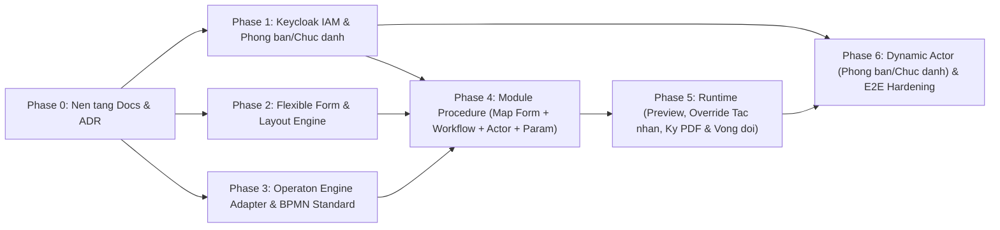

# 03 — Kế hoạch Triển khai Theo Các Phase (Phase 0 -> Phase 6)

**Trạng thái:** `APPROVED` (Phase 0)

Mỗi Phase từ **Phase 1 trở đi** đều bắt buộc đi qua **2 lượt tách biệt**:
- **Lượt A (`[Spec]`):** Hoàn thiện toàn bộ tài liệu trong `01-architecture/` và `02-specs/phase-X-*/`, tự kiểm bằng [`doc-review-checklist.md`](../03-checklists/doc-review-checklist.md), sau đó **dừng lại chờ duyệt (`APPROVED`)**.
- **Lượt B (`[Code & Verify]`):** Chỉ được phép viết code khi tài liệu Lượt A đã `APPROVED`. Sau khi code xong, chạy kiểm thử + kiểm tra tuân thủ bằng [`code-compliance-checklist.md`](../03-checklists/code-compliance-checklist.md), cập nhật `backend/docs/` & `frontend/docs/` và trạng thái trong [`04-traceability-matrix.md`](./04-traceability-matrix.md).

---

## Tổng quan lộ trình & phụ thuộc

---

## Chi tiết từng Phase

### Phase 0 — Nền tảng Tài liệu & Khung Quy trình (Hiện tại)
- **Mục tiêu:** Thiết lập bộ khung `E_Office_Docs/`, thống nhất tầm nhìn 3 trụ cột, từ điển thuật ngữ, 5 quyết định kiến trúc cốt lõi (ADR), ma trận truy vết và 2 cổng kiểm soát (`doc-review`, `code-compliance`). Audit đúng hiện trạng code.
- **Deliverables:** Các file trong `README.md`, `00-overview/*`, `03-checklists/*`. **Không sửa bất kỳ file code nào.**
- **Exit Criteria:** Người phụ trách duyệt toàn bộ `ADR-001..005` và thứ tự triển khai Phase 1 -> 6.

### Phase 1 — Keycloak IAM & Đồng bộ User / Phòng ban / Chức danh
- **Entry Criteria:** Phase 0 được duyệt (`APPROVED`).
- **Lượt A (Spec — `01-architecture/auth-keycloak-architecture.md` + `02-specs/phase-1-keycloak-identity/`):**
  - Thiết kế luồng OIDC/PKCE (Frontend -> Keycloak -> Backend `JwtStrategy`/OIDC validation) dựa trên `AuthProvider` interface sẵn có.
  - Thiết kế đồng bộ thông tin User (`keycloakSub`, `email`, `displayName`, `jobTitle` chức danh, ánh xạ `Organization` phòng ban) để hiển thị rõ khi gán tác nhân.
  - Chiến lược chuyển đổi/song song với `LocalAuthProvider` trong giai đoạn dev/migration.
- **Lượt B (Code & Verify):**
  - Migration Prisma cho `User` (`keycloakSub`, `jobTitle`, ...), triển khai `KeycloakOidcProvider` & đồng bộ danh bạ/phòng ban.
  - Cập nhật UI Login / UserPicker hiển thị tên + phòng ban + chức danh.
  - Test Plan: Unit + Integration auth/OIDC token verification + sync profile.

### Phase 2 — Module Tạo Biểu mẫu & Layout Linh hoạt (`e-Office`)
- **Entry Criteria:** Phase 0 được duyệt (`APPROVED`). *(Có thể làm song song hoặc trước Phase 3 vì hoàn toàn độc lập với Operaton).*
- **Lượt A (Spec — `02-specs/phase-2-form-layout-engine/`):**
  - Chốt `layout-schema-spec.md` (JSON Schema cho `Section`, `Grid columns/colSpan`, `Repeater/Sub-table`, `Conditional Visibility`, `Document Slots`).
  - Data model mở rộng `FormVersion` mà giữ tương thích 100% với `FormResponseValue` (EAV) và các `Form` cũ.
  - UI Spec cho Form Builder kéo-thả/cấu hình layout (tuân thủ GAFOOD × RAMP Design Rules) và `FormRenderer` động.
- **Lượt B (Code & Verify):**
  - Migration Prisma + cập nhật `FormBuilderModule` (`backend`) validation theo Data Schema + Layout Schema.
  - Nâng cấp `FormBuilderScreen`, `FormRenderer`, `RequestFormData` (`frontend`).
  - Test Plan: Backward-compatibility với form cũ, validation repeater/hidden fields, build & E2E form versioning.

### Phase 3 — Operaton Workflow Engine Adapter & Chuẩn BPMN
- **Entry Criteria:** Phase 0 được duyệt (`APPROVED`).
- **Lượt A (Spec — `01-architecture/operaton-engine-contract.md` + `02-specs/phase-3-operaton-adapter/`):**
  - Chuẩn dựng môi trường Operaton (Docker Compose dev + kết nối `/engine-rest`, phân nhóm/tenant `e-Office`).
  - Tài liệu hướng dẫn vẽ BPMN chuẩn cho nhóm `e-Office` (`bpmn-modeling-standards.md`): quy ước `taskDefinitionKey`, biến điều kiện `var_*`, biến gán người `actor_*` / `actorList_*` (Multi-instance), xử lý `REQUEST_CHANGES` / `REJECT` / `CANCEL`.
  - Hợp đồng `OperatonAdapterService` (server-to-server: list definitions, parse BPMN XML, start instance, query tasks, complete task, cancel instance, cơ chế sync listener/polling).
- **Lượt B (Code & Verify):**
  - Dựng container Operaton dev + 1-2 mẫu BPMN chuẩn (ví dụ mẫu `FLOW 1` rẽ nhánh `giá trị` + song song + tuần tự).
  - Xây dựng `OperatonModule` (`OperatonClient`, `BpmnParserService`, `OperatonSyncService`) kèm integration test với Operaton thật.

### Phase 4 — Lớp Cầu nối `Procedure` (Mapping Form + Workflow + Tác nhân + Tham số)
- **Entry Criteria:** Phase 1, Phase 2 và Phase 3 đạt `VERIFIED`.
- **Lượt A (Spec — `02-specs/phase-4-procedure-mapping/`):**
  - Data Model cho `Procedure` / `ProcedureVersion`, `ProcedureActorMapping` (`taskDefinitionKey`, `defaultUserId` + hiển thị phòng ban/chức danh, `allowOverride`), `ProcedureVariableMapping` (`operatonVarName` <-> `formFieldKey`, kiểu dữ liệu ép kiểu).
  - API Contract CRUD & Publish `Procedure` (ghim `FormVersionId` + `operatonProcessDefinitionId`).
  - UI Spec màn hình quản trị cấu hình `Procedure` (kéo workflow từ Operaton, xem sơ đồ BPMN, map tham số & gán user từng bước).
- **Lượt B (Code & Verify):**
  - Triển khai `ProcedureModule` (`backend`) + màn hình quản trị Procedure (`frontend`).
  - Test Plan: Validation thiếu mapping biến/thiếu user mặc định, version pinning khi publish bản mới.

### Phase 5 — Vận hành Run-time (`Request` + Preview/Override Tác nhân + Ký PDF + Vòng đời Operaton)
- **Entry Criteria:** Phase 4 đạt `VERIFIED`.
- **Lượt A (Spec — `02-specs/phase-5-runtime-and-signing/`):**
  - Đặc tả luồng tạo yêu cầu từ `Procedure`: nhập Form theo layout mới -> xem trước sơ đồ BPMN + đánh giá nhánh điều kiện dự kiến -> **cho phép người trình sửa/bổ sung người duyệt** theo từng bước -> đính kèm PDF & đặt `SignatureField` cho danh sách người duyệt thực tế đã chốt.
  - Đặc tả thực thi phê duyệt/từ chối/yêu cầu sửa/hủy: móc nối `SignatureModule` (bắt buộc ký trước khi complete task `APPROVE` khi có PDF ký) với `OperatonAdapterService`, đồng bộ `FormResponse.status` và bảng projection task để màn *"Công việc của tôi"* lọc/phân trang nhanh.
  - Đặc tả luồng `Revise` / `Cancel` đồng bộ đóng/tạo mới `ProcessInstance`.
- **Lượt B (Code & Verify):**
  - Tích hợp `RequestModule` + `SignatureModule` với `OperatonModule` & `ProcedureModule`.
  - Nâng cấp `CreateRequestWizard`, `RequestDetailScreen` (Split-view + preview luồng BPMN), `RequestListScreen`.
  - Test Plan: E2E trọn luồng rẽ nhánh điều kiện, song song, override tác nhân, ký PDF và revise/cancel.

### Phase 6 — Gán Tác nhân Động (Phòng ban / Chức danh) & E2E Hardening
- **Entry Criteria:** Phase 5 đạt `VERIFIED`.
- **Lượt A (Spec — `02-specs/phase-6-dynamic-actor-and-hardening/`):**
  - Mở rộng `ProcedureActorMapping` hỗ trợ rule động (vd: *Trưởng phòng trực tiếp của người trình*, *Quản lý đơn vị gốc*, *User giữ chức danh X tại phòng ban Y*) dựa trên `Organization` tree & thuộc tính Keycloak.
  - Cơ chế fallback/cảnh báo khi không tìm thấy người giữ chức danh phù hợp.
- **Lượt B (Code & Verify):**
  - Triển khai `ActorResolverService`, UI chọn rule động trên Procedure.
  - Chạy full E2E regression suite, rà soát bảo mật/hiệu năng, cập nhật toàn bộ `backend/docs/`, `frontend/docs/`, và chạy `graphify` đồng bộ đồ thị.

---

## Ma trận Rủi ro & Biện pháp kiểm soát

| Rủi ro | Mức độ | Biện pháp thiết kế ngay từ Phase 0 / Spec |
|---|---|---|
| Lệch trạng thái giữa Operaton và DB e-Office (hoặc user thao tác song song gây race) | Cao | Dùng `businessKey = request.id`, lưu projection trạng thái + Listener/Sync job đối soát + idempotency key |
| Admin sửa Form hoặc sửa BPMN làm hỏng yêu cầu đang chạy | Cao | Áp dụng **ADR-005 (Version Pinning)**: mỗi `FormResponse` khóa cứng `procedureVersionId` (`formVersionId` + `processDefinitionId`) |
| Người trình sửa người duyệt làm hỏng cấu trúc BPMN | Trung bình | Áp dụng **ADR-003**: BPMN dùng biến `actor_*` / Multi-instance collection `actorList_*` thay vì gán cứng tên user trong XML |
| Tài liệu viết xong bị bỏ quên khi code | Cao | Bắt buộc kiểm tra qua [`code-compliance-checklist.md`](../03-checklists/code-compliance-checklist.md) & [`04-traceability-matrix.md`](./04-traceability-matrix.md) trước khi kết thúc Phase |

