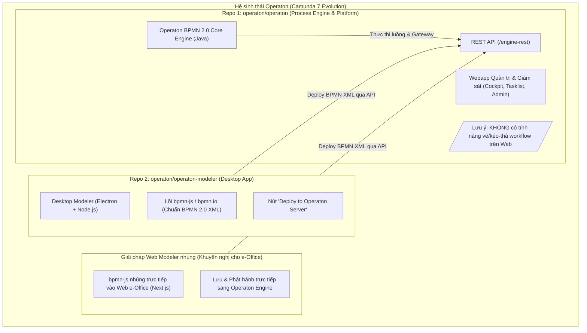
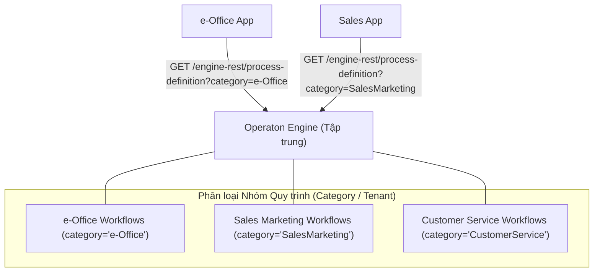
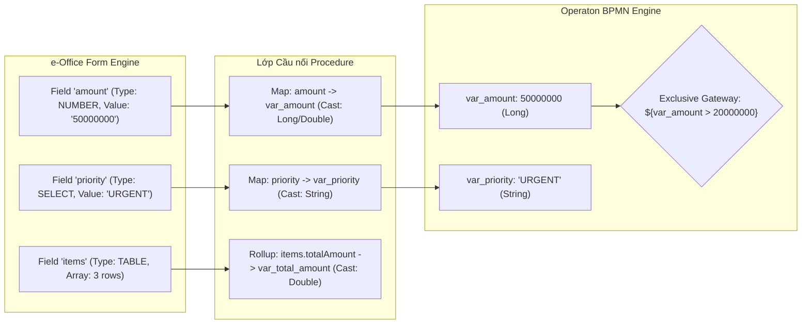
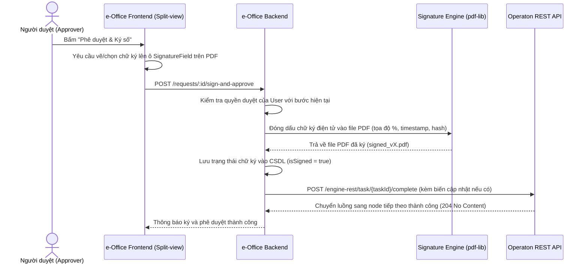

# 05 — Phân tích Toàn diện Kiến trúc Operaton: Workflow Engine, Công cụ Thiết kế & Tích hợp e-Office

**Trạng thái:** `APPROVED` (Phase 0 bổ sung)  
**Tài liệu tham chiếu gốc:** [`architecture_operatioin_eoffice.md`](../architecture_operatioin_eoffice.md), [ADR-002](./adr/ADR-002-operaton-variable-conventions.md), [ADR-006](./adr/ADR-006-operaton-deployment-and-modeler-strategy.md).

---

## 1. Bản chất Kỹ thuật của Operaton: Engine vs. Công cụ Thiết kế (Modeler)

Khi đề xuất: *"tôi muốn clone phần mềm tạo workflow này `https://github.com/operaton/operaton.git`... sao cho module tạo biểu mẫu (e-office) và module tạo workflow (operaton) độc lập và chuyên biệt nhưng tương thích tốt"*, cần làm rõ bản chất các thành phần trong hệ sinh thái Operaton để tránh ngộ nhận kỹ thuật:

### 1.1 `operaton/operaton` là gì?
- Là repository chứa **BPMN 2.0 Process Engine** (viết bằng Java/Spring Boot), kế thừa trực tiếp từ Camunda 7 Community Edition.
- Cung cấp:
  - Bộ máy thực thi quy trình (State Machine, Timer, Event Listener, Persistence vào CSDL quan hệ).
  - Cổng giao tiếp chuẩn REST API tại endpoint `/engine-rest`.
  - Bộ giao diện Web quản trị: **Cockpit** (giám sát các phiên bản quy trình đang chạy, lỗi incident), **Admin** (quản lý user/group hệ thống), **Tasklist** (danh sách công việc thuần BPMN).
- **Điểm then chốt:** `operaton/operaton` **hoàn toàn KHÔNG có giao diện kéo thả để vẽ workflow trên trình duyệt web**. Cockpit chỉ dùng để *xem* sơ đồ đã được deploy và giám sát luồng chạy.

### 1.2 Vậy công cụ vẽ/tạo workflow ("Phần mềm tạo workflow") nằm ở đâu?
Trong hệ sinh thái chuẩn, việc tạo/vẽ sơ đồ BPMN được thực hiện bởi:
1. **Desktop App — `operaton/operaton-modeler`** (`https://github.com/operaton/operaton-modeler`):
   - Ứng dụng Desktop (chạy trên Windows/macOS/Linux) xây dựng bằng Electron và lõi `bpmn-js` (từ `bpmn.io`).
   - Cho phép BA/Admin kéo thả các node: `StartEvent`, `UserTask`, `ExclusiveGateway`, `ParallelGateway`, `EndEvent`...
   - Cấu hình thuộc tính BPMN (`id`, `name`, `assignee`, biểu thức rẽ nhánh `${var_amount >= 50000000}`).
   - Có nút **Deploy** đẩy trực tiếp file BPMN XML lên Operaton Engine qua endpoint `POST /engine-rest/deployment/create`.
2. **Web BPMN Modeler nhúng trực tiếp trong e-Office (Đề xuất tối ưu UX)**:
   - Vì lõi của `operaton-modeler` chính là thư viện mã nguồn mở **`bpmn-js`**, chúng ta hoàn toàn có thể tích hợp canvas thiết kế BPMN 2.0 ngay trên giao diện web e-Office (Next.js).
   - Người quản trị e-Office có thể mở tab "Thiết kế Luồng", vẽ sơ đồ trên trình duyệt web và bấm "Phát hành sang Operaton" mà không bắt buộc phải cài thêm ứng dụng desktop.

---

## 2. Chiến lược Triển khai: Docker-First vs. Clone Source Code

| Tiêu chí | Phương án A: Dùng Docker Image chính thức (`operaton/operaton:latest`) | Phương án B: Clone mã nguồn `operaton/operaton` và tự build Java |
|---|---|---|
| **Cách thực hiện** | Khai báo 1 service trong `docker-compose.yml`, kết nối chung PostgreSQL | `git clone https://github.com/operaton/operaton.git`, cài JDK 17+, Maven, chạy `mvn clean install` |
| **Thời gian khởi động** | **10 - 30 giây** | **20 - 45 phút** (tải dependencies Maven, compile hàng trăm module) |
| **Tài nguyên chiếm dụng** | Nhẹ, tối ưu trong container Alpine/Debian Slim | Nặng hàng GB ổ cứng, tốn RAM build |
| **Nâng cấp phiên bản** | Chỉ cần đổi tag `image: operaton/operaton:x.y.z` và chạy `docker compose pull` | Phải git fetch, giải quyết conflict mã nguồn Java |
| **Khi nào nên dùng?** | **Khuyến nghị tuyệt đối (99% trường hợp)**: Cho mọi môi trường Dev, Staging, Production khi dùng Operaton làm Headless Engine. | **Chỉ dùng khi**: Doanh nghiệp muốn can thiệp sửa trực tiếp mã nguồn C++/Java bên trong lõi engine hoặc viết Java Plugin nhúng sâu. |

> [!IMPORTANT]
> **Quyết định kiến trúc (Xem [ADR-006](./adr/ADR-006-operaton-deployment-and-modeler-strategy.md)):**
> - Không lồng source code Java của Operaton vào monorepo của `E_Office`.
> - Chạy Operaton độc lập bằng **Docker Compose** (`deploy/operaton/docker-compose.yml`) sử dụng image `operaton/operaton:latest`, chia sẻ PostgreSQL database server với e-Office (dùng database riêng `operaton_db`).
> - Cung cấp **2 cách tạo luồng song song**:
>   1. Dùng ứng dụng Desktop **Operaton Modeler** (cho BA chuyên nghiệp vẽ luồng phức tạp).
>   2. Dùng **Web BPMN Modeler (nhúng `bpmn-js`)** ngay trên web e-Office (cho Admin thao tác nhanh chóng trên 1 giao diện duy nhất).

---

## 3. Cân nhắc Toàn diện về Khung Ý tưởng (Comprehensive Considerations)

### 3.1 Độc lập & Tách biệt Đa Khối Nghiệp vụ (Multi-Tenancy & Grouping)
Trong sơ đồ của doanh nghiệp, Operaton đóng vai trò **Bộ não điều phối quy trình dùng chung** cho:
- Khối `e-Office` (Quy trình mua sắm, đề xuất văn phòng, trình ký văn bản).
- Khối `Sales Marketing` (Duyệt chiến dịch quảng cáo, chiết khấu khách hàng).
- Khối `Customer Service` (Xử lý khiếu nại, hoàn tiền).

- **Quy tắc phân tách:**
  - Mỗi workflow khi vẽ được gán thuộc tính `category` hoặc `tenantId` (ví dụ `category="e-Office"`).
  - Khi e-Office gọi API lấy danh sách workflow để tạo `Procedure`, e-Office luôn truyền query param `category=e-Office`. Các quy trình của Sales Marketing hay Customer Service sẽ **hoàn toàn vô hình** với người dùng e-Office, tránh nhầm lẫn và xung đột dữ liệu.

---

### 3.2 Hợp đồng Dữ liệu giữa e-Office Form và Operaton BPMN (Parameter Mapping & Type Casting)

Một trong những rủi ro lớn nhất khi ghép Biểu mẫu linh hoạt với Engine BPMN là **Lệch kiểu dữ liệu (Data Type Mismatch)** dẫn đến Gateway rẽ nhánh trên BPMN bị lỗi hoặc đánh giá sai.

- **Quy tắc ép kiểu tự động (Auto Type Casting):**
  - Form lưu giá trị dưới dạng JSON / String trong `FormResponseValue`.
  - Khi nộp yêu cầu, `OperatonAdapterService` dựa vào cấu hình `ProcedureVariableMapping` để chuyển đổi:
    - `NUMBER` &rarr; `Long` (nếu số nguyên) hoặc `Double` (nếu có thập phân).
    - `DATE` &rarr; `Date` (chuẩn ISO-8601 UTC).
    - `SELECT` / `TEXT` &rarr; `String`.
    - `TABLE` aggregate &rarr; Lấy giá trị tổng `SUM` hoặc đếm dòng `COUNT` đã tính toán tự động ở Phase 2 để ép sang `Double`/`Long`.
  - Nhờ vậy, biểu thức rẽ nhánh trên BPMN như `${var_amount >= 50000000}` luôn được đánh giá an toàn 100%.

---

### 3.3 Linh hoạt Tác nhân: Gán mặc định, Đổi người duyệt & Duyệt song song nhiều người (Multi-Instance)

Trong thực tế doanh nghiệp, người trình cần được phép thay đổi người duyệt ở một số bước. Tuy nhiên, nếu sơ đồ BPMN vẽ cứng 1 `UserTask`, làm sao để hỗ trợ:
1. **Đổi người duyệt khác?**
2. **Thêm nhiều người cùng duyệt ở 1 bước (duyệt song song)?**

Giải pháp chuẩn hóa:
- **Trường hợp 1 người duyệt (Single Assignee):**
  - Khai báo trên BPMN: `camunda:assignee="${actor_step_key}"`.
  - Khi người trình đổi người, e-Office chỉ cần truyền giá trị `actor_step_key = "user_new_id"` vào payload khi start instance.
- **Trường hợp duyệt song song nhiều người (Multi-Instance Parallel):**
  - Khai báo trên BPMN node dạng Multi-Instance:
    - Collection: `${actorList_step_key}`
    - Element Variable: `assigneeItem`
    - Assignee: `${assigneeItem}`
  - Khi người trình thêm 2, 3 người duyệt vào bước đó (ví dụ: cần cả Trưởng phòng A và Trưởng phòng B cùng ký), e-Office chỉ cần truyền mảng `actorList_step_key = ["user_A", "user_B"]`. Operaton sẽ tự động sinh ra đúng số lượng UserTask song song tương ứng mà **không cần sửa lại sơ đồ BPMN**!

---

### 3.4 Cơ chế "Gatekeeper" bảo vệ Chữ ký số PDF

Operaton không có khái niệm về file PDF, tọa độ chữ ký hay chứng thư số. Do đó, e-Office đóng vai trò là **người gác cổng bảo mật tuyệt đối**:

> [!CAUTION]
> **Nguyên tắc bất biến:** Không bao giờ cho phép gọi `/engine-rest/task/{taskId}/complete` trực tiếp từ client (Frontend). Mọi hành động hoàn tất UserTask bắt buộc phải đi qua Backend e-Office để kiểm tra chữ ký PDF và ghi nhận nhật ký kiểm toán (Audit Trail).

---

### 3.5 Vòng đời Đồng bộ và Xử lý Yêu cầu Chỉnh sửa (`REQUEST_CHANGES` / `Revise`)

Khi người duyệt từ chối hoặc yêu cầu sửa đổi:
- **Kịch bản A: Trả về người trình sửa trực tiếp trong luồng BPMN (In-flight Loop):**
  - Sơ đồ BPMN có đường rẽ nhánh từ UserTask quay về `UserTask: Creator Revise`.
  - Người trình mở đơn ra sửa lại biểu mẫu, bấm "Gửi lại", luồng chạy tiếp.
- **Kịch bản B: Hủy instance hiện tại và nhân bản đơn mới (Clone & Revise — Chuẩn e-Office hiện tại):**
  - e-Office gọi `DELETE /engine-rest/process-instance/{id}` với lý do `REVISED_BY_USER`.
  - e-Office tạo bản ghi đơn mới gắn nhãn bản sửa đổi (`revision`), cho phép người trình sửa form và khởi chạy một Process Instance mới hoàn toàn trên Operaton.
  - Lợi ích: Lịch sử các lần duyệt trước được lưu trữ thành hồ sơ độc lập, không bị đè dữ liệu.

---

## 4. Bảng Tổng kết & Khuyến nghị Hành động

| Hạng mục | Khuyến nghị Kỹ thuật | Hành động Triển khai |
|---|---|---|
| **Mã nguồn Operaton** | Chạy bằng Docker Image chính thức `operaton/operaton:latest` | Thiết lập `deploy/operaton/docker-compose.yml`, không clone source code Java vào monorepo e-Office. |
| **Công cụ Tạo Workflow** | Hỗ trợ song song cả Desktop App & Web Modeler | 1. Cung cấp hướng dẫn tải & cấu hình `operaton-modeler` desktop. 2. Nhúng thư viện `bpmn-js` thành màn hình vẽ quy trình trực quan trên Web e-Office. |
| **Phân loại Luồng** | Định danh theo `category` | Gắn nhãn `category="e-Office"` cho mọi BPMN phục vụ e-Office. |
| **Mapping Biểu mẫu & Luồng** | Qua thực thể `Procedure` | Xây dựng Data Model `Procedure`, `ProcedureActorMapping`, `ProcedureVariableMapping` ở Phase 4. |
| **Quyền người trình** | Cho phép xem trước & sửa người duyệt | Áp dụng quy chuẩn biến `actor_*` và Multi-Instance `${actorList_*}` trên BPMN. |
| **Bảo mật Chữ ký PDF** | Server-to-server Gatekeeper | Ký đóng dấu PDF hoàn tất mới gửi lệnh `/task/{taskId}/complete` sang Operaton. |

