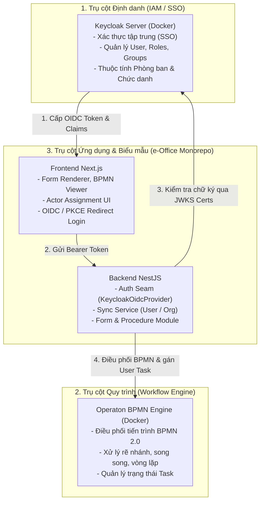
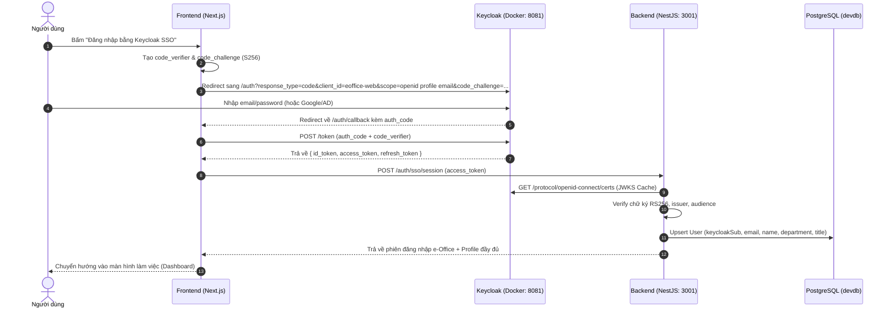

# Kiến trúc Định danh Tập trung Keycloak IAM & Cơ chế Đồng bộ e-Office

**Trạng thái:** `APPROVED` (Phase 1 Spec)  
**Phụ trách:** AI Coordinator & Người dùng  
**Tài liệu liên quan:** [01-vision-and-3-pillars.md](../00-overview/01-vision-and-3-pillars.md), [04-traceability-matrix.md](../00-overview/04-traceability-matrix.md), [ADR-006](../00-overview/adr/ADR-006-operaton-deployment-and-modeler-strategy.md).

---

## 1. Tầm nhìn Kiến trúc: Mảnh ghép Định danh trong Mô hình 3 Trụ cột

Trong kiến trúc tổng thể của hệ thống e-Office doanh nghiệp, **Keycloak** đóng vai trò là **Trụ cột Định danh & Phân quyền tập trung (IAM / SSO)**, tách rời hoàn toàn khỏi bộ máy nghiệp vụ Biểu mẫu (`e-Office`) và bộ máy Quy trình (`Operaton`):



### Nguyên tắc Cốt lõi
1. **Decoupled Identity (Độc lập định danh):** Keycloak là nguồn chân lý duy nhất (Single Source of Truth) cho thông tin tài khoản, mật khẩu, xác thực đa yếu tố (MFA), và phân quyền hệ thống. Mã nguồn e-Office không tự phát triển lại cơ chế băm mật khẩu hay phát hành token SSO.
2. **Docker-First & Zero-Code Core:** Keycloak chạy 100% bằng container Docker độc lập (`deploy/keycloak/docker-compose.keycloak.yml`), kết nối CSDL PostgreSQL (`keycloak_db`).
3. **Pluggable Auth Seam:** Backend e-Office trừu tượng hóa toàn bộ cơ chế xác thực thông qua interface `AuthProvider`. Việc chuyển đổi giữa `LocalAuthProvider` (phát triển offline) và `KeycloakOidcProvider` (SSO doanh nghiệp) diễn ra tại tầng Dependency Injection mà không chạm vào Controller hay Guard nghiệp vụ.
4. **Denormalized Directory Sync (Đồng bộ danh bạ cục bộ):** e-Office duy trì bảng `User` và `Organization` nội bộ để phục vụ gán tác nhân phê duyệt (`ProcedureActorMapping`), lọc danh sách yêu cầu (`RequestViewer`), và hiển thị tên/phòng ban/chức danh tức thì mà không cần gọi API Keycloak liên tục trong runtime.

---

## 2. Luồng Xác thực Chuẩn OpenID Connect (OIDC) với PKCE

Hệ thống áp dụng chuẩn bảo mật cao nhất hiện nay cho Single Page App / Web App: **Authorization Code Flow with Proof Key for Code Exchange (PKCE)**.



---

## 3. Kiến trúc Cổng Seam `AuthProvider` trên Backend

Kiến trúc backend đã được chuẩn bị sẵn từ ban đầu trong `backend/src/modules/auth/interfaces/auth-provider.interface.ts`.

### 3.1 Giao diện `AuthProvider`
```typescript
export interface AuthProvider {
  /** Xác thực đăng nhập cục bộ (Email/Pass) */
  login?(dto: LoginDto): Promise<AuthResult>;
  
  /** Xác thực Token từ Identity Provider ngoài (Keycloak SSO) */
  validateExternalToken?(token: string): Promise<AuthenticatedUser>;
  
  /** Làm mới Token */
  refreshToken(refreshToken: string, deviceId: string): Promise<AuthTokens>;
  
  /** Thu hồi phiên */
  revokeSession(userId: string, deviceId: string): Promise<void>;
}
```

### 3.2 Hiện thực `KeycloakOidcProvider`
Class `KeycloakOidcProvider` đóng gói:
1. **JWKS Client:** Sử dụng thư viện `jwks-rsa` để tải và cache public keys từ endpoint:
   `http://localhost:8081/realms/e-office/protocol/openid-connect/certs`.
2. **Token Verification:** Kiểm tra thuật toán mã hóa `RS256`, `iss` khớp với realm URL, và `aud` khớp với `eoffice-web` hoặc `eoffice-api`.
3. **Claim Extraction:** Trích xuất các trường định danh:
   - `sub`: Keycloak User ID (UUID duy nhất).
   - `email`: Địa chỉ email.
   - `name` / `preferred_username`: Tên hiển thị.
   - `realm_access.roles`: Danh sách vai trò (`admin`, `user`).
   - `attributes.department` & `attributes.jobTitle`: Thuộc tính mở rộng để gán tác nhân.

---

## 4. Cơ chế Đồng bộ Danh bạ & Phòng ban / Chức danh

Để hỗ trợ màn hình cấu hình thủ tục ở **Phase 4** và màn hình nộp đơn ở **Phase 5** hiển thị rõ ràng thông tin người duyệt:

### 4.1 Bảng ánh xạ Claims vào e-Office DB
| Keycloak Claim | Thuộc tính e-Office User | Mục đích sử dụng |
| :--- | :--- | :--- |
| `sub` | `User.keycloakSub` | Khóa chính đối soát ngoại bộ, đảm bảo tính duy nhất |
| `email` | `User.email` | Định danh tài khoản, nhận thông báo email |
| `name` / `given_name` | `User.displayName` | Hiển thị trên danh bạ, sơ đồ duyệt, và chữ ký PDF |
| `realm_access.roles` | `User.role` | Quyền hệ thống (`admin` hoặc `user`) |
| `attributes.department` | `User.department` | Phòng ban (ví dụ: *Phòng Mua hàng*, *Phòng Kế toán*) |
| `attributes.jobTitle` | `User.title` | Chức danh (ví dụ: *Trưởng phòng*, *Kế toán trưởng*) |

### 4.2 Tự động liên kết Cây Tổ chức (`Organization`)
Khi User đăng nhập hoặc khi chạy kịch bản đồng bộ:
- Hệ thống kiểm tra xem tên phòng ban trong `User.department` đã tồn tại trong bảng `organizations` chưa.
- Nếu chưa có, tự động tạo node phòng ban mới thuộc Root Company.
- Tự động liên kết bản ghi `OrganizationMember` tương ứng.

---

## 5. Chiến lược Chạy song song Dual-Auth (Migration & Dev Mode)

Nhằm đảm bảo môi trường dev linh hoạt và các integration test trước đây không bị gián đoạn:
1. **Biến môi trường điều khiển `AUTH_MODE`:**
   - `AUTH_MODE=dual` (Mặc định): Cho phép cả đăng nhập cục bộ (Email/Pass) lẫn đăng nhập SSO Keycloak.
   - `AUTH_MODE=keycloak`: Ép buộc 100% người dùng chuyển hướng sang Keycloak SSO.
   - `AUTH_MODE=local`: Chỉ dùng tài khoản nội bộ (phục vụ chạy test offline không cần Docker Keycloak).
2. **Tương thích mật khẩu cục bộ:**
   - Thuộc tính `User.passwordHash` được chuyển thành tùy chọn (`nullable`). User tạo từ Keycloak SSO sẽ có `passwordHash = null` và không thể bị tấn công brute-force vào endpoint login nội bộ.
