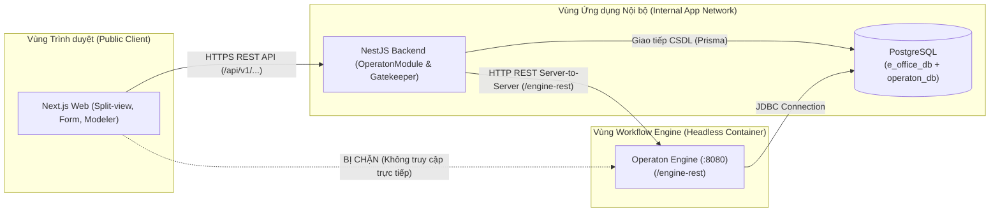

# Kiến trúc Hợp đồng Tích hợp: e-Office Backend <-> Operaton BPMN Engine

**Trạng thái:** `APPROVED` (Phase 3)  
**Tài liệu liên quan:** [01-vision-and-3-pillars.md](../00-overview/01-vision-and-3-pillars.md), [05-operaton-workflow-architecture-and-modeler.md](../00-overview/05-operaton-workflow-architecture-and-modeler.md), [ADR-002](../00-overview/adr/ADR-002-operaton-variable-conventions.md), [ADR-006](../00-overview/adr/ADR-006-operaton-deployment-and-modeler-strategy.md).

---

## 1. Nguyên tắc Kết nối & Ranh giới Bảo mật (Server-to-Server Only)

Hệ thống tuân thủ mô hình **Headless Engine**:
- **KHÔNG BAO GIỜ** cho phép client (Trình duyệt web / Next.js Frontend) kết nối trực tiếp đến cổng Operaton REST API (`http://operaton:8080/engine-rest`).
- **100% giao tiếp đi qua e-Office Backend (NestJS)**. Backend đóng vai trò lớp bảo vệ (Gatekeeper), thực hiện:
  1. Xác thực người dùng (JWT / SSO).
  2. Phân quyền và kiểm tra tính hợp lệ của hồ sơ / chữ ký PDF.
  3. Lọc và chuẩn hóa dữ liệu trước khi gửi sang Operaton.
  4. Che giấu thông tin nội bộ của engine khỏi client.



---

## 2. Thông số Cấu hình Môi trường Backend (`OperatonConfig`)

Backend NestJS đọc cấu hình từ biến môi trường (`.env`):

| Tên biến | Kiểu | Mặc định (Dev) | Ý nghĩa |
|---|---|---|---|
| `OPERATON_REST_URL` | String | `http://localhost:8080/engine-rest` (hoặc `http://operaton:8080/engine-rest` trong Docker network) | URL gốc của Operaton REST API |
| `OPERATON_TIMEOUT_MS` | Number | `10000` (10 giây) | Timeout cho mỗi request REST gọi sang Operaton |
| `OPERATON_AUTH_ENABLED` | Boolean | `false` (Dev) / `true` (Prod) | Bật xác thực Basic Auth giữa NestJS và Operaton REST API |
| `OPERATON_AUTH_USER` | String | `operaton-service` | Username tài khoản service account |
| `OPERATON_AUTH_PASSWORD` | String | `secret` | Mật khẩu tài khoản service account |
| `OPERATON_DEFAULT_CATEGORY`| String | `e-Office` | Tên category mặc định dùng để phân nhóm và lọc workflow |

---

## 3. Các Endpoint Operaton REST API Cốt lõi được Sử dụng

Backend NestJS tương tác với Operaton Engine qua các endpoint chuẩn:

### 3.1 Nhóm Quản lý Định nghĩa Quy trình (Process Definition)
1. **Lấy danh sách quy trình thuộc nhóm `e-Office`:**
   - `GET /engine-rest/process-definition?category=e-Office&latestVersion=true`
   - Mục đích: Hiển thị danh sách workflow cho Admin chọn khi tạo `Procedure`.
2. **Lấy sơ đồ BPMN XML:**
   - `GET /engine-rest/process-definition/{id}/xml`
   - Mục đích: Backend phân tích cấu trúc các node `UserTask`, `Gateway` và gửi về Frontend để render sơ đồ xem trước hoặc nhúng vào Modeler.
3. **Phát hành (Deploy) sơ đồ BPMN mới:**
   - `POST /engine-rest/deployment/create`
   - Header: `multipart/form-data`
   - Body: `deployment-name`, `deployment-source=e-Office`, `data` (file `.bpmn`).

### 3.2 Nhóm Điều phối Thực thi (Runtime Execution)
1. **Khởi chạy phiên quy trình (Start Process Instance):**
   - `POST /engine-rest/process-definition/{id}/start` (hoặc theo `key/{key}/start`)
   - Payload:
     ```json
     {
       "businessKey": "REQ-202611-0001",
       "variables": {
         "var_amount": { "value": 55000000, "type": "Long" },
         "var_priority": { "value": "HIGH", "type": "String" },
         "actor_review_1": { "value": "user_id_1", "type": "String" },
         "actor_manager": { "value": "user_id_2", "type": "String" },
         "actorList_board": { "value": ["user_id_3", "user_id_4"], "type": "Object", "valueInfo": { "serializationDataFormat": "application/json" } }
       }
     }
     ```
2. **Truy vấn các tác vụ đang mở (Active User Tasks):**
   - `GET /engine-rest/task?processInstanceId={id}` (hoặc `?assignee={userId}`)
   - Mục đích: Xác định đơn hiện tại đang dừng ở bước nào, ai là người có quyền duyệt.
3. **Hoàn tất tác vụ (Complete User Task):**
   - `POST /engine-rest/task/{id}/complete`
   - Gọi sau khi người duyệt đã ký số PDF thành công.
4. **Hủy phiên quy trình (Delete / Cancel Instance):**
   - `DELETE /engine-rest/process-instance/{id}?skipCustomListeners=true`
   - Gọi khi người trình thu hồi đơn hoặc đơn bị hủy bỏ.

---

## 4. Xử lý Lỗi, Timeout & Khả năng Chịu lỗi (Resilience)

1. **Timeout & Circuit Breaker:**
   - Mọi HTTP call sang Operaton đều áp dụng timeout 10s. Nếu Operaton không phản hồi trong 10s, request hủy và trả về lỗi chuẩn `504 Gateway Timeout` kèm thông điệp thân thiện: *"Hệ thống điều phối quy trình đang bận, vui lòng thử lại sau"*.
2. **Tính toàn vẹn CSDL (Transaction Boundary):**
   - Hành động nộp đơn / duyệt đơn luôn tuân thủ nguyên tắc: **Lưu CSDL e-Office trước, gọi Operaton sau**.
   - Nếu gọi Operaton thất bại (mạng đứt, biến sai): Rollback CSDL e-Office hoặc đánh dấu trạng thái `SYNC_FAILED` để cơ chế background retry kích hoạt lại mà không làm mất dữ liệu người dùng.
3. **Idempotency (Chống lặp lệnh):**
   - Sử dụng `businessKey` (Mã đơn `REQ-...`) làm khóa duy nhất khi start process instance để ngăn chặn việc người dùng double click làm sinh ra 2 luồng song song trên cùng 1 đơn.

