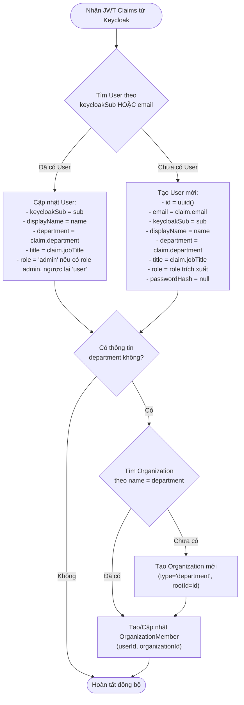

# Mô hình Dữ liệu (Data Model) & Đồng bộ Danh bạ — Phase 1

**Trạng thái:** `APPROVED` (Phase 1)  
**Tài liệu liên quan:** [auth-keycloak-architecture.md](../../01-architecture/auth-keycloak-architecture.md), [prd.md](./prd.md).

---

## 1. Điều chỉnh Lược đồ Cơ sở dữ liệu (Prisma Schema)

Vị trí tệp: `backend/prisma/schema/schema.prisma`

### 1.1 Cập nhật Model `User`
```prisma
model User {
  id             String   @id @default(uuid())
  email          String   @unique
  // passwordHash được chuyển sang tùy chọn (nullable) để hỗ trợ tài khoản SSO Keycloak thuần túy
  passwordHash   String?
  displayName    String?
  role           String   @default("user")
  isActive       Boolean  @default(true)

  // Trường định danh liên kết với Keycloak (OIDC Subject Identifier)
  keycloakSub    String?  @unique

  // Chức danh & Phòng ban để phục vụ gán tác nhân quy trình
  department     String?
  title          String?
  phone          String?

  // Chữ ký điện tử
  signatureName  String?
  signatureImage String?

  createdAt      DateTime @default(now())
  updatedAt      DateTime @updatedAt

  // ── Quan hệ liên kết ─────────────────────────────────────────
  createdForms               Form[]                   @relation("FormCreator")
  requests                   FormResponse[]           @relation("RequestCreator")
  requestViewers             RequestViewer[]
  flowAssignments            FlowAssignee[]
  tasks                      Task[]
  documents                  Document[]
  signatureFields            SignatureField[]
  comments                   RequestComment[]
  commentReactions           CommentReaction[]
  actualActors               RequestActualActor[]
  projectedTasks             TaskProjection[]
  createdProcedures          Procedure[]              @relation("ProcedureCreator")
  createdProcedureVersions   ProcedureVersion[]       @relation("ProcedureVersionCreator")
  procedureActorAssignments  ProcedureActorMapping[]  @relation("ProcedureActorUser")
  signingEnvelopes           SigningEnvelope[]        @relation("SigningEnvelopeOwner")
  signingAssignments         SigningRecipient[]       @relation("SigningRecipientUser")
  createdOrganizations       Organization[]           @relation("OrganizationCreator")
  organizationMembers        OrganizationMember[]
}
```

---

## 2. Chiến lược Đồng bộ Thực thể User & Tổ chức (JIT Sync Logic)

Quá trình đồng bộ diễn ra ngay khi người dùng đăng nhập SSO thành công (`POST /auth/sso/session`):



---

## 3. Bản ghi Chuyển đổi Dữ liệu (Prisma Migration)

Lệnh áp dụng thay đổi cấu trúc bảng:
```bash
npx prisma migrate dev --name add_keycloak_sub_and_optional_password
```

Kết quả sinh ra câu lệnh SQL:
```sql
ALTER TABLE "User" ADD COLUMN "keycloakSub" TEXT;
CREATE UNIQUE INDEX "User_keycloakSub_key" ON "User"("keycloakSub");
ALTER TABLE "User" ALTER COLUMN "passwordHash" DROP NOT NULL;
```

