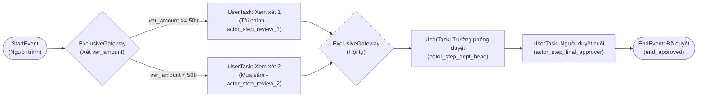

# Chuẩn Thiết kế Quy trình BPMN 2.0 cho GAFOOD e-Office

**Trạng thái:** `APPROVED` (Phase 3)  
**Tài liệu liên quan:** [operaton-engine-contract.md](../../01-architecture/operaton-engine-contract.md), [ADR-002](../../00-overview/adr/ADR-002-operaton-variable-conventions.md), [ADR-003](../../00-overview/adr/ADR-003-requestor-actor-override.md).

---

## 1. Nguyên tắc Đặt tên & Định danh Quy trình (Process Definition)

1. **Khóa quy trình (`processId` / `id`):**
   - Viết thường theo dạng `kebab-case` hoặc `snake_case`, bắt đầu bằng tiền tố khối nghiệp vụ: `eoffice_proc_<tên_quy_trình>`.
   - Ví dụ: `eoffice_proc_purchase_request`, `eoffice_proc_leave_application`.
2. **Tên quy trình (`name`):**
   - Tiếng Việt có dấu, rõ nghĩa: `Yêu cầu Mua sắm (FLOW 1)`, `Đơn xin nghỉ phép`.
3. **Phân nhóm (`category`):**
   - Bắt buộc khai báo thuộc tính: `category="e-Office"` (hoặc trên thẻ `<bpmn:process ...>`).
   - Giúp e-Office lọc chính xác các quy trình nội bộ, không hiển thị các quy trình của khối khác (`Sales Marketing`, `Customer Service`).
4. **Cờ thực thi (`isExecutable`):**
   - Bắt buộc đặt `isExecutable="true"`.

---

## 2. Quy ước Đặt tên Biến (Variable Naming Conventions)

Để đảm bảo tính độc lập và tương thích tự động khi map với Biểu mẫu e-Office, quy ước 2 nhóm tiền tố chuẩn:

### 2.1 Tiền tố Tham số Điều kiện: `var_<fieldKey>`
- Mọi biến dùng cho các cổng rẽ nhánh (`Exclusive Gateway`) hoặc đánh giá logic phải bắt đầu bằng `var_`.
- Ví dụ:
  - `var_amount`: Số tiền đề xuất (kiểu `Long` hoặc `Double`).
  - `var_priority`: Mức độ ưu tiên (`HIGH`, `MEDIUM`, `LOW` — kiểu `String`).
  - `var_department_code`: Mã phòng ban người trình (`String`).

### 2.2 Tiền tố Tác nhân Phê duyệt: `actor_<taskKey>` & `actorList_<taskKey>`
- **Đơn người duyệt (Single Assignee):**
  - Gán qua biểu thức: `camunda:assignee="${actor_<taskKey>}"`.
  - Ví dụ tại bước `step_department_head`: `camunda:assignee="${actor_step_department_head}"`.
- **Nhiều người duyệt song song trong cùng 1 bước (Multi-Instance Parallel):**
  - Sử dụng thẻ `multiInstanceLoopCharacteristics`:
    - `isSequential="false"` (chạy song song đồng thời).
    - `camunda:collection="${actorList_<taskKey>}"` (danh sách user IDs từ e-Office truyền sang).
    - `camunda:elementVariable="assigneeItem"`
    - Gán `camunda:assignee="${assigneeItem}"`.
  - Điều kiện hoàn thành mặc định: `${nrOfCompletedInstances == nrOfInstances}` (tất cả mọi người trong danh sách đều phải duyệt).

---

## 3. Cấu trúc các Node Chuẩn trong Quy trình e-Office



### 3.1 Node Bắt đầu (`StartEvent`)
- ID: `start_event_requestor`.
- Tên: `Người trình lập yêu cầu`.

### 3.2 Các Bước Duyệt Người dùng (`UserTask`)
- ID: Bắt buộc theo định dạng `step_<vai_tro>`.
- Thuộc tính mở rộng (`extensionElements`):
  - Khai báo nhãn hiển thị phòng ban/chức danh mặc định để e-Office render UI:
    ```xml
    <bpmn:userTask id="step_review_1" name="Xem xét 1 (Bộ phận Tài chính)">
      <bpmn:extensionElements>
        <camunda:properties>
          <camunda:property name="defaultRole" value="Kế toán trưởng" />
          <camunda:property name="allowOverride" value="true" />
        </camunda:properties>
      </bpmn:extensionElements>
      <bpmn:potentialOwner>
        <bpmn:resourceAssignmentExpression>
          <bpmn:formalExpression>${actor_step_review_1}</bpmn:formalExpression>
        </bpmn:resourceAssignmentExpression>
      </bpmn:potentialOwner>
    </bpmn:userTask>
    ```

### 3.3 Cổng Rẽ nhánh Điều kiện (`ExclusiveGateway`)
- ID: `gateway_<ten_dieu_kien>`.
- Biểu thức Sequence Flow đi ra: Sử dụng UEL (Unified Expression Language) chuẩn:
  ```xml
  <bpmn:sequenceFlow id="flow_high_value" sourceRef="gateway_value" targetRef="step_review_1">
    <bpmn:conditionExpression xsi:type="bpmn:tFormalExpression">
      <![CDATA[${var_amount >= 50000000}]]>
    </bpmn:conditionExpression>
  </bpmn:sequenceFlow>
  ```
  Và nhánh mặc định (Default Flow) hoặc nhánh ngược lại:
  ```xml
  <bpmn:sequenceFlow id="flow_low_value" sourceRef="gateway_value" targetRef="step_review_2">
    <bpmn:conditionExpression xsi:type="bpmn:tFormalExpression">
      <![CDATA[${var_amount < 50000000}]]>
    </bpmn:conditionExpression>
  </bpmn:sequenceFlow>
  ```

### 3.4 Cổng Phê duyệt Song song (`ParallelGateway`)
- Dùng khi cần 2 hoặc nhiều bộ phận độc lập duyệt cùng lúc (ví dụ: Kế toán và Pháp chế cùng duyệt).
- Nhánh rẽ `ParallelGateway (Fork)` &rarr; Các `UserTask` song song &rarr; Nhánh gộp `ParallelGateway (Join)` để đợi đủ các bên duyệt mới đi tiếp.

### 3.5 Node Kết thúc (`EndEvent`)
- Phê duyệt thành công: `<bpmn:endEvent id="end_approved" name="Đã duyệt hoàn tất" />`.
- Từ chối / Kết thúc sớm: `<bpmn:endEvent id="end_rejected" name="Từ chối yêu cầu"><bpmn:terminateEventDefinition /></bpmn:endEvent>`.

---

## 4. Đặc tả Quy trình Mẫu Chuẩn: `FLOW 1 — Yêu cầu Mua sắm`

Tệp BPMN mẫu chuẩn này được lưu trữ tại `deploy/operaton/bpmn-templates/e-office-purchase-flow-1.bpmn` và sẽ tự động được deploy lên Operaton Engine khi khởi tạo môi trường dev:
- **Process ID:** `eoffice_proc_purchase_flow_1`
- **Tên hiển thị:** `Quy trình Nghiệp vụ: Yêu cầu Mua sắm (FLOW 1)`
- **Category:** `e-Office`
- **Các bước thực thi:**
  1. `start_event_requestor` (Khởi tạo bởi Người trình).
  2. `gateway_check_value` (Kiểm tra `var_amount >= 50000000`).
  3. Nhánh `>= 50tr`: `step_review_1` (Xem xét 1 - Ban Giám sát / Kế toán trưởng).
  4. Nhánh `< 50tr`: `step_review_2` (Xem xét 2 - Chuyên viên mua sắm cơ bản).
  5. `step_department_head` (Trưởng phòng phê duyệt).
  6. `step_final_approver` (Ban Tổng Giám đốc duyệt cuối).
  7. `end_approved` (Hoàn thành phê duyệt & Đóng dấu hồ sơ).

