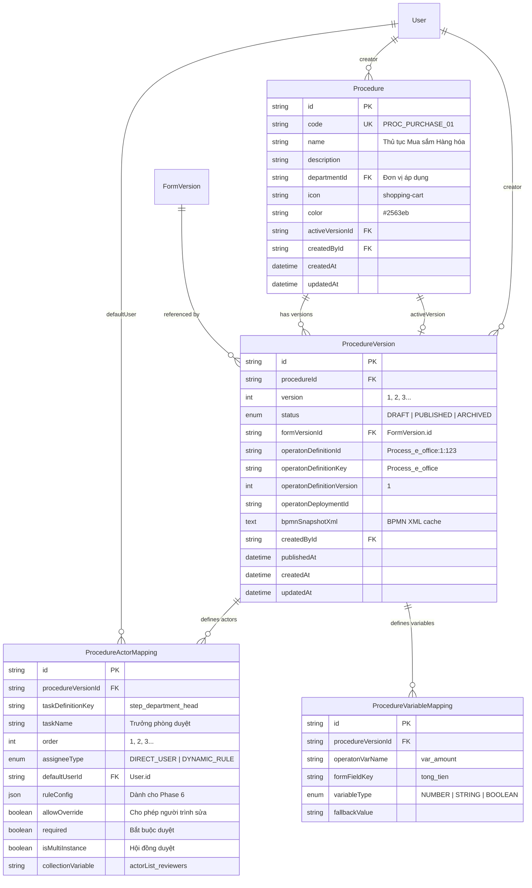

# Thiết kế Mô hình Dữ liệu (Data Model) — Module Thủ tục (Procedure)

**Mã tài liệu:** `SPEC-PRC-DATA-01`  
**Thuộc Phase:** `Phase 4 — Lớp Cầu nối Procedure`  
**Trạng thái:** `PENDING_REVIEW`  
**Ngày lập:** 13/11/2026  
**Tác giả:** Google DeepMind / Antigravity Agent  
**Tương thích:** PostgreSQL 15+, Prisma Multi-file Schema (`backend/prisma/schema/*.prisma`)  

---

## 1. Sơ đồ Quan hệ Thực thể (ERD)



---

## 2. Đặc tả Chi tiết các Bảng Schema (`procedure.prisma`)

File schema mới sẽ được đặt tại [`backend/prisma/schema/procedure.prisma`](file:///f:/Downloads/Projects/Gafood/E_Office/backend/prisma/schema/procedure.prisma).

### 2.1. Các Enums Định nghĩa

```prisma
enum ProcedureStatus {
  DRAFT       // Bản nháp đang cấu hình mapping
  PUBLISHED   // Phiên bản đã thẩm định và đang phát hành chính thức
  ARCHIVED    // Phiên bản cũ đã ngưng sử dụng
}

enum ActorAssigneeType {
  DIRECT_USER   // Gán trực tiếp cho 1 User cụ thể (Phase 4)
  DYNAMIC_RULE  // Gán động theo vai trò/cây tổ chức (Phase 6)
}

enum VariableMappingType {
  NUMBER    // Chuyển đổi thành kiểu số (Float/Integer) cho Gateway Operaton
  STRING    // Giữ nguyên chuỗi ký tự
  BOOLEAN   // Chuyển đổi thành True/False
}
```

---

### 2.2. Bảng `Procedure` (Thực thể Thủ tục gốc)

Đại diện cho danh mục thủ tục của doanh nghiệp (ví dụ: *Yêu cầu mua sắm*, *Đề xuất tuyển dụng*, *Nghỉ phép*).

| Tên trường | Kiểu dữ liệu | Thuộc tính | Mô tả |
|---|---|---|---|
| `id` | `String` | `@id @default(uuid())` | Khóa chính UUID v4 |
| `code` | `String` | `@unique` | Mã định danh nghiệp vụ (viết hoa, không dấu, vd: `PROC_PURCHASE`) |
| `name` | `String` | Not Null | Tên hiển thị của thủ tục (vd: *Yêu cầu mua sắm hàng hóa & tài sản*) |
| `description` | `String?` | Nullable | Mô tả mục đích, phạm vi áp dụng |
| `departmentId` | `String?` | Nullable | ID phòng ban đầu mối quản trị (liên kết với `Organization.id`) |
| `icon` | `String?` | Default `"file-text"` | Tên icon (Lucide React) hiển thị trên giao diện danh mục |
| `color` | `String?` | Default `"#2563eb"` | Mã màu nhận diện thủ tục |
| `activeVersionId`| `String?` | Nullable | Trỏ tới `ProcedureVersion.id` đang có hiệu lực (`PUBLISHED`) |
| `createdById` | `String` | FK &rarr; `User.id` | Quản trị viên khởi tạo |
| `createdAt` | `DateTime` | `@default(now())` | Thời điểm tạo |
| `updatedAt` | `DateTime` | `@updatedAt` | Thời điểm cập nhật cuối |

---

### 2.3. Bảng `ProcedureVersion` (Phiên bản Bất biến — ADR-005)

Mỗi lần Admin cấu hình lại liên kết Form hoặc Workflow và bấm **Publish**, một bản ghi `ProcedureVersion` mới sẽ được tạo. Phiên bản này **khóa cứng (pin)** liên kết:

| Tên trường | Kiểu dữ liệu | Thuộc tính | Mô tả |
|---|---|---|---|
| `id` | `String` | `@id @default(uuid())` | Khóa chính UUID v4 |
| `procedureId` | `String` | FK &rarr; `Procedure.id` | Thủ tục cha |
| `version` | `Int` | Not Null | Số thứ tự phiên bản tăng dần (1, 2, 3...) |
| `status` | `ProcedureStatus`| Default `DRAFT` | Trạng thái vòng đời phiên bản |
| `formVersionId` | `String` | FK &rarr; `FormVersion.id` | Phiên bản Form khóa cứng (từ Phase 2) |
| `operatonDefinitionId` | `String` | Not Null | ID định danh duy nhất của Workflow trên Operaton |
| `operatonDefinitionKey`| `String` | Not Null | Process Definition Key (vd: `Process_e_office_purchase_flow_1`) |
| `operatonDefinitionVersion`| `Int` | Not Null | Version của Workflow trên Operaton tại thời điểm ghim |
| `operatonDeploymentId` | `String?`| Nullable | Mã Deployment tương ứng trên Operaton |
| `bpmnSnapshotXml` | `String?` | `@db.Text` | Bản sao lưu XML tại thời điểm publish (đảm bảo render độc lập) |
| `createdById` | `String` | FK &rarr; `User.id` | Người tạo bản version |
| `publishedAt` | `DateTime?` | Nullable | Thời điểm phát hành chính thức |
| `createdAt` | `DateTime` | `@default(now())` | Thời điểm tạo |
| `updatedAt` | `DateTime` | `@updatedAt` | Thời điểm cập nhật cuối |

**Ràng buộc chỉ mục:**
- `@@unique([procedureId, version])`: Không thể trùng số version trong cùng 1 thủ tục.
- `@@index([procedureId, status])`: Tối ưu truy vấn tìm bản `PUBLISHED` hiện tại.

---

### 2.4. Bảng `ProcedureActorMapping` (Ánh xạ Người duyệt & Quyền Override)

Bảng này chứa cấu hình cho từng node `UserTask` có trong Workflow BPMN:

| Tên trường | Kiểu dữ liệu | Thuộc tính | Mô tả |
|---|---|---|---|
| `id` | `String` | `@id @default(uuid())` | Khóa chính UUID v4 |
| `procedureVersionId` | `String` | FK &rarr; `ProcedureVersion.id` (onDelete: Cascade) | Thuộc phiên bản thủ tục nào |
| `taskDefinitionKey` | `String` | Not Null | ID của task trong BPMN (vd: `step_department_head`) |
| `taskName` | `String` | Not Null | Tên nhãn hiển thị của bước (vd: *Trưởng phòng phê duyệt*) |
| `order` | `Int` | Not Null | Thứ tự hiển thị các bước trên màn hình |
| `assigneeType` | `ActorAssigneeType` | Default `DIRECT_USER` | Kiểu gán tác nhân (ở Phase 4 là `DIRECT_USER`) |
| `defaultUserId` | `String?` | FK &rarr; `User.id` (Nullable) | User mặc định được gán cho bước này |
| `ruleConfig` | `Json?` | Nullable | Cấu hình rule động (dự trù cho Phase 6) |
| `allowOverride` | `Boolean` | Default `true` | **Quan trọng:** Cho phép người trình sửa/chọn người khác khi nộp đơn |
| `required` | `Boolean` | Default `true` | Bước này bắt buộc phải có người duyệt (không được bỏ trống) |
| `isMultiInstance` | `Boolean` | Default `false` | Đánh dấu bước duyệt song song/hội đồng |
| `collectionVariable` | `String?` | Nullable | Biến mảng danh sách người duyệt trong BPMN (`actorList_*`) |

**Ràng buộc chỉ mục:**
- `@@unique([procedureVersionId, taskDefinitionKey])`: Mỗi bước task trong một phiên bản chỉ có 1 cấu hình mapping duy nhất.

---

### 2.5. Bảng `ProcedureVariableMapping` (Ánh xạ Biến Rẽ nhánh Gateway)

Bảng này chứa cấu hình nối giữa biến điều kiện của BPMN (`conditionVariables` với tiền tố `var_`) và trường dữ liệu của biểu mẫu (`FormField.key`):

| Tên trường | Kiểu dữ liệu | Thuộc tính | Mô tả |
|---|---|---|---|
| `id` | `String` | `@id @default(uuid())` | Khóa chính UUID v4 |
| `procedureVersionId` | `String` | FK &rarr; `ProcedureVersion.id` (onDelete: Cascade) | Thuộc phiên bản thủ tục nào |
| `operatonVarName` | `String` | Not Null | Tên biến trong biểu thức BPMN (vd: `var_amount`) |
| `formFieldKey` | `String` | Not Null | Mã trường trong `FormField.key` (vd: `tong_tien_de_xuat`) |
| `variableType` | `VariableMappingType` | Default `NUMBER` | Kiểu dữ liệu cần ép kiểu trước khi gửi sang Operaton |
| `fallbackValue` | `String?` | Nullable | Giá trị mặc định phòng khi người trình bỏ trống trường không bắt buộc |

**Ràng buộc chỉ mục:**
- `@@unique([procedureVersionId, operatonVarName])`: Mỗi biến điều kiện rẽ nhánh chỉ được map với 1 trường form.

---

### 2.6. Mở rộng Bảng `User` & Danh bạ (Tối ưu Hiển thị Phòng ban & Chức danh)

Theo yêu cầu nghiệp vụ: *"gán từng user (đồng thời hiển thị phòng ban, chức danh của người đó)"*.  
Hiện tại bảng `users` trong [`backend/prisma/schema/schema.prisma`](file:///f:/Downloads/Projects/Gafood/E_Office/backend/prisma/schema/schema.prisma) đã liên kết với `organization_members`. Để tối ưu hóa tốc độ tìm kiếm và hiển thị trên giao diện Web:
1. Giữ nguyên quan hệ chuẩn `user.organizationMembers -> organization`.
2. Bổ sung trường tùy chọn trực tiếp trên `User`:
   - `department: String?` (Tên phòng ban hiển thị nhanh, vd: *"Phòng Kế toán"*).
   - `title: String?` (Chức danh nghề nghiệp, vd: *"Kế toán trưởng"*, *"Trưởng phòng Mua hàng"*).
   - `phone: String?` (Số điện thoại liên hệ nội bộ).
3. Cung cấp API `GET /procedures/helpers/directory` trả về danh sách User kèm `displayName`, `email`, `department`, `title`, `role`, `signatureImage`.

---

## 3. Migration SQL Dự kiến (`20261113_add_procedure_module`)

```sql
-- CreateEnum
CREATE TYPE "ProcedureStatus" AS ENUM ('DRAFT', 'PUBLISHED', 'ARCHIVED');
CREATE TYPE "ActorAssigneeType" AS ENUM ('DIRECT_USER', 'DYNAMIC_RULE');
CREATE TYPE "VariableMappingType" AS ENUM ('NUMBER', 'STRING', 'BOOLEAN');

-- AlterTable users
ALTER TABLE "users" ADD COLUMN "department" TEXT;
ALTER TABLE "users" ADD COLUMN "title" TEXT;
ALTER TABLE "users" ADD COLUMN "phone" TEXT;

-- CreateTable procedures
CREATE TABLE "procedures" (
    "id" TEXT NOT NULL,
    "code" TEXT NOT NULL,
    "name" TEXT NOT NULL,
    "description" TEXT,
    "departmentId" TEXT,
    "icon" TEXT DEFAULT 'file-text',
    "color" TEXT DEFAULT '#2563eb',
    "activeVersionId" TEXT,
    "createdById" TEXT NOT NULL,
    "createdAt" TIMESTAMP(3) NOT NULL DEFAULT CURRENT_TIMESTAMP,
    "updatedAt" TIMESTAMP(3) NOT NULL,

    CONSTRAINT "procedures_pkey" PRIMARY KEY ("id")
);

-- CreateTable procedure_versions
CREATE TABLE "procedure_versions" (
    "id" TEXT NOT NULL,
    "procedureId" TEXT NOT NULL,
    "version" INTEGER NOT NULL,
    "status" "ProcedureStatus" NOT NULL DEFAULT 'DRAFT',
    "formVersionId" TEXT NOT NULL,
    "operatonDefinitionId" TEXT NOT NULL,
    "operatonDefinitionKey" TEXT NOT NULL,
    "operatonDefinitionVersion" INTEGER NOT NULL,
    "operatonDeploymentId" TEXT,
    "bpmnSnapshotXml" TEXT,
    "createdById" TEXT NOT NULL,
    "publishedAt" TIMESTAMP(3),
    "createdAt" TIMESTAMP(3) NOT NULL DEFAULT CURRENT_TIMESTAMP,
    "updatedAt" TIMESTAMP(3) NOT NULL,

    CONSTRAINT "procedure_versions_pkey" PRIMARY KEY ("id")
);

-- CreateTable procedure_actor_mappings
CREATE TABLE "procedure_actor_mappings" (
    "id" TEXT NOT NULL,
    "procedureVersionId" TEXT NOT NULL,
    "taskDefinitionKey" TEXT NOT NULL,
    "taskName" TEXT NOT NULL,
    "order" INTEGER NOT NULL,
    "assigneeType" "ActorAssigneeType" NOT NULL DEFAULT 'DIRECT_USER',
    "defaultUserId" TEXT,
    "ruleConfig" JSONB,
    "allowOverride" BOOLEAN NOT NULL DEFAULT true,
    "required" BOOLEAN NOT NULL DEFAULT true,
    "isMultiInstance" BOOLEAN NOT NULL DEFAULT false,
    "collectionVariable" TEXT,

    CONSTRAINT "procedure_actor_mappings_pkey" PRIMARY KEY ("id")
);

-- CreateTable procedure_variable_mappings
CREATE TABLE "procedure_variable_mappings" (
    "id" TEXT NOT NULL,
    "procedureVersionId" TEXT NOT NULL,
    "operatonVarName" TEXT NOT NULL,
    "formFieldKey" TEXT NOT NULL,
    "variableType" "VariableMappingType" NOT NULL DEFAULT 'NUMBER',
    "fallbackValue" TEXT,

    CONSTRAINT "procedure_variable_mappings_pkey" PRIMARY KEY ("id")
);

-- CreateIndex
CREATE UNIQUE INDEX "procedures_code_key" ON "procedures"("code");
CREATE UNIQUE INDEX "procedure_versions_procedureId_version_key" ON "procedure_versions"("procedureId", "version");
CREATE INDEX "procedure_versions_procedureId_status_idx" ON "procedure_versions"("procedureId", "status");
CREATE UNIQUE INDEX "procedure_actor_mappings_procedureVersionId_taskDefinitionKey_key" ON "procedure_actor_mappings"("procedureVersionId", "taskDefinitionKey");
CREATE UNIQUE INDEX "procedure_variable_mappings_procedureVersionId_operatonVarName_key" ON "procedure_variable_mappings"("procedureVersionId", "operatonVarName");

-- AddForeignKey
ALTER TABLE "procedures" ADD CONSTRAINT "procedures_createdById_fkey" FOREIGN KEY ("createdById") REFERENCES "users"("id") ON DELETE RESTRICT ON UPDATE CASCADE;
ALTER TABLE "procedures" ADD CONSTRAINT "procedures_activeVersionId_fkey" FOREIGN KEY ("activeVersionId") REFERENCES "procedure_versions"("id") ON DELETE SET NULL ON UPDATE CASCADE;
ALTER TABLE "procedure_versions" ADD CONSTRAINT "procedure_versions_procedureId_fkey" FOREIGN KEY ("procedureId") REFERENCES "procedures"("id") ON DELETE CASCADE ON UPDATE CASCADE;
ALTER TABLE "procedure_versions" ADD CONSTRAINT "procedure_versions_formVersionId_fkey" FOREIGN KEY ("formVersionId") REFERENCES "FormVersion"("id") ON DELETE RESTRICT ON UPDATE CASCADE;
ALTER TABLE "procedure_versions" ADD CONSTRAINT "procedure_versions_createdById_fkey" FOREIGN KEY ("createdById") REFERENCES "users"("id") ON DELETE RESTRICT ON UPDATE CASCADE;
ALTER TABLE "procedure_actor_mappings" ADD CONSTRAINT "procedure_actor_mappings_procedureVersionId_fkey" FOREIGN KEY ("procedureVersionId") REFERENCES "procedure_versions"("id") ON DELETE CASCADE ON UPDATE CASCADE;
ALTER TABLE "procedure_actor_mappings" ADD CONSTRAINT "procedure_actor_mappings_defaultUserId_fkey" FOREIGN KEY ("defaultUserId") REFERENCES "users"("id") ON DELETE SET NULL ON UPDATE CASCADE;
ALTER TABLE "procedure_variable_mappings" ADD CONSTRAINT "procedure_variable_mappings_procedureVersionId_fkey" FOREIGN KEY ("procedureVersionId") REFERENCES "procedure_versions"("id") ON DELETE CASCADE ON UPDATE CASCADE;
```

