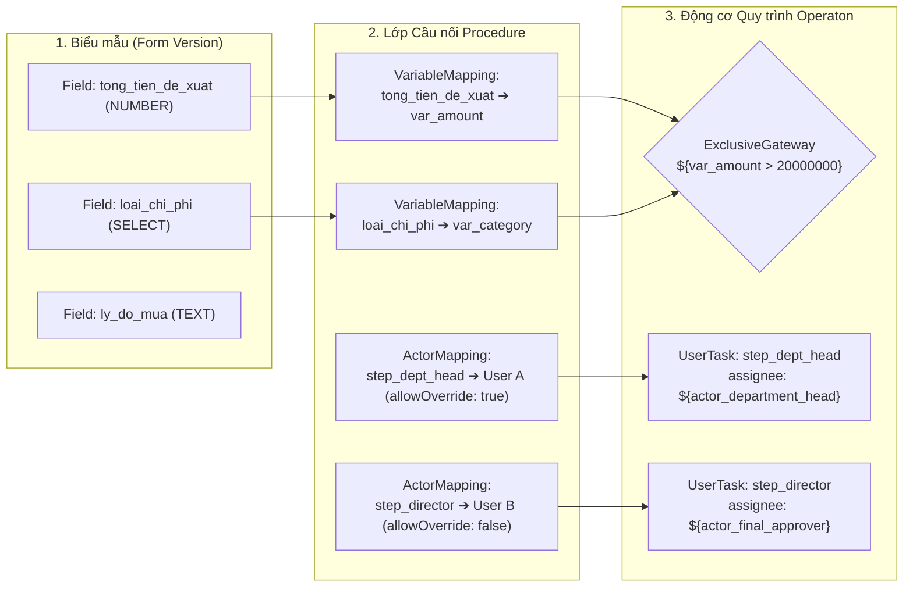
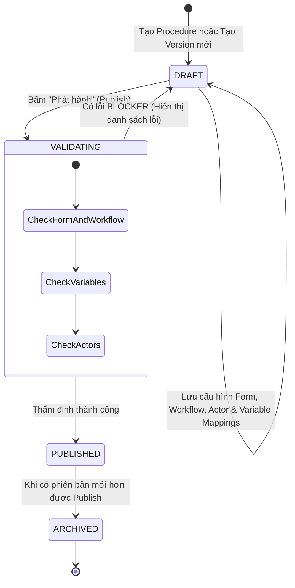

# Quy tắc Ánh xạ & Thẩm định (Mapping & Validation Rules) — Procedure

**Mã tài liệu:** `SPEC-PRC-RULES-01`  
**Thuộc Phase:** `Phase 4 — Lớp Cầu nối Procedure`  
**Trạng thái:** `PENDING_REVIEW`  
**Ngày lập:** 13/11/2026  
**Tác giả:** Google DeepMind / Antigravity Agent  
**Tài liệu liên quan:**  
- [`bpmn-modeling-standards.md`](../phase-3-operaton-adapter/bpmn-modeling-standards.md)  
- [`operaton-engine-contract.md`](../../01-architecture/operaton-engine-contract.md)  
- [`ADR-002-operaton-variable-conventions.md`](../../00-overview/adr/ADR-002-operaton-variable-conventions.md)  
- [`ADR-003-requestor-actor-override.md`](../../00-overview/adr/ADR-003-requestor-actor-override.md)  

---

## 1. Tổng quan Kiến trúc Ánh xạ

Thủ tục (`Procedure`) thực hiện hai nhiệm vụ ánh xạ then chốt để kết nối Biểu mẫu e-Office và Động cơ Operaton:



---

## 2. Quy tắc Ánh xạ Biến Rẽ nhánh (Dynamic Variable Mapping)

### 2.1. Quy ước Đặt tên & Nguồn trích xuất
1. **Nguồn biến từ BPMN:** Tất cả các biến được sử dụng trong thuộc tính condition của luồng (vd: `${var_amount > 20000000}`, `${var_days <= 3}`) được service `BpmnParserService.parseXml()` trích xuất tự động vào mảng `conditionVariables`.
2. **Tiền tố chuẩn:** Theo [ADR-002](../../00-overview/adr/ADR-002-operaton-variable-conventions.md), các biến này luôn bắt đầu bằng tiền tố `var_` (ví dụ: `var_amount`, `var_priority`, `var_is_urgent`).
3. **Đích ánh xạ từ Form:** Biến `var_*` phải trỏ vào một `FormField.key` ổn định trong `FormVersion` đã chọn.

### 2.2. Ma trận Tương thích Kiểu dữ liệu

| Kiểu dữ liệu trong BPMN Expression | Loại trường Form (`FieldType`) | Kiểu ép kiểu (`VariableMappingType`) | Cơ chế chuyển đổi (Type Casting) | Giá trị dự phòng mặc định (`fallbackValue`) |
|---|---|---|---|---|
| **Số học (`> 20000000`, `<= 5`)** | `NUMBER` | `NUMBER` | Chuyển chuỗi hoặc number sang `Float` (`parseFloat(val)`) | `"0"` |
| **Bảng chi tiết (Tính tổng cột)** | `TABLE` (cột số) | `NUMBER` | Tính `SUM` của cột số trong bảng | `"0"` |
| **Chuỗi so khớp (`== 'URGENT'`)** | `TEXT`, `SELECT` (SINGLE) | `STRING` | Giữ nguyên chuỗi, trim khoảng trắng | `""` |
| **Logic (`== true`, `== false`)** | `SELECT` (Yes/No), Switch | `BOOLEAN` | Chuyển `true/"true"/1` &rarr; `true`, ngược lại `false` | `"false"` |

### 2.3. Định dạng Payload gửi sang Operaton khi Khởi chạy Request
Khi người dùng submit Form ở Phase 5, e-Office sẽ chuyển các trường được map thành định dạng chuẩn của Operaton Engine REST API:
```json
{
  "variables": {
    "var_amount": {
      "value": 25000000,
      "type": "Double"
    },
    "var_category": {
      "value": "EQUIPMENT",
      "type": "String"
    },
    "var_is_urgent": {
      "value": false,
      "type": "Boolean"
    }
  },
  "businessKey": "req_uuid_12345"
}
```

---

## 3. Quy tắc Ánh xạ Người duyệt (Actor Assignment Mapping)

### 3.1. Các Bước UserTask trong BPMN
- Mỗi `bpmn:userTask` trong sơ đồ có một `id` duy nhất (ví dụ: `step_reviewer_1`, `step_department_head`, `step_final_approver`).
- Tên bước hiển thị (`name`) được lấy từ thuộc tính `name` của task trong BPMN (ví dụ: *"Trưởng phòng phê duyệt"*).
- Biến gán người duyệt trong BPMN:
  - Đơn lẻ: `camunda:assignee="${actor_department_head}"`.
  - Song song/Hội đồng (Multi-Instance): `camunda:assignee="${assignee}"`, `camunda:collection="${actorList_reviewers}"`.

### 3.2. Cấu hình gán Tác nhân trên Procedure
1. **Kiểu gán (`assigneeType`):**
   - **`DIRECT_USER` (Trọng tâm Phase 4):** Chọn trực tiếp một tài khoản nhân viên từ danh bạ công ty.
   - **`DYNAMIC_RULE` (Dự phòng Phase 6):** Cấu hình rule động (vd: *Quản lý trực tiếp của người tạo đơn*).
2. **Thông tin hiển thị khi chọn User (`defaultUserId`):**
   - Khi Admin gán User trên giao diện cấu hình, hệ thống phải hiển thị đầy đủ:
     - Họ tên hiển thị (`displayName`) + Email.
     - Phòng ban trực thuộc (`department` / `organization.name`).
     - Chức danh chuyên môn (`title` / `role`).
     - Trạng thái hoạt động (`isActive: true`).
3. **Quyền Cho phép Người trình sửa (`allowOverride`):**
   - **`allowOverride = true` (Mặc định khuyến nghị):** Khi nhân viên tạo yêu cầu từ thủ tục này, hệ thống sẽ điền sẵn người duyệt mặc định, nhưng cho phép nhân viên có thể đổi sang người khác hoặc bổ sung thêm người duyệt (nếu nhân sự được phân công đang đi công tác hoặc nghỉ phép).
   - **`allowOverride = false` (Cố định):** Khóa cứng người duyệt. Người trình đơn chỉ được xem trước mà không có quyền thay đổi bước này.
4. **Tính chất Bắt buộc (`required`):**
   - **`required = true`:** Bước này bắt buộc phải có ít nhất 1 người duyệt được chỉ định trước khi yêu cầu được khởi tạo.
   - **`required = false`:** Bước xem xét/tư vấn tùy chọn, nếu không chọn người duyệt thì hệ thống sẽ tự động bỏ qua bước này (auto-skip).

---

## 4. Công cụ Thẩm định Toàn vẹn (Pre-publish Validation Engine)

Trước khi chuyển `ProcedureVersion` từ trạng thái `DRAFT` sang `PUBLISHED`, hệ thống backend thực hiện chạy một chuỗi kiểm tra bắt buộc (Zero-Drift Validation). Nếu có bất kỳ lỗi vi phạm nào thuộc nhóm `BLOCKER`, yêu cầu Publish sẽ bị từ chối với mã lỗi `422 Unprocessable Entity` kèm danh sách chi tiết các lỗi.

### 4.1. Bảng Quy tắc Thẩm định (Validation Matrix)

| Mã Quy tắc | Nhóm | Mức độ | Điều kiện kiểm tra | Thông báo lỗi chi tiết |
|---|---|---|---|---|
| `VAL-PRC-01` | Form | **BLOCKER** | `formVersionId` phải tồn tại trong CSDL và có ít nhất 1 trường dữ liệu. | `Biểu mẫu được chọn không hợp lệ hoặc không có trường dữ liệu nào.` |
| `VAL-PRC-02` | Workflow | **BLOCKER** | `operatonDefinitionId` phải tồn tại trên Operaton Engine và lấy được cấu trúc XML hợp lệ. | `Quy trình BPMN không tồn tại trên Operaton Engine hoặc bị lỗi cú pháp XML.` |
| `VAL-PRC-03` | Variable | **BLOCKER** | Toàn bộ biến trong `conditionVariables` của BPMN phải có trong `ProcedureVariableMapping`. | `Thiếu ánh xạ cho biến điều kiện rẽ nhánh: [var_amount]. Vui lòng chọn trường form tương ứng.` |
| `VAL-PRC-04` | Variable | **BLOCKER** | Trường form (`formFieldKey`) được map phải thực sự tồn tại trong `FormVersion.fields`. | `Trường form [tong_tien] không tồn tại trong phiên bản Form đã chọn.` |
| `VAL-PRC-05` | Variable | **WARNING** | Kiểu dữ liệu của trường form nên tương thích với biểu thức rẽ nhánh (ví dụ so sánh số thì trường form nên là `NUMBER`). | `Trường [mo_ta] có kiểu TEXT nhưng được ánh xạ vào biến số học [var_amount].` |
| `VAL-PRC-06` | Actor | **BLOCKER** | Mọi `UserTask` trong BPMN phải có bản ghi tương ứng trong `ProcedureActorMapping`. | `Chưa cấu hình người duyệt cho bước: [step_final_approver].` |
| `VAL-PRC-07` | Actor | **BLOCKER** | Nếu bước có `allowOverride = false` và `required = true`, bắt buộc phải có `defaultUserId` hợp lệ. | `Bước [Trưởng phòng duyệt] bị khóa cố định (không cho sửa) nhưng chưa được gán người duyệt mặc định.` |
| `VAL-PRC-08` | Actor | **BLOCKER** | User được gán làm `defaultUserId` phải đang hoạt động (`isActive = true`). | `Người duyệt mặc định [nguyen.van.a@gafood.vn] đang bị vô hiệu hóa tài khoản.` |
| `VAL-PRC-09` | Actor | **BLOCKER** | Với task Multi-Instance (`isMultiInstance = true`), phải chỉ định biến collection (`collectionVariable`). | `Bước hội đồng duyệt thiếu cấu hình biến danh sách (collectionVariable).` |

---

## 5. Kịch bản Vòng đời & Version Pinning (ADR-005)



### Nguyên tắc Bất biến khi đã `PUBLISHED`:
1. Bản ghi `ProcedureVersion` có `status = 'PUBLISHED'` sẽ **bị khóa toàn bộ (read-only)**. Không API nào được phép sửa đổi `ProcedureActorMapping` hay `ProcedureVariableMapping` của version này.
2. Nếu Quản trị viên muốn đổi người duyệt mặc định hoặc đổi trường map:
   - Gọi API `POST /procedures/:id/draft` để nhân bản thành `ProcedureVersion (DRAFT)` tiếp theo (vd: version 2).
   - Chỉnh sửa trên draft.
   - Kiểm tra và publish version mới.
   - Khi version 2 được publish, version 1 sẽ tự động chuyển sang `ARCHIVED`.
   - Các `FormResponse` (Yêu cầu) đã tạo từ version 1 vẫn tiếp tục chạy mượt mà trên version 1 cho đến khi kết thúc vòng đời mà không phát sinh bất kỳ xung đột nào.

