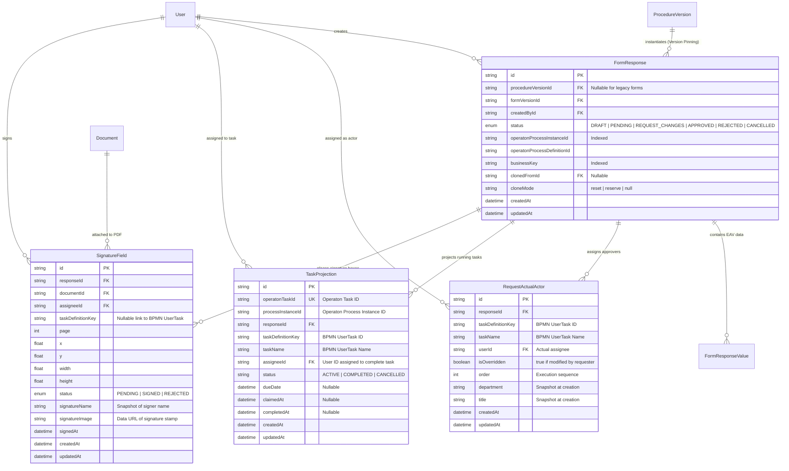

# Thiết kế Mô hình Dữ liệu (Data Model) — Module Vận hành Run-time & Ký số PDF

**Mã tài liệu:** `SPEC-RUN-DAT-01`  
**Thuộc Phase:** `Phase 5 — Vận hành Run-time (Request + Preview/Override Tác nhân + Ký PDF + Vòng đời Operaton)`  
**Trạng thái:** `PENDING_REVIEW`  
**Ngày lập:** 13/11/2026  
**Tác giả:** Google DeepMind / Antigravity Agent  
**Liên kết kiến trúc:**  
- [`architecture_operatioin_eoffice.md`](../../architecture_operatioin_eoffice.md)  
- [`00-overview/adr/ADR-003-requestor-actor-override.md`](../../00-overview/adr/ADR-003-requestor-actor-override.md)  
- [`00-overview/adr/ADR-005-version-pinning.md`](../../00-overview/adr/ADR-005-version-pinning.md)  
- [`02-specs/phase-4-procedure-mapping/data-model.md`](../phase-4-procedure-mapping/data-model.md)  

---

## 1. Sơ đồ Thực thể - Mối quan hệ (ERD)



---

## 2. Chi tiết Các Bảng & Trường Dữ liệu

### 2.1. Cập nhật Thực thể `FormResponse` (`form_response.prisma`)
`FormResponse` đóng vai trò là một **Hồ sơ / Yêu cầu (`Request`)** được khởi tạo từ một `ProcedureVersion` cụ thể.

| Trường | Kiểu dữ liệu | Ràng buộc | Mô tả |
|---|---|---|---|
| `id` | `String` (UUID) | `@id @default(uuid())` | Khóa chính của Request. |
| `procedureVersionId` | `String?` | `@relation(fields: [procedureVersionId], references: [id])` | Liên kết đến phiên bản Thủ tục đã xuất bản (ADR-005 Version Pinning). Bắt buộc với request mới; nullable để tương thích ngược với legacy request. |
| `formVersionId` | `String` | `@relation(fields: [formVersionId], references: [id])` | Phiên bản Form chứa cấu trúc `LayoutSchema` dùng để hiển thị và lưu giá trị EAV. |
| `createdById` | `String` | `@relation(fields: [createdById], references: [id])` | Người khởi tạo hồ sơ (Requester). |
| `status` | `RequestStatus` | `@default(DRAFT)` | Trạng thái vòng đời hồ sơ: `DRAFT`, `PENDING`, `REQUEST_CHANGES`, `APPROVED`, `REJECTED`, `CANCELLED`. |
| `operatonProcessInstanceId` | `String?` | `@index` | ID của Process Instance đang chạy trên Operaton Engine (ví dụ: `8a3b5c12-...`). Null khi còn là DRAFT. |
| `operatonProcessDefinitionId` | `String?` | | ID phiên bản quy trình BPMN trên Operaton (ví dụ: `FLOW_1_PURCHASE:1:3c19...`). |
| `businessKey` | `String?` | `@index` | Mã định danh nghiệp vụ truyền sang Operaton (mặc định bằng chính `FormResponse.id`). |
| `clonedFromId` | `String?` | `@relation("RequestClone", fields: [clonedFromId], references: [id])` | ID của hồ sơ gốc nếu hồ sơ này được nhân bản. |
| `cloneMode` | `String?` | | Chế độ nhân bản: `"reset"` (sao chép form + reset toàn bộ người duyệt) hoặc `"reserve"` (sao chép cả form và giữ nguyên người duyệt đã override). |
| `createdAt` | `DateTime` | `@default(now())` | Thời điểm tạo hồ sơ. |
| `updatedAt` | `DateTime` | `@updatedAt` | Thời điểm cập nhật cuối cùng. |

### 2.2. Thực thể Mới: `RequestActualActor` (`form_response.prisma`)
Lưu trữ danh sách người duyệt thực tế cho từng bước duyệt (`taskDefinitionKey`) của hồ sơ, cho phép phân biệt giữa người duyệt mặc định từ mẫu Thủ tục và người duyệt do người trình ghi đè (`isOverridden = true`) theo ADR-003.

| Trường | Kiểu dữ liệu | Ràng buộc | Mô tả |
|---|---|---|---|
| `id` | `String` (UUID) | `@id @default(uuid())` | Khóa chính. |
| `responseId` | `String` | `@relation(fields: [responseId], references: [id], onDelete: Cascade)` | Liên kết đến hồ sơ `FormResponse`. Xóa hồ sơ sẽ xóa bảng tác nhân thực tế. |
| `taskDefinitionKey` | `String` | | Khóa định danh UserTask trong BPMN (ví dụ: `Activity_DeptHeadApprove`, `Activity_DirectorApprove`). |
| `taskName` | `String` | | Tên hiển thị của bước duyệt trong BPMN. |
| `userId` | `String` | `@relation(fields: [userId], references: [id])` | ID nhân viên được chỉ định xử lý bước này. |
| `isOverridden` | `Boolean` | `@default(false)` | `false` nếu lấy từ mặc định của Procedure; `true` nếu người trình sửa đổi/bổ sung. |
| `order` | `Int` | `@default(0)` | Thứ tự thực hiện bước duyệt (để sắp xếp hiển thị trên timeline). |
| `department` | `String?` | | Snapshot phòng ban của user tại thời điểm chỉ định (để hiển thị không phụ thuộc vào việc chuyển phòng ban sau này). |
| `title` | `String?` | | Snapshot chức danh của user tại thời điểm chỉ định. |
| `createdAt` | `DateTime` | `@default(now())` | Thời điểm gán tác nhân. |
| `updatedAt` | `DateTime` | `@updatedAt` | Thời điểm sửa đổi. |

**Chỉ mục (Indexes):**
- `@@index([responseId])`
- `@@index([userId])`
- `@@index([responseId, taskDefinitionKey])`

### 2.3. Thực thể Mới: `TaskProjection` (`form_response.prisma`)
Bảng hình chiếu (Read Projection) lưu trữ các nhiệm vụ người dùng (User Tasks) đang hoạt động trên Operaton. Giúp màn hình "Công việc của tôi" (`/requests/duty`) truy vấn siêu tốc (< 100ms) với bộ lọc, phân trang, không phụ thuộc vào việc gọi REST API liên tục sang Operaton.

| Trường | Kiểu dữ liệu | Ràng buộc | Mô tả |
|---|---|---|---|
| `id` | `String` (UUID) | `@id @default(uuid())` | Khóa chính. |
| `operatonTaskId` | `String` | `@unique` | ID nhiệm vụ từ Operaton REST API (ví dụ: `Task_12345`). |
| `processInstanceId` | `String` | `@index` | ID tiến trình trên Operaton. |
| `responseId` | `String` | `@relation(fields: [responseId], references: [id], onDelete: Cascade)` | Liên kết hồ sơ e-Office tương ứng. |
| `taskDefinitionKey` | `String` | | Khóa định danh bước duyệt trong sơ đồ BPMN. |
| `taskName` | `String` | | Tên bước duyệt (ví dụ: "Trưởng phòng duyệt mua sắm"). |
| `assigneeId` | `String` | `@relation(fields: [assigneeId], references: [id])` | ID nhân viên có thẩm quyền hoàn thành task này. |
| `status` | `String` | `@default("ACTIVE")` | Trạng thái nhiệm vụ: `ACTIVE` (đang chờ duyệt), `COMPLETED` (đã xong), `CANCELLED` (bị hủy). |
| `dueDate` | `DateTime?` | | Hạn xử lý nhiệm vụ (nếu BPMN có cấu hình due date). |
| `claimedAt` | `DateTime?` | | Thời điểm người duyệt nhận xử lý task. |
| `completedAt` | `DateTime?` | | Thời điểm hoàn thành task. |
| `createdAt` | `DateTime` | `@default(now())` | Thời điểm task được sinh ra trên Operaton. |
| `updatedAt` | `DateTime` | `@updatedAt` | Thời điểm cập nhật cuối. |

**Chỉ mục (Indexes):**
- `@@index([assigneeId, status])` -> Tối ưu hóa truy vấn màn "Công việc của tôi": `WHERE assigneeId = :userId AND status = 'ACTIVE'`.
- `@@index([responseId])`
- `@@index([processInstanceId])`

### 2.4. Cập nhật Thực thể `SignatureField` (`signature.prisma`)
Mở rộng bảng `SignatureField` để gắn kết trực tiếp ô chữ ký trên tài liệu PDF với bước duyệt BPMN tương ứng.

| Trường | Thay đổi | Mô tả |
|---|---|---|
| `taskDefinitionKey` | **Thêm mới (`String?`)** | Khóa bước duyệt trong BPMN mà ô chữ ký này phụ thuộc vào. Khi đến lượt duyệt bước này, người duyệt có nghĩa vụ phải ký vào ô có `taskDefinitionKey` tương ứng trước khi ấn duyệt. |
| `actualActorId` | **Thêm mới (`String?`)** | Khóa ngoại tùy chọn liên kết đến `RequestActualActor.id`. |
| `status` | Giữ nguyên | `PENDING`, `SIGNED`, `REJECTED`. |
| `signatureName` | Giữ nguyên | Họ tên người ký hiển thị trên con dấu. |
| `signatureImage` | Giữ nguyên | Dữ liệu Data URL hình ảnh chữ ký/con dấu. |
| `signedAt` | Giữ nguyên | Thời điểm ký số thành công. |

---

## 3. Cập nhật Quan hệ trong Prisma Schema

### 3.1. Cập nhật `backend/prisma/schema/procedure.prisma`
```prisma
model ProcedureVersion {
  // ... các trường hiện có ...
  formResponses FormResponse[]
}
```

### 3.2. Cập nhật `backend/prisma/schema/schema.prisma`
```prisma
model User {
  // ... các trường hiện có ...
  actualActors   RequestActualActor[]
  projectedTasks TaskProjection[]
}
```

---

## 4. Chiến lược Di chuyển Dữ liệu (Migration Strategy)

1. **Khả năng Tương thích Ngược (Zero-Downtime & Backward Compatibility):**
   - Trường `procedureVersionId` trong `FormResponse` được đánh dấu là `Nullable (`String?`)`. Các hồ sơ cũ (legacy requests tạo từ Phase 2) vẫn hoạt động bình thường, không bị lỗi gãy dữ liệu.
   - Các bảng mới `RequestActualActor` và `TaskProjection` được tạo mới độc lập, không làm thay đổi các bảng lõi khác ngoài việc thêm quan hệ một-nhiều.
2. **Khởi tạo Dữ liệu Ban đầu (Initial Seed/Backfill):**
   - Khi chạy migration Phase 5, không cần backfill dữ liệu cho `TaskProjection` của các request cũ đã hoàn thành (`APPROVED`/`REJECTED`).
   - Các request đang chạy nếu có sẽ được đồng bộ theo cơ chế lazy sync khi người dùng truy cập.

