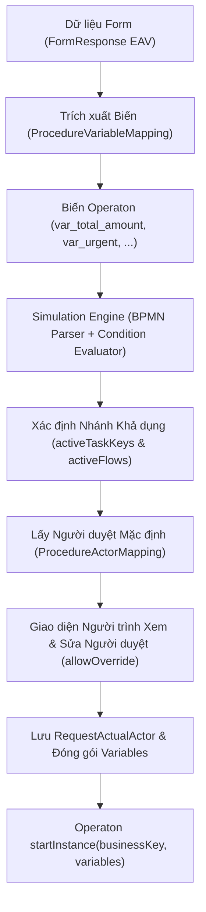
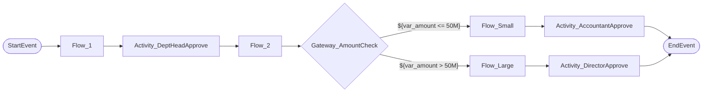
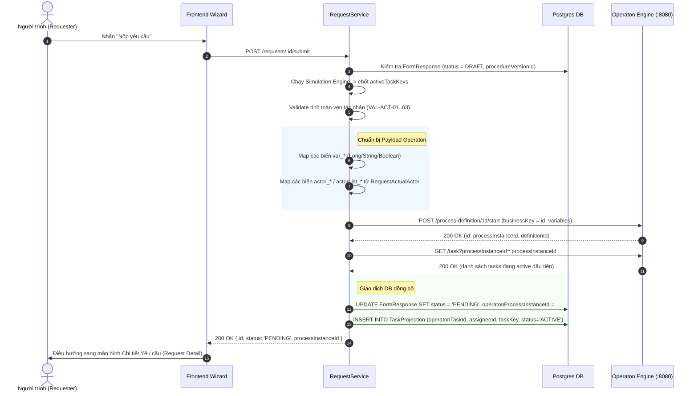

# Đặc tả Thuật toán Mô phỏng Luồng & Ghi đè Tác nhân (Flow Preview & Override Engine)

**Mã tài liệu:** `SPEC-RUN-ENG-01`  
**Thuộc Phase:** `Phase 5 — Vận hành Run-time (Request + Preview/Override Tác nhân + Ký PDF + Vòng đời Operaton)`  
**Trạng thái:** `PENDING_REVIEW`  
**Ngày lập:** 13/11/2026  
**Tác giả:** Google DeepMind / Antigravity Agent  
**Liên kết kiến trúc:**  
- [`architecture_operatioin_eoffice.md`](../../architecture_operatioin_eoffice.md)  
- [`00-overview/adr/ADR-003-requestor-actor-override.md`](../../00-overview/adr/ADR-003-requestor-actor-override.md)  
- [`02-specs/phase-4-procedure-mapping/mapping-rules.md`](../phase-4-procedure-mapping/mapping-rules.md)  

---

## 1. Tổng quan Kiến trúc

Trong mô hình e-Office hiện đại, người trình (Requester) **không được phép bị đặt vào trạng thái mù mờ (Black Box)** khi nộp một hồ sơ. Hệ thống phải giải quyết 2 bài toán lớn:
1. **Dự báo luồng xử lý (Flow Simulation):** Khi nhập các con số (ví dụ: Tổng giá trị đề xuất = 75.000.000 VNĐ), hồ sơ sẽ rẽ nhánh đi đâu? Bước nào sẽ phải qua, bước nào được miễn duyệt?
2. **Minh bạch và Tự chủ tác nhân (Actor Override - ADR-003):** Người trình nhìn thấy đích danh ai sẽ duyệt hồ sơ của mình ở từng bước. Nếu có lý do công việc (trưởng phòng đi vắng, ủy quyền xử lý, bước tư vấn chuyên môn cần thêm người), người trình được phép đổi hoặc thêm người duyệt ở các bước được cho phép (`allowOverride: true`), nhưng **tuyệt đối không làm thay đổi hoặc biến dạng sơ đồ BPMN gốc trên Operaton**.



---

## 2. Trích xuất Tham số Form thành Biến Quy trình (`var_*`)

### 2.1. Quy trình Ánh xạ Dữ liệu (Value Extraction)
Dữ liệu từ Form được lưu dưới dạng cặp Key-Value trong `FormResponseValue`. `ProcedureVariableMapping` định nghĩa quy tắc biến đổi từ `fieldKey` sang `operatonVarName`.

```typescript
export interface VariableEvaluationContext {
  [varName: string]: number | string | boolean;
}
```

**Thuật toán trích xuất giá trị:**
1. Lấy toàn bộ `ProcedureVariableMapping` của `ProcedureVersion` hiện tại.
2. Với mỗi mapping `m`:
   - Tìm giá trị của `m.formFieldKey` trong payload người dùng gửi lên hoặc bản ghi `FormResponseValue`.
   - **Xử lý theo kiểu dữ liệu đích (`targetType`):**
     - `NUMBER`: Ép kiểu `parseFloat(value)`. Nếu không hợp lệ hoặc rỗng, mặc định là `0`.
     - `BOOLEAN`: Ép kiểu `Boolean(value)` hoặc so sánh chuỗi `value === 'true'`.
     - `STRING`: Ép kiểu `String(value ?? '').trim()`.
   - **Xử lý đối với trường Bảng lặp (`TABLE` aggregate):**
     - Nếu `fieldKey` trỏ vào cột của bảng (ví dụ: `items.amount`), hệ thống lấy giá trị tổng hợp `SUM` hoặc `COUNT` từ định nghĩa form layout.
   - Gán vào đối tượng context: `context[m.operatonVarName] = parsedValue`.

---

## 3. Động cơ Mô phỏng Luồng (Simulation & Condition Evaluator Engine)

### 3.1. Cú pháp Biểu thức Điều kiện Hỗ trợ
Operaton / Camunda BPMN hỗ trợ các biểu thức UEL (Unified Expression Language) trên các luồng SequenceFlow đi ra từ Exclusive Gateway (`XOR`):
- So sánh số: `${var_total_amount > 50000000}`, `${var_total_amount <= 20000000}`
- So sánh bằng/khác: `${var_department == 'FINANCE'}`, `${var_urgent != true}`
- Kết hợp logic: `${var_total_amount > 50000000 && var_urgent == true}`

### 3.2. Bộ Đánh giá Biểu thức An toàn (Safe Condition Evaluator)
Để tránh các lỗ hổng bảo mật Remote Code Execution (RCE) do dùng `eval()`, hệ thống e-Office triển khai bộ phân tích cú pháp AST biểu thức an toàn:
1. **Chuẩn hóa chuỗi:** Bỏ wrapper `${...}`.
2. **Tokenizer:** Tách chuỗi thành các Tokens:
   - Identifiers: `var_[a-zA-Z0-9_]+`
   - Numbers: `[0-9]+(\.[0-9]+)?`
   - Strings: `'[^']*'` hoặc `"[^"]*"`
   - Operators: `>`, `<`, `>=`, `<=`, `==`, `!=`, `&&`, `||`, `!`
3. **Thay thế Biến:** Tra cứu giá trị thực tế của biến từ `VariableEvaluationContext`. Nếu biến không tồn tại trong context, gán giá trị mặc định (`0` cho số, `false` cho boolean, `""` cho string).
4. **Tính toán Logic:** Thực thi phép so sánh toán học và logic trả về `boolean` (`true` hoặc `false`).

### 3.3. Thuật toán Duyệt Đường đi (Path Traversal Algorithm)



**Các bước duyệt đồ thị từ BPMN XML:**
1. Bắt đầu từ `startEventId`.
2. Lần theo các `bpmn:sequenceFlow` đi ra (`outgoing`):
   - Nếu gặp `bpmn:userTask`: Thêm `taskKey` vào danh sách `activeTaskKeys`, tiếp tục đi theo flow đi ra của task đó.
   - Nếu gặp `bpmn:exclusiveGateway` (XOR Gateway):
     - Lấy danh sách toàn bộ các flow đi ra (`outgoingFlows`).
     - Đánh giá biểu thức `conditionExpression` của từng flow với `VariableEvaluationContext`.
     - Nhánh đầu tiên trả về `true` được chọn là nhánh tích cực (`selectedFlow`). Thêm flow này vào `activeFlowIds`.
     - Nếu không có nhánh nào trả về `true`, chọn flow mặc định (`defaultFlow`).
     - Các nhánh còn lại được đưa vào `bypassedFlowIds`, và toàn bộ các task thuộc nhánh con đó được đưa vào `bypassedTaskKeys`.
   - Nếu gặp `bpmn:parallelGateway` (AND Gateway):
     - Mọi flow đi ra đều được coi là tích cực (`activeFlowIds`).
     - Tiếp tục duyệt đồng thời qua tất cả các nhánh song song.
   - Nếu gặp `bpmn:endEvent`: Dừng nhánh duyệt.

**Kết quả trả về của hàm mô phỏng:**
```typescript
export interface FlowSimulationResult {
  variables: Record<string, any>;
  activeTaskKeys: string[];
  bypassedTaskKeys: string[];
  activeFlowIds: string[];
  bypassedFlowIds: string[];
  stages: {
    taskDefinitionKey: string;
    taskName: string;
    order: number;
    isMultiInstance: boolean;
    defaultActor: {
      userId: string;
      fullName: string;
      department?: string;
      title?: string;
      avatarUrl?: string;
    } | null;
    allowOverride: boolean;
  }[];
}
```

---

## 4. Cơ chế Xem trước & Ghi đè Tác nhân (ADR-003 Implementation)

### 4.1. Quy tắc Nghiệp vụ Phân quyền Ghi đè
1. **Bước duyệt Cố định (`allowOverride = false`):**
   - Áp dụng cho các bước có tính chất kiểm soát nghiêm ngặt theo quy chế công ty (ví dụ: *Ban Kiểm soát*, *Kế toán trưởng*, *Tổng Giám đốc*).
   - Giao diện hiển thị người duyệt mặc định từ `ProcedureActorMapping` kèm biểu tượng ổ khóa.
   - Người trình **không thể thay đổi** người duyệt tại bước này. Nếu cố tình gửi request API can thiệp, backend trả về lỗi `403 Forbidden` (`ERR-ACTOR-OVERRIDE-DENIED`).
2. **Bước duyệt Linh hoạt (`allowOverride = true`):**
   - Áp dụng cho các bước duyệt cấp quản lý trực tiếp hoặc bước nghiệp vụ linh hoạt (ví dụ: *Trưởng bộ phận*, *Người phụ trách dự án*, *Chuyên viên phản biện*).
   - Người trình có thể nhấn "Thay đổi" và chọn một User khác từ danh bạ công ty.
   - Khi người trình chọn User mới, bản ghi được lưu kèm cờ `isOverridden = true`.

### 4.2. Hỗ trợ Bước Duyệt Nhiều Người (Multi-Instance)
Trong BPMN, một bước duyệt có thể được khai báo là Multi-Instance Sequential hoặc Parallel:
- Biến cấu hình gán: `actorList_<taskKey>`.
- Giao diện cho phép người trình bấm "+ Thêm người duyệt" để bổ sung 2 hoặc nhiều nhân viên cùng duyệt.
- Giá trị truyền sang Operaton sẽ là một mảng chuỗi danh sách ID user: `["user-1", "user-2", "user-3"]`.

### 4.3. Xác thực Tính Hợp lệ Tác nhân trước khi Nộp (`Pre-submit Actor Validation`)
Trước khi cho phép nộp hồ sơ (`POST /requests/:id/submit`), hệ thống kiểm tra 3 điều kiện tiên quyết:
1. `VAL-ACT-01`: Tất cả các `taskKey` nằm trong `activeTaskKeys` bắt buộc phải có ít nhất 1 người duyệt được chỉ định (`RequestActualActor`).
2. `VAL-ACT-02`: Người duyệt được chỉ định phải là User đang hoạt động (`status = ACTIVE`) trong hệ thống.
3. `VAL-ACT-03`: Nếu có bước ghi đè (`isOverridden = true`), bước đó phải có cấu hình `allowOverride = true` trong `ProcedureActorMapping` của phiên bản thủ tục hiện hành.

---

## 5. Khởi chạy Process Instance trên Operaton Engine

Khi người trình nhấn **"Nộp yêu cầu" (Submit Request)**:



