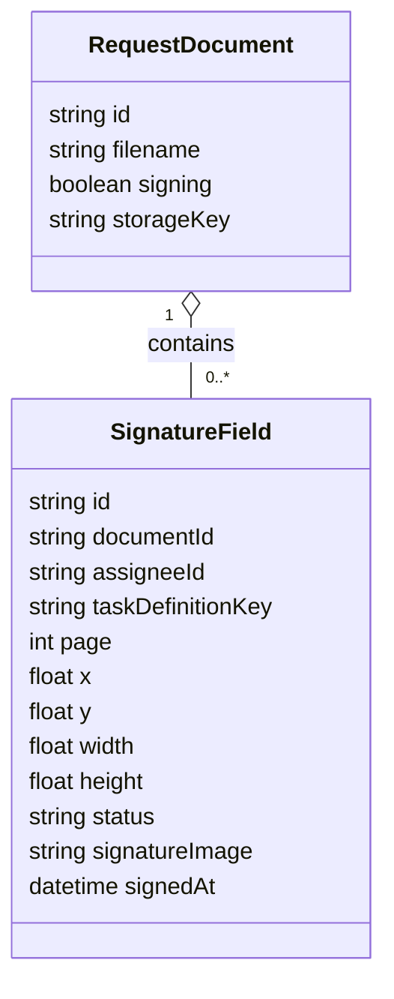
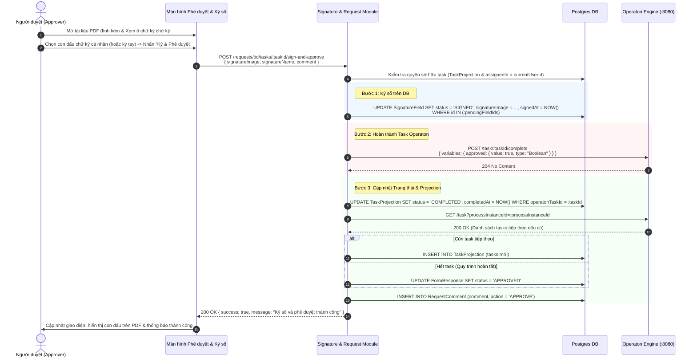

# Đặc tả Tích hợp Ký số PDF & Hoàn thành Nhiệm vụ Operaton (PDF Signing Integration)

**Mã tài liệu:** `SPEC-RUN-SGN-01`  
**Thuộc Phase:** `Phase 5 — Vận hành Run-time (Request + Preview/Override Tác nhân + Ký PDF + Vòng đời Operaton)`  
**Trạng thái:** `PENDING_REVIEW`  
**Ngày lập:** 13/11/2026  
**Tác giả:** Google DeepMind / Antigravity Agent  
**Liên kết kiến trúc:**  
- [`architecture_operatioin_eoffice.md`](../../architecture_operatioin_eoffice.md)  
- [`00-overview/adr/ADR-003-requestor-actor-override.md`](../../00-overview/adr/ADR-003-requestor-actor-override.md)  
- [`02-specs/phase-5-runtime-and-signing/data-model.md`](./data-model.md)  

---

## 1. Mục đích & Nguyên tắc Cốt lõi

Trong các tổ chức doanh nghiệp, việc phê duyệt hồ sơ giấy tờ (như Hợp đồng kinh tế, Đề xuất chi ngân sách, Quyết định bổ nhiệm...) không chỉ là một cú nhấp chuột "Đồng ý" trên hệ thống phần mềm, mà còn đòi hỏi **văn bản pháp lý đính kèm phải có dấu ấn chữ ký của người có thẩm quyền**.

Hệ thống thiết lập nguyên tắc bất biến:
> **Nguyên tắc "Ký trước - Duyệt sau" (Sign-then-Approve Enforcement):**  
> Nếu một hồ sơ có tài liệu PDF chỉ định ký số (`signing = true`) và bước duyệt hiện tại có gán ô chữ ký cho người duyệt, hệ thống **bắt buộc người duyệt phải thực hiện thao tác ký số trên PDF** trước khi được phép gửi lệnh hoàn thành nhiệm vụ (`completeTask`) sang Operaton BPMN Engine.

---

## 2. Thiết lập Ô chữ ký trên Tài liệu PDF (Signature Placement)

### 2.1. Chọn Tài liệu Ký số Chính
- Khi người trình đính kèm các tài liệu trong wizard tạo hồ sơ, người trình có thể đánh dấu 1 tài liệu PDF làm **"Tài liệu ký số chính"** (`RequestDocument.signing = true`).
- Nếu không có tài liệu nào được đánh dấu `signing = true`, quy trình chạy ở chế độ phê duyệt điện tử thông thường (không yêu cầu ký PDF).

### 2.2. Tọa độ Ô chữ ký (`SignatureField`)
Mỗi ô chữ ký được người trình định vị trên văn bản PDF:
- `page`: Số trang (bắt đầu từ trang 1).
- `x`, `y`: Tọa độ góc trên bên trái của khung chữ ký, tính theo phần trăm kích thước trang (`0.0` đến `100.0%`).
- `width`, `height`: Chiều rộng và chiều cao của khung chữ ký tính theo phần trăm.
- `assigneeId`: ID của người duyệt thực tế (`userId`) được chỉ định ký vào ô này.
- `taskDefinitionKey`: Khóa định danh bước duyệt BPMN (ví dụ: `Activity_DeptHeadApprove`) gắn liền với quyền ký này.



---

## 3. Ràng buộc Ký số Chặt chẽ (Backend Enforcement)

### 3.1. Cơ chế Kiểm tra Kiểm soát (Guard Validation)
Khi người duyệt gửi yêu cầu phê duyệt thông thường (`POST /requests/:id/tasks/:taskId/approve`):
1. Backend xác định `taskDefinitionKey` của task hiện tại trên Operaton.
2. Backend truy vấn các ô chữ ký liên quan:
   ```sql
   SELECT * FROM "SignatureField"
   WHERE "responseId" = :responseId
     AND "assigneeId" = :currentUserId
     AND "taskDefinitionKey" = :taskDefinitionKey
     AND "status" = 'PENDING';
   ```
3. **Phán quyết:**
   - Nếu tìm thấy ít nhất 1 ô chữ ký ở trạng thái `PENDING`:
     - Chặn yêu cầu với mã lỗi HTTP `422 Unprocessable Entity`.
     - Error payload:
       ```json
       {
         "statusCode": 422,
         "error": "Unprocessable Entity",
         "message": "Bạn chưa ký số vào tài liệu đính kèm của bước duyệt này.",
         "code": "ERR_SIGNATURE_REQUIRED",
         "details": {
           "pendingSignatureFieldIds": ["sig-uuid-1"]
         }
       }
       ```
   - Nếu không có ô chữ ký nào hoặc tất cả ô chữ ký đã có `status = 'SIGNED'`:
     - Cho phép hoàn thành task trên Operaton.

---

## 4. Quy trình Phê duyệt & Ký số Liên hoàn (Sign-and-Approve Workflow)

Để tối ưu hóa trải nghiệm người dùng, hệ thống cung cấp API hợp nhất: **Ký số và Duyệt trong 1 thao tác (`POST /requests/:id/tasks/:taskId/sign-and-approve`)**.



---

## 5. Xử lý các Hành động Không Yêu cầu Ký số

Trong trường hợp người duyệt không đồng ý phê duyệt:
1. **Yêu cầu Chỉnh sửa (`REQUEST_CHANGES`):**
   - Người duyệt nhập nội dung yêu cầu người trình sửa đổi/bổ sung.
   - **Không yêu cầu ký số.**
   - Ô chữ ký vẫn giữ nguyên trạng thái `PENDING` để người duyệt ký sau khi người trình nộp lại hồ sơ hợp lệ.
2. **Từ chối Phê duyệt (`REJECT`):**
   - Người duyệt nhập lý do từ chối.
   - **Không yêu cầu ký số.**
   - Toàn bộ các ô chữ ký còn `PENDING` của hồ sơ sẽ được cập nhật sang trạng thái `REJECTED`.
   - Tiến trình Operaton kết thúc hoặc bị hủy bỏ.

