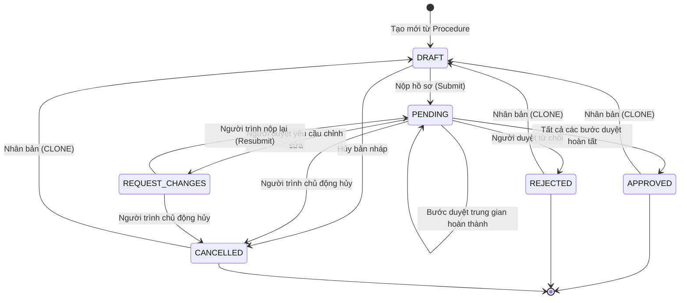

# Đặc tả Vòng đời Yêu cầu & Đồng bộ Operaton Engine (Request Lifecycle & Engine Synchronization)

**Mã tài liệu:** `SPEC-RUN-LIF-01`  
**Thuộc Phase:** `Phase 5 — Vận hành Run-time (Request + Preview/Override Tác nhân + Ký PDF + Vòng đời Operaton)`  
**Trạng thái:** `PENDING_REVIEW`  
**Ngày lập:** 13/11/2026  
**Tác giả:** Google DeepMind / Antigravity Agent  
**Liên kết kiến trúc:**  
- [`architecture_operatioin_eoffice.md`](../../architecture_operatioin_eoffice.md)  
- [`00-overview/adr/ADR-005-version-pinning.md`](../../00-overview/adr/ADR-005-version-pinning.md)  
- [`02-specs/phase-5-runtime-and-signing/prd.md`](./prd.md)  
- [`02-specs/phase-5-runtime-and-signing/data-model.md`](./data-model.md)  

---

## 1. Sơ đồ Máy Trạng thái Vòng đời (State Machine Diagram)

Mỗi hồ sơ yêu cầu (`FormResponse`) trải qua một chuỗi trạng thái được kiểm soát chặt chẽ:

---

## 2. Chi tiết Từng Trạng thái & Cơ chế Đồng bộ Operaton

| Trạng thái | Ý nghĩa nghiệp vụ | Tiến trình Operaton tương ứng | Bảng `TaskProjection` |
|---|---|---|---|
| `DRAFT` | Hồ sơ đang soạn thảo, người trình đang điền form, xem trước luồng hoặc chọn người duyệt. | Chưa khởi tạo (`operatonProcessInstanceId = null`). | Không có bản ghi nào. |
| `PENDING` | Hồ sơ đã gửi đi và đang chạy qua các bước phê duyệt trong quy trình BPMN. | Đang chạy (`RUNNING`). | Chứa 1 hoặc nhiều task `status = 'ACTIVE'` được gán cho các approvers hiện tại. |
| `REQUEST_CHANGES` | Một người duyệt yêu cầu người trình giải trình hoặc sửa đổi số liệu trong form. | Tạm dừng hoặc chờ task sửa đổi (`WAITING_REVISE`). | Các task duyệt bị treo, có thể có task sửa đổi gán cho người trình. |
| `APPROVED` | Hồ sơ đã hoàn thành toàn bộ các bước duyệt trong BPMN và đi đến EndEvent. | Hoàn thành (`COMPLETED`). Tiến trình tự kết thúc trong Operaton. | Tất cả task chuyển sang `COMPLETED`. Không còn task nào `ACTIVE`. |
| `REJECTED` | Hồ sơ bị một cấp có thẩm quyền từ chối phê duyệt. | Kết thúc tại nhánh từ chối hoặc bị xóa (`DELETED`). | Tất cả task chuyển sang `CANCELLED`. |
| `CANCELLED` | Người trình chủ động thu hồi/hủy bỏ hồ sơ khi đang xử lý. | Bị xóa khỏi Operaton qua lệnh `deleteProcessInstance`. | Tất cả task chuyển sang `CANCELLED`. |

---

## 3. Xử lý Chi tiết các Luồng Chuyển trạng thái Nghiệp vụ

### 3.1. Luồng Nộp Hồ sơ (`Submit`: `DRAFT` &rarr; `PENDING`)
1. **Kiểm tra nghiệp vụ:**
   - Trạng thái hiện tại phải là `DRAFT`.
   - Form data đã được điền đầy đủ theo ràng buộc của `LayoutSchema`.
   - Toàn bộ các bước duyệt trên nhánh dự kiến đã có người duyệt (`RequestActualActor`).
2. **Thực thi đồng bộ:**
   - Khởi tạo Operaton Process Instance: `POST /process-definition/:id/start` với `businessKey = FormResponse.id`.
   - Lưu `operatonProcessInstanceId` vào `FormResponse`.
   - Lấy danh sách task đầu tiên từ Operaton (`GET /task?processInstanceId=...`).
   - Lưu các task này vào `TaskProjection` với `status = 'ACTIVE'`.
   - Cập nhật `FormResponse.status = 'PENDING'`.

### 3.2. Luồng Yêu cầu Chỉnh sửa (`REQUEST_CHANGES`: `PENDING` &rarr; `REQUEST_CHANGES`)
Khi người duyệt nhận thấy hồ sơ có điểm chưa hợp lý nhưng chưa đến mức phải hủy bỏ:
1. Người duyệt gửi lệnh `POST /requests/:id/tasks/:taskId/request-changes` kèm nội dung phản hồi `comment`.
2. **Cơ chế phối hợp với Operaton:**
   - Hệ thống đánh dấu cờ biến quy trình `approved = false` và `action = 'REQUEST_CHANGES'`.
   - Nếu trong thiết kế BPMN có nhánh quay lại bước khởi tạo/sửa đổi: token trên Operaton sẽ tự động di chuyển về `UserTask` chỉnh sửa dành cho người trình.
   - Nếu sơ đồ BPMN không thiết kế cổng lặp: e-Office chuyển trạng thái `FormResponse.status = 'REQUEST_CHANGES'`, đình chỉ tạm thời task duyệt hiện tại.
3. **Cập nhật dữ liệu e-Office:**
   - Thêm bản ghi `RequestComment` loại `REQUEST_CHANGES`.
   - Gửi thông báo đến người trình (`createdById`).
   - Mở khóa form cho phép người trình chỉnh sửa giá trị EAV.

### 3.3. Luồng Nộp lại sau Chỉnh sửa (`Resubmit`: `REQUEST_CHANGES` &rarr; `PENDING`)
1. Người trình sửa đổi các trường thông tin trên Form và nhấn "Nộp lại" (`POST /requests/:id/resubmit`).
2. **Đồng bộ Operaton:**
   - Nếu luồng BPMN có task chỉnh sửa của người trình: hoàn thành task đó (`completeTask`) để đẩy token quay lại bước duyệt.
   - Hệ thống trích xuất lại các biến điều kiện `var_*` từ dữ liệu form mới. Nếu giá trị mới làm thay đổi nhánh rẽ của Gateway, các biến điều kiện trên Operaton được cập nhật lại tương ứng.
3. Chuyển `FormResponse.status = 'PENDING'`, đồng bộ lại `TaskProjection`.

### 3.4. Luồng Từ chối (`REJECT`: `PENDING` &rarr; `REJECTED`)
1. Người duyệt gửi lệnh `POST /requests/:id/tasks/:taskId/reject` kèm lý do từ chối.
2. **Đồng bộ Operaton:**
   - Gọi `operatonClient.completeTask(taskId, { approved: false, action: 'REJECT' })` dẫn token đến `EndEvent_Rejected`, hoặc gọi `operatonClient.deleteProcessInstance(instanceId, reason)` để dọn dẹp tiến trình.
3. **Cập nhật dữ liệu e-Office:**
   - Cập nhật `TaskProjection`: chuyển toàn bộ task của hồ sơ này sang `CANCELLED`.
   - Cập nhật các ô chữ ký `SignatureField` chưa ký sang `REJECTED`.
   - Chuyển `FormResponse.status = 'REJECTED'`.
   - Ghi nhận lịch sử `RequestComment`.

### 3.5. Luồng Hủy Hồ sơ (`Cancel`: `PENDING` | `REQUEST_CHANGES` &rarr; `CANCELLED`)
1. Người trình chỉ có thể hủy hồ sơ do chính mình tạo ra (`createdById === currentUserId`).
2. **Đồng bộ Operaton:**
   - Gọi `operatonClient.deleteProcessInstance(operatonProcessInstanceId, "Hồ sơ bị hủy bởi người trình")`.
3. **Cập nhật dữ liệu e-Office:**
   - Xóa hoặc cập nhật các task trong `TaskProjection` thành `CANCELLED`.
   - Chuyển `FormResponse.status = 'CANCELLED'`.

---

## 4. Cơ chế Sao chép Hồ sơ (`CLONE`) & Gắn kết Phiên bản

Khi người dùng cần tạo một hồ sơ tương tự một hồ sơ đã có (dù đã hoàn thành, bị từ chối hay bị hủy):
1. Gọi API `POST /requests/:id/clone` với tham số `mode: "reset" | "reserve"`.
2. **Quy tắc gán Phiên bản (ADR-005 Version Pinning):**
   - Hồ sơ nhân bản mới được gán với **phiên bản Thủ tục (`ProcedureVersion`) mới nhất đang ở trạng thái `PUBLISHED`**, không bị trói buộc vào phiên bản cũ của hồ sơ gốc.
3. **Xử lý dữ liệu Form:**
   - Toàn bộ giá trị form (`FormResponseValue`) của hồ sơ cũ được sao chép sang hồ sơ mới.
4. **Xử lý Tác nhân (`mode`):**
   - `reset`: Bỏ qua các người duyệt cũ, tự động nạp danh sách người duyệt mặc định từ `ProcedureVersion` mới.
   - `reserve`: Giữ lại danh sách người duyệt đã được người trình override ở hồ sơ cũ (nếu các user đó vẫn còn hiệu lực và bước duyệt đó vẫn tồn tại trong quy trình mới).
5. Hồ sơ mới được tạo với `status = 'DRAFT'`, `clonedFromId = parentRequest.id`.

