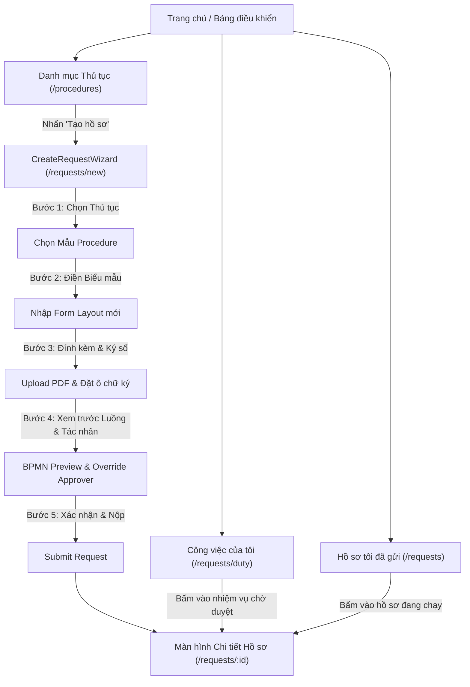

# Thiết kế Giao diện & Quy tắc Tương tác (UI Wireframe & Interaction Rules) — Module Vận hành Run-time & Ký số PDF

**Mã tài liệu:** `SPEC-RUN-UIR-01`  
**Thuộc Phase:** `Phase 5 — Vận hành Run-time (Request + Preview/Override Tác nhân + Ký PDF + Vòng đời Operaton)`  
**Trạng thái:** `PENDING_REVIEW`  
**Ngày lập:** 13/11/2026  
**Tác giả:** Google DeepMind / Antigravity Agent  
**Liên kết kiến trúc:**  
- [`architecture_operatioin_eoffice.md`](../../architecture_operatioin_eoffice.md)  
- [`02-specs/phase-5-runtime-and-signing/prd.md`](./prd.md)  
- [`02-specs/phase-5-runtime-and-signing/data-model.md`](./data-model.md)  

---

## 1. Bản đồ Điều hướng & Luồng Trải nghiệm Người dùng



---

## 2. Thiết kế Màn hình Tạo Yêu cầu (Create Request Wizard)

### 2.1. Thanh Tiến trình 5 Bước (Stepper Header)
Giao diện đỉnh trang hiển thị thanh tiến trình 5 bước trực quan:
```text
[ (1) Chọn Thủ tục ] ────> [ (2) Nhập Biểu mẫu ] ────> [ (3) Tài liệu & Ký số ] ────> [ (4) Luồng duyệt & Tác nhân ] ────> [ (5) Hoàn tất & Nộp ]
```

---

### 2.2. Chi tiết Từng Bước trong Wizard

#### Bước 1: Chọn Thủ tục (Procedure Catalog)
- **Hiển thị:** Lưới thẻ (Card Grid) các Thủ tục đang `PUBLISHED`.
- **Thành phần:**
  - Ô tìm kiếm nhanh theo tên thủ tục hoặc mã thủ tục (`PRC-...`).
  - Bộ lọc theo Phòng ban ban hành.
  - Mỗi thẻ hiển thị: Icon, Tên thủ tục, Mã thủ tục, Mô tả tóm tắt, Phiên bản hiệu lực (`v1.0`), và Nút **"Bắt đầu thực hiện"**.
- Khi người dùng nhấn "Bắt đầu thực hiện", hệ thống tự động gọi `POST /requests/from-procedure` và chuyển sang Bước 2.

#### Bước 2: Nhập Biểu mẫu Động (Dynamic Form Input)
- **Hiển thị:** Nhúng component `FormRenderer` nạp từ `FormVersion.layoutSchema`.
- **Hỗ trợ đầy đủ các tính năng Phase 2:**
  - Grid linh hoạt nhiều cột (12-column grid system).
  - Phân vùng Section có tiêu đề và mô tả.
  - Bảng lặp (`TABLE`) nhập nhiều dòng có tự động tính tổng `SUM` cột tiền tệ.
  - Ẩn/hiện trường có điều kiện (`visibleWhen`).
- Nút điều hướng chân trang: `[ Quay lại ]` và `[ Tiếp tục: Đính kèm tài liệu -> ]`.

#### Bước 3: Đính kèm Tài liệu & Đặt Ô Chữ ký (Document & Signature Placement)
- **Vùng tải lên tài liệu:** Hỗ trợ kéo thả các file PDF, DOCX, XLSX, hình ảnh.
- **Chỉ định tài liệu ký số:** Một công tắc Toggle bên cạnh file PDF: `[X] Chọn làm Tài liệu Ký số chính`.
- **Trình đặt ô chữ ký trực quan:**
  - Khi mở tài liệu ký số chính, hiển thị bộ xem PDF nhúng.
  - Cột bên phải hiển thị danh sách các người duyệt thực tế.
  - Người trình kéo thẻ tên người duyệt thả vào vị trí cần ký trên trang PDF, hệ thống tự động tính toán tọa độ `%` (`x`, `y`, `width`, `height`, `page`).

#### Bước 4: Xem trước Luồng & Tác nhân (Flow Preview & Actor Override)
Màn hình chia làm 2 khối song song:

```text
┌──────────────────────────────────────────────┬──────────────────────────────────────────────┐
│ SƠ ĐỒ QUY TRÌNH DỰ KIẾN (BPMN Interactive)   │ DANH SÁCH NGƯỜI DUYỆT THỰC TẾ               │
│                                              │                                              │
│ [Start] ──> [Trưởng phòng] ──> <Kim cương>   │ Bước 1: Trưởng phòng duyệt                   │
│                                  │ (Số tiền) │  👤 Lê Văn Phó - Phó Trưởng phòng (Ủy quyền)  │
│          ┌───────────────────────┴────────┐  │  🏷️ Phòng Kỹ thuật                            │
│          ▼                                ▼  │  [ Sửa người duyệt ] (allowOverride: true)    │
│ [Ban Giám Đốc] (Xanh lá - Active)  [Kế toán] │ ──────────────────────────────────────────   │
│                                    (Mờ - Bye)│ Bước 2: Ban Giám đốc phê duyệt               │
│                                              │  👤 Trần Ban Giám Đốc - Tổng Giám Đốc        │
│                                              │  🔒 Cố định theo quy chế (allowOverride:false│
└──────────────────────────────────────────────┴──────────────────────────────────────────────┘
```

- **Quy tắc tương tác:**
  - Sơ đồ BPMN tô màu xanh lá các nhánh và task được kích hoạt dựa trên số liệu vừa nhập ở Bước 2. Các nhánh không thỏa điều kiện bị làm mờ (opacity 30%).
  - Khối danh sách người duyệt liệt kê đầy đủ thông tin: Avatar, Họ tên, Phòng ban, Chức danh.
  - Khi người trình bấm **"Sửa người duyệt"**, mở slide-over drawer danh bạ nhân viên để chọn người thay thế.

#### Bước 5: Hoàn tất & Nộp hồ sơ (Review & Submit)
- Bảng tóm tắt toàn bộ thông tin: Tên thủ tục, Dữ liệu form, Tài liệu đính kèm, Sơ đồ duyệt và Danh sách người ký.
- Nút chính: `[ Nộp yêu cầu phê duyệt ]` (Button màu xanh chủ đạo, có biểu tượng gửi).

---

## 3. Thiết kế Màn hình Chi tiết Yêu cầu (Request Detail Screen)

Giao diện Split-View 2 cột tối ưu cho cả Người trình và Người duyệt:

```text
┌─────────────────────────────────────────────────────────────┬─────────────────────────────────┐
│ CỘT TRÁI (60%): NỘI DUNG HỒ SƠ & TÀI LIỆU KÝ               │ CỘT PHẢI (40%): TIẾN ĐỘ QUY TRÌNH│
│                                                             │                                 │
│ [Tab: Biểu mẫu]   [Tab: Tài liệu PDF đã ký]   [Tab: Lịch sử]│ [ Sơ đồ BPMN Tiến độ ]          │
│                                                             │  - Bước đã xong: Viền xanh lá   │
│ --- THÔNG TIN ĐỀ XUẤT ---                                   │  - Bước đang chờ: Viền cam nhấp │
│ Mục đích: Mua sắm màn hình Dell 27 inch                      │  - Bước chưa đến: Viền xám      │
│ Tổng kinh phí: 75.000.000 VNĐ                               │                                 │
│ ...                                                         │ [ Dòng thời gian Phê duyệt ]   │
│                                                             │  ✓ Nguyễn Văn Nhân Viên (Tạo)   │
│ [KHUNG XEM PDF NẾU CHỌN TAB TÀI LIỆU]                       │  ⏳ Lê Văn Phó (Đang chờ duyệt)  │
│  Hiển thị trang PDF với con dấu chữ ký điện tử              │  ○ Trần Ban Giám Đốc (Chờ)      │
└─────────────────────────────────────────────────────────────┴─────────────────────────────────┘
┌───────────────────────────────────────────────────────────────────────────────────────────────┐
│ THANH TÁC VỤ DƯỚI ĐÁY (Sticky Floating Action Bar):                                           │
│  [Từ chối hồ sơ]   [Yêu cầu chỉnh sửa]                 [ 🖊️ Ký số & Phê duyệt ]               │
└───────────────────────────────────────────────────────────────────────────────────────────────┘
```

---

## 4. Thiết kế Màn hình "Công việc của tôi" (`/requests/duty`)

- **Thanh chuyển Tab:**
  - `[ Cần tôi xử lý (3) ]` (Chứa badge số lượng màu đỏ nổi bật).
  - `[ Tôi đã xử lý ]`.
- **Thanh công cụ lọc:**
  - Ô tìm kiếm theo tên thủ tục / tên người trình.
  - Bộ lọc Dropdown chọn Thủ tục.
  - Bộ lọc Khoảng thời gian gửi.
- **Bảng dữ liệu (Table Columns):**
  1. *Mã & Tên Thủ tục*: Kèm icon đại diện.
  2. *Người trình*: Avatar + Tên + Phòng ban.
  3. *Bước cần duyệt*: Tên bước BPMN (ví dụ: "Trưởng phòng duyệt").
  4. *Yêu cầu ký số*: Badge `[ 🖊️ Cần ký PDF ]` hoặc `[ Duyệt điện tử ]`.
  5. *Thời gian gửi*: Định dạng tương đối (ví dụ: "10 phút trước", "Hôm qua").
  6. *Thao tác*: Nút `[ Xem & Xử lý ]`.

