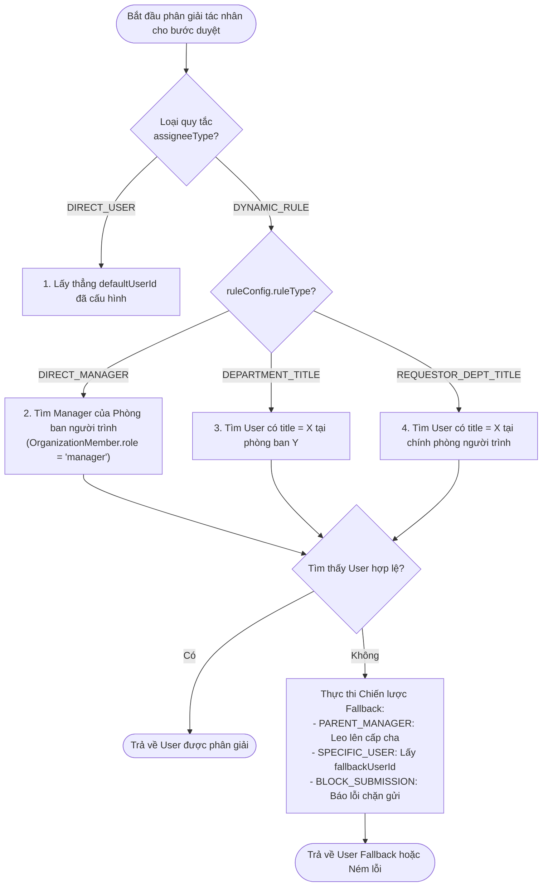

# Quy tắc & Thuật toán Phân giải Tác nhân Động (Dynamic Actor Rules)

**Trạng thái:** `APPROVED` (Phase 6 Spec)  
**Tài liệu liên quan:** [prd.md](./prd.md), [data-model.md](./data-model.md).

---

## 1. Phân loại Quy tắc Phân giải Tác nhân

Hệ thống hỗ trợ 4 loại quy tắc (`ruleType`) khi cấu hình tác nhân cho một bước duyệt BPMN trong Thủ tục:



---

## 2. Chi tiết Thuật toán Từng Quy tắc

### 2.1 Quy tắc 1: `DIRECT_USER` (Gán đích danh cố định)
- **Đầu vào:** `mapping.defaultUserId`.
- **Logic:** Truy vấn User trong DB theo `id = defaultUserId`.
- **Áp dụng:** Các bước duyệt yêu cầu chỉ định đích danh một nhân sự cụ thể (ví dụ: một chuyên gia độc lập hoặc tài khoản kiểm soát viên chuyên trách).

---

### 2.2 Quy tắc 2: `DIRECT_MANAGER` (Trưởng phòng / Quản lý trực tiếp)
- **Đầu vào:** `requestorId` (ID của người nộp đơn).
- **Thuật toán:**
  1. Tìm node phòng ban trực tiếp của người nộp đơn trong bảng `OrganizationMember`:
     ```sql
     SELECT organizationId FROM organization_members WHERE userId = requestorId AND isActive = true LIMIT 1;
     ```
  2. Tại node phòng ban đó, tìm thành viên có quyền quản lý:
     ```sql
     SELECT userId FROM organization_members 
     WHERE organizationId = :orgId AND role = 'manager' AND isActive = true AND userId != :requestorId
     LIMIT 1;
     ```
  3. **Xử lý đặc biệt khi Người trình chính là Trưởng phòng (Self-Approval Prevention):**
     - Nếu người nộp đơn chính là Manager của phòng ban đó, hệ thống tự động leo lên cấp cha (`org.parentId`) để tìm Manager cấp trên (ví dụ: Phó Giám Đốc hoặc Tổng Giám Đốc phụ trách), tránh trường hợp người nộp đơn tự duyệt đơn của chính mình.
  4. Nếu không tìm thấy, chuyển sang **Cơ chế Fallback** (mục 3).

---

### 2.3 Quy tắc 3: `DEPARTMENT_TITLE` (Chức danh cụ thể tại Phòng ban xác định)
- **Đầu vào:** `ruleConfig.departmentName` (hoặc `departmentId`) và `ruleConfig.targetJobTitle`.
- **Thuật toán:**
  1. Tìm User thỏa mãn cả 2 điều kiện:
     - `User.department == ruleConfig.departmentName` (hoặc thông qua liên kết `OrganizationMember`).
     - `User.title == ruleConfig.targetJobTitle` (khớp chính xác hoặc không phân biệt hoa thường).
     - `User.isActive == true`.
  2. Nếu có nhiều hơn 1 người cùng giữ chức danh (ví dụ có 2 Phó phòng), ưu tiên lấy người có role `manager` hoặc người đầu tiên theo danh bạ, đồng thời cho phép người trình chọn lại lúc nộp đơn nếu `allowOverride: true`.
  3. Nếu không tìm thấy ai giữ chức danh đó, kích hoạt **Cơ chế Fallback**.

---

### 2.4 Quy tắc 4: `REQUESTOR_DEPT_TITLE` (Chức danh trong cùng phòng người nộp đơn)
- **Đầu vào:** `requestorId` và `ruleConfig.targetJobTitle`.
- **Thuật toán:**
  1. Xác định phòng ban của người nộp đơn (`requestor.department`).
  2. Tìm User trong cùng phòng ban đó có `User.title == ruleConfig.targetJobTitle` và `isActive == true`.
  3. Áp dụng cho các bước như: *"Phó phòng ký nháy trước khi Trưởng phòng duyệt"*.
  4. Nếu không tìm thấy, kích hoạt **Cơ chế Fallback**.

---

## 3. Cơ chế Dự phòng Không Bế tắc (Zero-Deadlock Fallback Strategy)

Khi việc phân giải không tìm thấy nhân sự phù hợp, hệ thống xử lý theo cấu hình `fallbackStrategy`:

| Chiến lược Fallback | Logic thực thi | Ứng dụng thực tế |
| :--- | :--- | :--- |
| **`PARENT_MANAGER`** *(Mặc định)* | Truy vết ngược lên cây thư mục tổ chức: Lấy `Organization.parentId` của phòng ban hiện tại. Tìm Manager của node cha. Nếu node cha vẫn không có, tiếp tục leo lên tới node gốc (Root / Ban Giám Đốc). | Phòng ban mới thành lập chưa có Trưởng phòng thì tự động chuyển lên Giám đốc khối hoặc Tổng Giám đốc. |
| **`SPECIFIC_USER`** | Lấy ID người dự phòng được khai báo trước trong `ruleConfig.fallbackUserId`. | Cấu hình sẵn tài khoản Thư ký hoặc Phó Tổng Giám Đốc xử lý thay khi khuyết vị trí. |
| **`BLOCK_SUBMISSION`** | Báo lỗi thẩm định: *"Không thể xác định người duyệt cho bước [Tên bước]. Vui lòng liên hệ Quản trị viên để cập nhật danh bạ phòng ban."* | Áp dụng cho các bước duyệt tài chính bắt buộc, không được phép duyệt thay ngoài thẩm quyền. |

---

## 4. Gắn kết với Vòng đời Phê duyệt BPMN Operaton

Khi người duyệt thực tế được giải quyết:
1. Thông tin người duyệt được lưu vào bảng `request_actual_actors` với cờ `isDynamicResolved: true` và `resolvedRuleType: 'DIRECT_MANAGER'`.
2. Khi phát lệnh khởi tạo tiến trình sang Operaton (`OperatonAdapterService.startProcessInstance`), ID người duyệt được đưa vào biến tiến trình `actor_<taskDefinitionKey>`.
3. Operaton giao task cho đúng User Task Assignee tương ứng.

