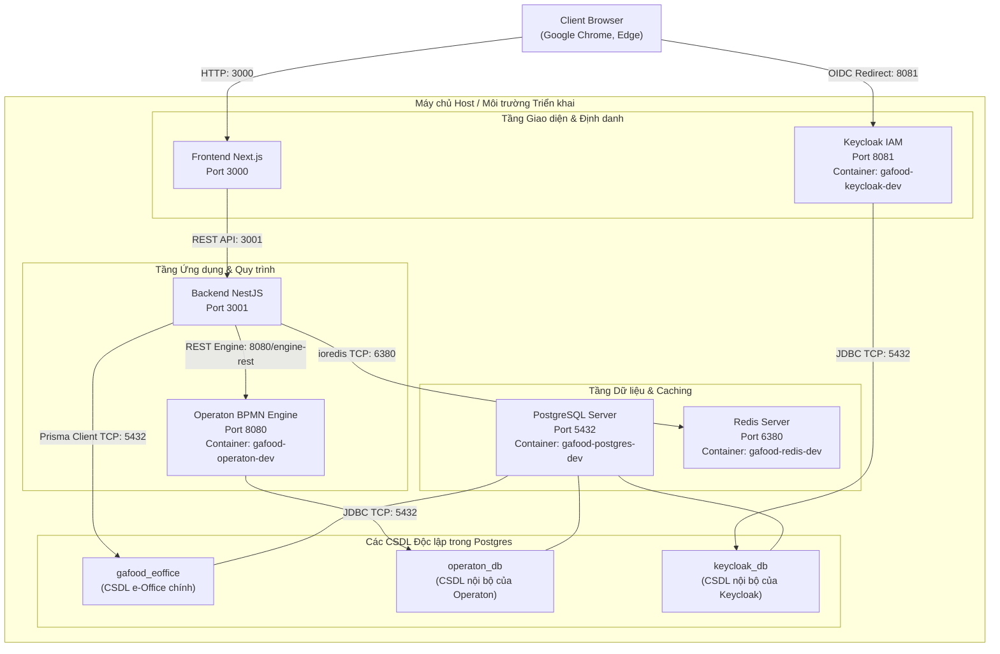
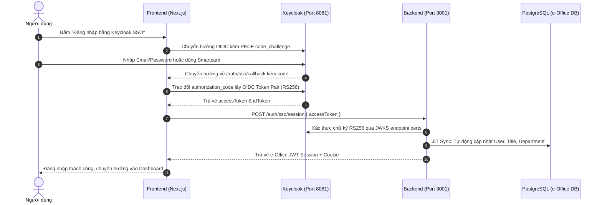
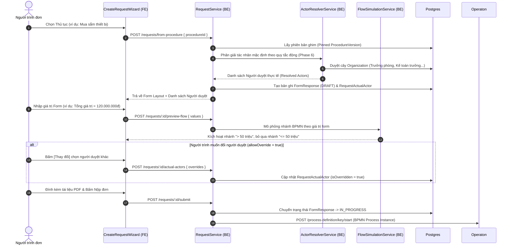
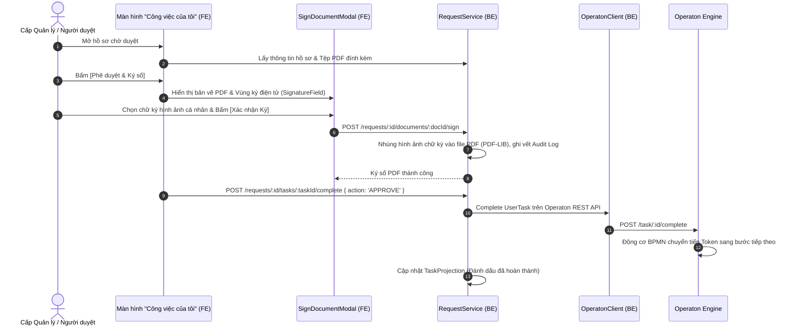

# 01 — Bản vẽ Kiến trúc Tổng thể & Luồng Tích hợp Hệ thống (System Architecture Blueprint)

**Dành cho:** Trưởng phòng Dev, Solution Architect, Tech Lead  
**Tài liệu tham khảo liên quan:** [README.md](./README.md), [operaton-engine-contract.md](../01-architecture/operaton-engine-contract.md), [auth-keycloak-architecture.md](../01-architecture/auth-keycloak-architecture.md).

---

## 1. Bối cảnh & Lý do Lựa chọn Kiến trúc 3 Trụ cột Phân rã

Trước đây, các hệ thống e-Office truyền thống thường mắc phải một trong hai "căn bệnh" kiến trúc phổ biến:
1. **Kiến trúc Hard-coded (Cứng nhắc):** Tự viết toàn bộ logic luồng duyệt vào code ứng dụng bằng các bảng `approval_steps`, `step_order`. Khi doanh nghiệp thay đổi quy trình (thêm bước duyệt, rẽ nhánh hạn mức tiền, duyệt song song), lập trình viên phải sửa code và chạy migration CSDL.
2. **Kiến trúc Monolith nguyên khối phụ thuộc Vendor (Vendor Lock-in):** Nhúng trực tiếp toàn bộ Java BPMN Engine (như Camunda/Flowable) vào chung ứng dụng, biến toàn bộ hệ thống thành một khối nặng nề, khó scale, phụ thuộc sâu vào ngôn ngữ Java và khó kiểm soát giao diện người dùng.

Để giải quyết triệt để vấn đề này, Gafood E-Office 2.0 được thiết kế theo **Mô hình 3 Trụ cột Phân rã Hoàn toàn (Decoupled 3-Pillar Architecture)**:

```
┌──────────────────────────────────────────────────────────────────────────────────────────────────┐
│                                       NGƯỜI DÙNG DOANH NGHIỆP                                   │
└─────────────────────────────────┬──────────────────────────────────┬─────────────────────────────┘
                                  │                                  │
                                  ▼                                  ▼
                ┌──────────────────────────────────┐ ┌──────────────────────────────────┐
                │ TRỤ CỘT 1: ĐỊNH DANH TẬP TRUNG   │ │ TRỤ CỘT 2: ĐỘNG CƠ QUY TRÌNH     │
                │ Keycloak 26.1 IAM (Docker)       │ │ Operaton BPMN Engine 2.2 (Docker)│
                │                                  │ │                                  │
                │ • Đăng nhập SSO (PKCE OIDC)      │ │ • Chuẩn BPMN 2.0 Quốc tế         │
                │ • Quản lý tài khoản, phòng ban   │ │ • Quản lý State Machine & Tasks  │
                │ • Cấp JWT RS256 JWKS chuẩn       │ │ • Giao tiếp 100% qua REST API    │
                └─────────────────┬────────────────┘ └──────────────────┬───────────────┘
                                  │ Bearer JWT                          │ Engine REST
                                  ▼                                     ▼
                ┌───────────────────────────────────────────────────────────────────────┐
                │ TRỤ CỘT 3: ỨNG DỤNG E-OFFICE (Monorepo Node.js / TypeScript)          │
                │                                                                       │
                │ • Frontend: Next.js 16 (Turbopack, Tailwind CSS, Form & BPMN Modeler) │
                │ • Backend: NestJS (Prisma ORM, Redis Rate-limiting, Procedure Engine) │
                │ • CSDL chính: PostgreSQL (EAV Form Values + Procedures + Requests)    │
                │ • Ký số văn bản: In-App Digital Signature Canvas & PDF Embedding      │
                └───────────────────────────────────────────────────────────────────────┘
```

### Ưu thế Kỹ thuật của Kiến trúc:
* **Tính Độc lập Tuyệt đối (High Cohesion, Low Coupling):** Backend e-Office chỉ là một REST Client đối với Operaton và Keycloak. Nếu cần bảo trì hoặc nâng cấp BPMN Engine, ứng dụng e-Office không bị sập hay gián đoạn dữ liệu.
* **Tự do Công nghệ:** Frontend và Backend dùng thuần TypeScript / Node.js hiện đại, không cần duy trì stack Java runtime trong monorepo.
* **Bảo mật Cấp Doanh nghiệp:** Toàn bộ việc xác thực danh tính được ủy quyền cho Keycloak – giải pháp IAM mã nguồn mở chuẩn doanh nghiệp hàng đầu hiện nay.

---

## 2. Sơ đồ Mạng lưới & Cổng Dịch vụ (Component Topology & Ports)

Toàn bộ hạ tầng phát triển và triển khai cục bộ được điều phối thông qua Docker Compose:



### Danh mục Cổng Giao tiếp Mạng:
| Dịch vụ | Container Name | Cổng Expose | Giao thức & Công dụng |
|:---|:---|:---:|:---|
| **Frontend Web** | _(Dev server / Docker)_ | `3000` | HTTP/HTTPS giao diện người dùng Next.js App Router |
| **Backend API** | _(Dev server / Docker)_ | `3001` | REST API, Swagger docs (`/api/docs`), WebSocket |
| **Keycloak IAM** | `gafood-keycloak-dev` | `8081` | OpenID Connect, OAuth2, Admin Console (`/admin`) |
| **Operaton Engine** | `gafood-operaton-dev` | `8080` | REST API Engine (`/engine-rest`), Webapp (`/app`) |
| **PostgreSQL** | `gafood-postgres-dev` | `5432` | Chứa 3 CSDL tách biệt: `gafood_eoffice`, `operaton_db`, `keycloak_db` |
| **Redis Cache** | `gafood-redis-dev` | `6380` | Throttle Rate Limit (15 req/phút), Session Blacklist, Cache tạm |

---

## 3. Kiến trúc Bảo mật & Xác thực Danh tính (Security & IAM)

Hệ thống triển khai cơ chế **Dual-Authentication Strategy (Chiến lược Xác thực Kép)** hỗ trợ song song cả tài khoản nội bộ cũ và SSO Keycloak hiện đại.



### Các nguyên tắc an ninh cốt lõi:
1. **Zero-Trust Token Verification (Xác thực không tin tưởng trước):**
   - Backend xác thực token Keycloak bằng thuật toán bất đối xứng **RS256** thông qua JWKS URI (`http://localhost:8081/realms/e-office/protocol/openid-connect/certs`). Backend không cần lưu trữ bất kỳ private key nhạy cảm nào.
2. **JIT Synchronization (Đồng bộ tức thời - Just In Time):**
   - Khi người dùng đăng nhập SSO lần đầu hoặc có thay đổi về Chức danh (`jobTitle`), Phòng ban (`department`), Backend tự động đồng bộ vào bảng `User` và cây `Organization` trong CSDL e-Office.
3. **Phân quyền Dựa trên Vai trò (Role-Based Access Control - RBAC):**
   - Hệ thống chia làm 3 tầng quyền chính:
     * `admin`: Toàn quyền cấu hình Biểu mẫu, Quy trình BPMN, Thủ tục và Quản trị Tổ chức.
     * `manager`: Quyền phê duyệt, ký số văn bản và theo dõi hồ sơ của phòng ban phụ trách.
     * `user`: Quyền khởi tạo hồ sơ từ Thủ tục, theo dõi tiến độ hồ sơ cá nhân và nhận trả hồ sơ khi có yêu cầu sửa đổi.
4. **Bảo vệ Chống Tấn công Từ chối Dịch vụ (Redis Throttle & Rate Limiting):**
   - Áp dụng bộ lọc `RedisThrottleGuard` trên toàn bộ các endpoint xác thực và nộp đơn (5-15 requests/phút theo IP thực thông qua `trust proxy = 1`).

---

## 4. Các Luồng Nghiệp vụ Trọng yếu (End-to-End Interaction Flows)

### 4.1 Luồng Khởi tạo Hồ sơ & Mô phỏng Quy trình Thực tế (Phase 5 & 6)



### 4.2 Luồng Phê duyệt Nghiệp vụ & Ký số Văn bản (Sign-First, Approve-Later)

Nhằm đảm bảo tính toàn vẹn pháp lý trong doanh nghiệp, hệ thống áp dụng cơ chế nghiêm ngặt: **Người duyệt bắt buộc phải Ký số thành công trước khi Hoàn tất nhiệm vụ BPMN**.



---

## 5. Đánh giá Khả năng Mở rộng & Dự phòng Rủi ro (Scalability & Fault Tolerance)

1. **Hiệu năng Truy vấn Danh sách Công việc (Task Projection Engine):**
   - Khi có hàng chục ngàn Process Instance đang chạy, việc query trực tiếp vào bảng runtime của Operaton sẽ làm nghẽn REST API.
   - e-Office giải quyết bằng bảng **`TaskProjection`** trong PostgreSQL: Mỗi khi có UserTask được tạo ra hoặc hoàn thành, Backend tự động đồng bộ một bản chiếu nhẹ (Projection). Màn hình *"Công việc của tôi"* truy vấn 100% trên `TaskProjection` với index tối ưu, đạt tốc độ phản hồi `< 50ms`.
2. **Khả năng Phục hồi khi Operaton hoặc Keycloak gặp sự cố:**
   - CSDL `gafood_eoffice` và `operaton_db` được phân tách hoàn toàn. Nếu Operaton bị restart, trạng thái hồ sơ trong e-Office vẫn an toàn.
   - Khi Operaton phục hồi, cơ chế `OperatonSyncService` có thể quét và tái đồng bộ các task bị trễ.
3. **Mở rộng Đa chi nhánh / Đa cụm (Multi-Tenant & Clustering):**
   - Mọi quy trình thuộc e-Office đều được gắn cờ `category="e-Office"`, cho phép dùng chung một cụm Operaton Engine với các phòng ban khác (như CRM, HRM, Kho vận) mà không lo bị trùng lặp hoặc nhìn thấy quy trình của nhau.

