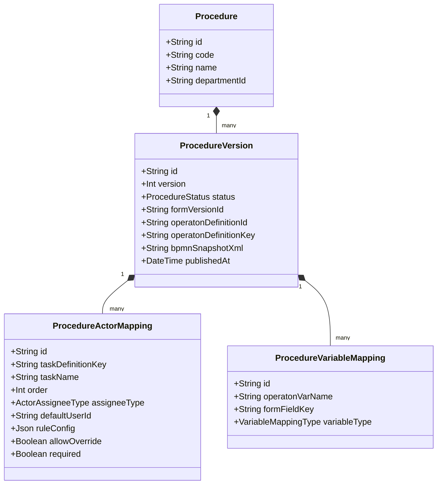
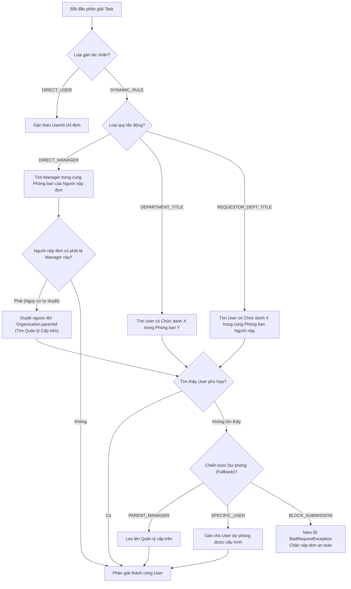
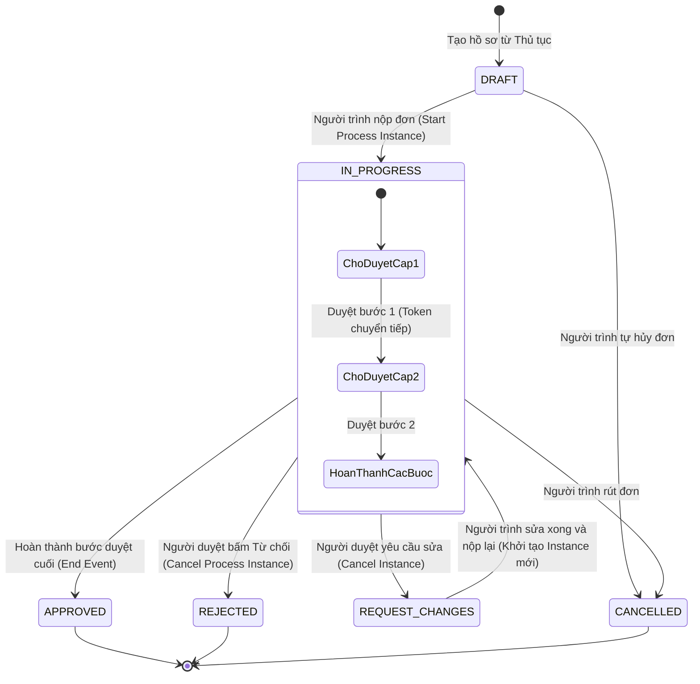

# 02 — Cơ chế Lõi & Mô hình Dữ liệu Cốt lõi (Core Engine & Data Models)

**Dành cho:** Trưởng phòng Dev, Database Architect, Backend Lead  
**Tài liệu tham khảo liên quan:** [ADR-001](../00-overview/adr/ADR-001-form-layout-json.md), [ADR-005](../00-overview/adr/ADR-005-version-pinning.md), [dynamic-actor-rules.md](../02-specs/phase-6-dynamic-actor-and-hardening/dynamic-actor-rules.md).

---

## 1. Kiến trúc Tầng Dữ liệu Lai: EAV kết hợp JSON Layout Schema

Một trong những bài toán hóc búa nhất của các hệ thống văn phòng điện tử là: **Làm sao để người dùng nghiệp vụ có thể tự do tạo và sửa biểu mẫu (thêm trường, xóa trường, chia cột, thêm bảng lặp con) mà không phải can thiệp cấu trúc bảng CSDL (DDL Schema Migration) và vẫn đảm bảo khả năng tìm kiếm, lập chỉ mục?**

Gafood E-Office giải quyết triệt để vấn đề này bằng kiến trúc **Hybrid EAV + JSON Layout Schema**:

```
                       CƠ CHẾ LƯU TRỮ VÀ KẾT XUẤT BIỂU MẪU ĐỘNG
┌───────────────────────────────────────────────┐ ┌───────────────────────────────────────────────┐
│         ĐỊNH NGHĨA HÌNH THỨC (LAYOUT)         │ │            DỮ LIỆU THỰC TẾ (EAV)              │
│       Lưu tại: FormVersion.layoutSchema       │ │       Lưu tại: FormResponseValue (Table)      │
└───────────────────────┬───────────────────────┘ └───────────────────────┬───────────────────────┘
                        │                                                 │
                        ▼                                                 ▼
        ┌───────────────────────────────┐                 ┌───────────────────────────────┐
        │ JSON Schema (Cấu trúc giao diện)│                 │ Cột: fieldKey, value (JSONB)  │
        │ - sections: Nhóm thông tin    │                 │ - Indexing trên responseId    │
        │ - grid: colSpan, rows         │                 │ - Tìm kiếm giá trị trực tiếp  │
        │ - visibleWhen: AST logic ẩn/hiện│               │ - Lưu trữ EAV chuẩn hóa       │
        │ - tableConfig: Cấu hình bảng con│               │                               │
        └───────────────┬───────────────┘                 └───────────────┬───────────────┘
                        │                                                 │
                        └───────────────────────┬─────────────────────────┘
                                                ▼
                                ┌───────────────────────────────┐
                                │    FormRenderer Component     │
                                │   (Hiển thị biểu mẫu động)    │
                                └───────────────────────────────┘
```

### 1.1 Cấu trúc JSON Layout Schema (FormVersion)
Thay vì lưu cứng vị trí vào CSDL, toàn bộ cách bố trí không gian của Form được lưu trong trường `layoutSchema` (JSON) của bảng `FormVersion`:
* **`sections`**: Phân chia màn hình thành các khối nghiệp vụ logic có tiêu đề.
* **`grid` (Multi-column layout)**: Hỗ trợ chia từ 1 đến 4 cột với thuộc tính `colSpan` co giãn linh hoạt.
* **`visibleWhen` (Biểu thức điều kiện động)**: Sử dụng cú pháp Abstract Syntax Tree (AST) dạng `{ field: 'loai_mua_sam', operator: 'EQUALS', value: 'NGOAI_DINH_MUC' }` để tự động ẩn/hiện trường nhập liệu khi người dùng thao tác mà không cần viết code JavaScript tùy biến.
* **`tableConfig` (Bảng lặp con - Sub-table/Repeater)**: Cho phép tạo các bảng chi tiết động (như danh sách vật tư mua sắm, bảng kê hóa đơn) kèm công thức tính toán tự động (`SUM`, `COUNT`).

### 1.2 Bảng Dữ liệu Thực tế (FormResponseValue)
Giá trị thực của người dùng nhập vào được lưu trong bảng quan hệ `FormResponseValue`:
* `fieldKey` (String): Mã định danh trường (ví dụ: `tong_gia_tri`, `ly_do_mua`).
* `value` (Json): Giá trị kiểu chuỗi, số, mảng hoặc đối tượng JSON của bảng con.
* Có index kép `(responseId, fieldKey)` giúp việc trích xuất tham số rẽ nhánh cho quy trình BPMN đạt hiệu năng tối đa `O(1)`.

---

## 2. Lớp Cầu nối `Procedure` & Cơ chế Ghim Phiên bản (Version Pinning)

### 2.1 Bản chất của `Procedure` (Thủ tục Hành chính)
Trong doanh nghiệp, một quy trình phê duyệt không thể đứng riêng lẻ, mà luôn cần 4 yếu tố gắn kết:
$$\text{Thủ tục (Procedure)} = \text{Biểu mẫu (Form)} + \text{Sơ đồ duyệt (Workflow BPMN)} + \text{Tham số rẽ nhánh} + \text{Người duyệt (Actors)}$$



### 2.2 Cơ chế Ghim Phiên bản (Version Pinning - ADR-005)
Một trong những lỗi nghiêm trọng nhất ở các hệ thống e-Office là khi Quản trị viên sửa đổi quy trình hoặc biểu mẫu, các hồ sơ đang xử lý dở dang bị lỗi (schema mismatch hoặc dead task).

Gafood E-Office xử lý vấn đề này bằng **Quy tắc Ghim Bất biến (Immutable Snapshot)**:
1. Khi Quản trị viên bấm **Xuất bản (Publish)** một phiên bản Thủ tục:
   - Hệ thống kéo toàn bộ sơ đồ BPMN từ Operaton về và lưu thành chuỗi XML bất biến vào trường `ProcedureVersion.bpmnSnapshotXml`.
   - Ghim cứng `formVersionId` tương ứng.
   - Phiên bản chuyển trạng thái sang `PUBLISHED` và **khóa vĩnh viễn (Read-only)**.
2. Khi người dùng nộp đơn tạo hồ sơ (`FormResponse`):
   - Bản ghi `FormResponse` trỏ trực tiếp đến `ProcedureVersionId` đã xuất bản.
   - Mọi thao tác sau này (kể cả 1 năm sau xem lại) vẫn sử dụng đúng sơ đồ BPMN Snapshot và Form Layout của phiên bản đó.
   - Quản trị viên có thể thoải mái tạo bản thảo `v2`, `v3` mà không ảnh hưởng bất kỳ hồ sơ nào đang chạy của bản `v1`.

---

## 3. Động cơ Phân giải Tác nhân Động (Dynamic Actor Resolution Engine)

Triển khai tại Phase 6 theo yêu cầu `REQ-DYN-01`, giải quyết bài toán: Không cần gán cứng đích danh một cá nhân vào quy trình, mà gán theo **Vị trí và Cây Cơ cấu Tổ chức**.



### Các quy tắc đảm bảo an toàn (Zero-Deadlock Invariants):
1. **Chống Tự Phê duyệt (Self-Approval Prevention):**
   - Nếu Trưởng phòng tự nộp đơn xin nghỉ phép hoặc mua sắm, hệ thống tự động phát hiện và không bao giờ gán chính họ duyệt bước của mình. Thuật toán tự động duyệt ngược lên cây tổ chức cha (`org.parentId`) để tìm Quản lý cấp trên (Giám đốc khối / Tổng Giám đốc).
2. **Chuỗi Dự phòng Bất biến (Zero-Deadlock Fallback):**
   - Khi một phòng ban chưa kịp bổ nhiệm chức danh hoặc người đó đã nghỉ việc, hệ thống không bao giờ bị rơi vào trạng thái "treo vô định" (Hanging State). Chiến lược Fallback sẽ kích hoạt hoặc đưa ra thông báo cảnh báo rõ ràng ngay trước khi nộp đơn.

---

## 4. Máy Trạng thái Kép & Vòng đời Quy trình (Dual Lifecycle Synchronization)

Hệ thống duy trì cơ chế đồng bộ song hành giữa **Trạng thái Nghiệp vụ e-Office** (`FormResponse.status`) và **Tiến trình Động cơ BPMN** (`Operaton ProcessInstance`):



### Nguyên tắc Xử lý Yêu cầu Chỉnh sửa (`REQUEST_CHANGES` - ADR-004):
* Khi cấp trên yêu cầu bổ sung chứng từ, Process Instance hiện tại trên Operaton được hủy an toàn.
* Hồ sơ quay về trạng thái `REQUEST_CHANGES`. Người trình được mở lại quyền sửa các ô dữ liệu biểu mẫu.
* Khi người trình nộp lại, Backend khởi tạo một Process Instance mới trên Operaton với các tham số cập nhật, đảm bảo đồ thị tiến trình luôn sạch sẽ, không sinh rác token chạy ngầm.
