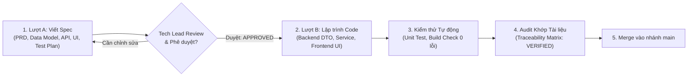

# 04 — Cẩm nang Kỹ thuật & Quản trị Đội ngũ Dev (Engineering Handbook)

**Dành cho:** Trưởng phòng Dev, Tech Lead, Senior Developers, Code Reviewers  
**Tài liệu tham khảo liên quan:** [doc-review-checklist.md](../03-checklists/doc-review-checklist.md), [code-compliance-checklist.md](../03-checklists/code-compliance-checklist.md).

---

## 1. Quy trình Phát triển Bắt buộc: "Docs-First & Zero-Drift"

Tại Gafood E-Office, toàn bộ đội ngũ kỹ thuật tuân thủ nghiêm ngặt nguyên lý **Docs-First**: Không có bất kỳ dòng code nào được phép đưa vào hệ thống nếu chưa có tài liệu đặc tả được phê duyệt trước.



### 3 Điều "Cấm Kỵ" trong Dự án (Engineering Red Lines):
1. **Tuyệt đối không "Code chui":** Không tự ý bổ sung endpoint, trường CSDL hoặc logic rẽ nhánh ngoài tài liệu Spec. Nếu phát sinh yêu cầu thực tế: **Phải cập nhật Spec trước -> Tech Lead duyệt -> Mới viết code**.
2. **Tuyệt đối không xâm phạm Ranh giới 3 Trụ cột:**
   - Không bao giờ cho Backend e-Office đọc/ghi trực tiếp vào CSDL của Operaton (`operaton_db`) hay Keycloak (`keycloak_db`).
   - Mọi tương tác bắt buộc phải thông qua REST API chuẩn hóa (`OperatonClientService`, `KeycloakOidcProvider`).
3. **Tuyệt đối không phá vỡ Quy tắc Ghim Phiên bản (Version Pinning):**
   - Không được sửa trực tiếp Biểu mẫu hoặc Sơ đồ luồng của một `ProcedureVersion` đã ở trạng thái `PUBLISHED`. Khi cần sửa, bắt buộc phải tạo bản thảo mới (`DRAFT v2, v3`).

---

## 2. Chuẩn mực Kiến trúc Mã nguồn (Codebase Structure Standards)

### 2.1 Backend (NestJS Architecture)
Cấu trúc module hóa cao độ theo miền nghiệp vụ (Domain-Driven):
```
backend/src/
 ├── core/                     # Hạ tầng dùng chung cốt lõi
 │    ├── database/            # PrismaService, Transaction helper
 │    ├── redis/               # RedisService, RateLimiter
 │    └── logger/              # Structured Logging
 │
 ├── modules/
 │    ├── auth/                # Định danh, Keycloak OIDC Provider, JWT Strategy, Guards
 │    ├── user/                # Quản lý tài khoản, thông tin hồ sơ
 │    ├── organization/        # Cây cơ cấu phòng ban, chức danh
 │    ├── form-builder/        # Quản lý Form, FormVersion, LayoutSchema (Phase 2)
 │    ├── operaton/            # OperatonClient, BpmnParser, Engine Adapter (Phase 3)
 │    ├── procedure/           # Procedure, ActorMapping, ActorResolverService (Phase 4 & 6)
 │    └── request/             # Request runtime, FlowSimulation, Ký số PDF (Phase 5)
```

**Quy tắc Backend:**
* Mọi Controller phải có Decorator `@UseGuards(RolesGuard)` hoặc `@Public()`.
* Mọi DTO phải dùng `class-validator` với cấu hình toàn cục `whitelist: true, forbidNonWhitelisted: true`.
* Mọi thao tác cập nhật nhiều bảng liên quan (như tạo Procedure kèm Version và Mappings) bắt buộc phải bọc trong `prisma.$transaction`.

### 2.2 Frontend (Next.js 16 App Router Architecture)
Tổ chức theo mô hình Feature-based Modular:
```
frontend/
 ├── app/                      # Next.js App Router (Routing, Layout, Server Components)
 │    ├── (main)/              # Giao diện có Sidebar chính
 │    │    ├── procedures/     # Quản lý và thiết kế Thủ tục
 │    │    ├── requests/       # Tạo hồ sơ, danh sách, chi tiết, "Công việc của tôi"
 │    │    └── workflows/      # Quản lý và vẽ luồng BPMN
 │    └── auth/                # Trang đăng nhập, callback SSO Keycloak
 │
 ├── features/                 # Logic nghiệp vụ theo từng domain
 │    ├── procedure/           # Types, API Client, ProcedureBuilder (ActorMappingTab, ...)
 │    ├── requests/            # FlowPreviewAndActorStep, BpmnFlowViewer, SignModal
 │    └── workflow/            # WebBpmnModeler nhúng thư viện bpmn-js
 │
 └── components/               # UI Reusable components (Modal, Button, Input, Table)
```

**Quy tắc Frontend:**
* Không viết logic gọi `fetch` tự do trong component; bắt buộc đóng gói thành API functions trong thư mục `features/*/api/` thông qua `apiFetch` client chuẩn.
* Mọi giao diện phải hỗ trợ đầy đủ Dark Mode và thiết kế Responsive chuẩn Tailwind CSS.
* Text hiển thị trên UI phải dùng tiếng Việt phổ thông chuẩn mực, không dùng biệt ngữ kỹ thuật khó hiểu với người dùng.

---

## 3. Checklist Dành riêng cho Tech Lead khi Review Pull Request

Trước khi bấm nút Merge bất kỳ Pull Request nào vào nhánh `main`, Trưởng phòng Dev / Tech Lead vui lòng kiểm tra đủ 6 mục sau:

- [ ] **1. Tính Hợp lệ của Đặc tả (Spec Alignment):** PR này thuộc Phase nào? Đã có file đặc tả tương ứng trong `02-specs/` chưa? Các DTO và endpoint có khớp 100% với file `api-contract.md` không?
- [ ] **2. An toàn Dữ liệu & Version Pinning:** Các thay đổi có làm ảnh hưởng đến các hồ sơ đang chạy ở trạng thái `IN_PROGRESS` không? Có trường hợp nào xóa hoặc sửa đè lên `ProcedureVersion` đã `PUBLISHED` không?
- [ ] **3. An ninh & Xác thực:** Các endpoint mới có được bảo vệ bằng `@Roles(...)` không? Có khả năng bị bypass IDOR (sửa ID của người khác) không?
- [ ] **4. Xử lý Lỗi & Font tiếng Việt:** Các thông báo lỗi trả về có rõ ràng, bằng tiếng Việt và không để lộ chuỗi SQL / Stack trace nhạy cảm không? Dữ liệu chữ tiếng Việt có được bảo toàn nguyên vẹn UTF-8 không?
- [ ] **5. Kiểm thử Đơn vị & Tích hợp:** Đã có test case tự động kiểm tra cho logic nghiệp vụ mới chưa?
- [ ] **6. Build Check 0 Lỗi:** Cả `backend` (`nest build`) và `frontend` (`next build` Turbopack) có biên dịch sạch 100% không cảnh báo không?
