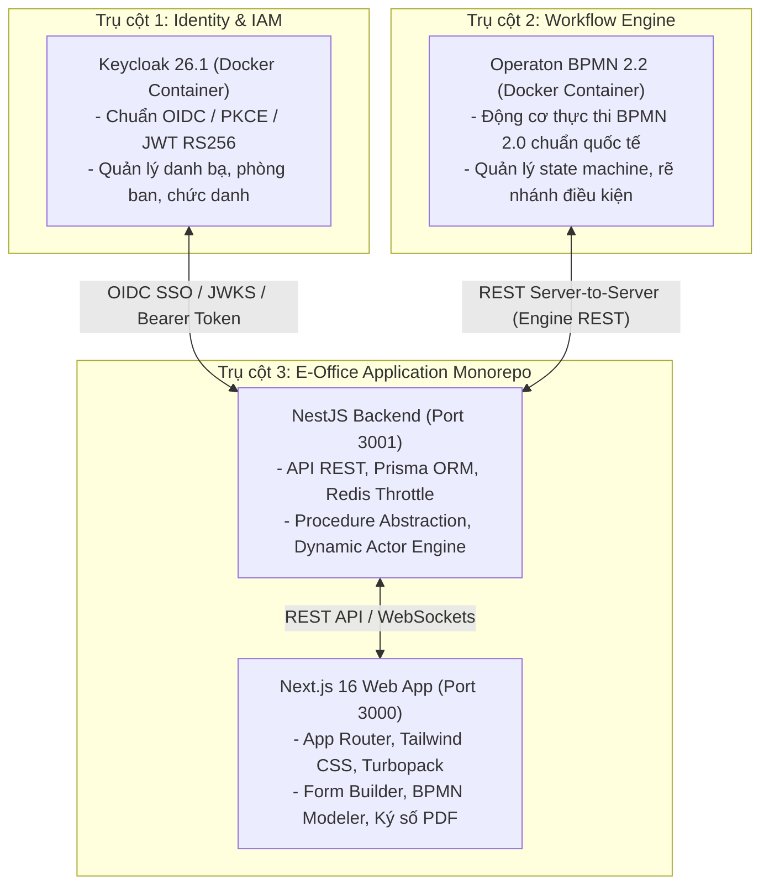

# Cẩm nang Kiến trúc & Thiết kế Toàn diện dành cho Trưởng phòng Dev (Tech Lead Guide)

**Dành riêng cho:** Head of Development, Tech Lead, Solution Architect, Lead Engineer.  
**Mục đích:** Cung cấp cái nhìn thiết kế tổng quan cấp cao (Bird's Eye View & Architectural Blueprint) về toàn bộ hệ thống Gafood E-Office 2.0 mà không bị sa đà vào từng dòng code triển khai chi tiết.

---

## 1. Giới thiệu & Tầm nhìn Thiết kế (Executive Summary)

Gafood E-Office 2.0 là hệ sinh thái **Quản trị Văn phòng Số & Phê duyệt Quy trình Nghiệp vụ Doanh nghiệp** được tái kiến trúc toàn diện theo phương pháp **Decoupled 3-Pillar Architecture (Kiến trúc 3 Trụ cột Phân rã)**:



### Triết lý Cốt lõi của Hệ thống (Core Architectural Principles):
1. **Zero Vendor Lock-In (Độc lập Động cơ & Nền tảng):** 
   - Động cơ quy trình Operaton chạy độc lập qua REST API, không nhúng thư viện Java vào codebase ứng dụng. Sau này hoàn toàn có thể thay bằng Camunda 7/8, Zeebe mà không sửa nghiệp vụ cốt lõi.
   - Hệ thống định danh Keycloak chạy độc lập, Backend xác thực qua chuẩn JWT Bearer công khai (JWKS), sẵn sàng liên kết với Microsoft Azure AD, Google Workspace hoặc Okta.
2. **Docs-First & Traceability (Tài liệu đi trước — Code theo sau):**
   - Mọi tính năng nghiệp vụ từ Phase 1 đến Phase 6 đều có tài liệu PRD, Data Model, API Contract, Test Plan được phê duyệt trước khi viết code.
   - 100% yêu cầu được đối chiếu tại Ma trận Truy vết ([04-traceability-matrix.md](../00-overview/04-traceability-matrix.md)).
3. **Flexible Form vs Standard BPMN (Tách biệt Dữ liệu & Tiến trình):**
   - Dữ liệu biểu mẫu lưu trữ theo mô hình EAV linh hoạt kết hợp JSON Layout Schema (không cần chạy DDL migration mỗi khi đổi mẫu đơn).
   - Tiến trình phê duyệt tuân thủ tuyệt đối chuẩn quốc tế BPMN 2.0 (hỗ trợ Gateway rẽ nhánh, song song, tuần tự, Multi-instance).
4. **Version Pinning & Zero-Deadlock (Đảm bảo an toàn vận hành thời gian thực):**
   - Mọi hồ sơ khi phát hành đều được ghim cứng phiên bản Biểu mẫu, Sơ đồ luồng và Quy tắc duyệt tại thời điểm nộp đơn ([ADR-005](../00-overview/adr/ADR-005-version-pinning.md)).
   - Thuật toán phân giải người duyệt động có cơ chế chống tự duyệt (Self-Approval Prevention) và chuỗi dự phòng (Fallback) đảm bảo quy trình không bao giờ bị nghẽn (Zero-Deadlock).

---

## 2. Lộ trình Nắm bắt Hệ thống trong 30 Phút (30-Minute Roadmap)

Nếu anh là Trưởng phòng Dev mới tiếp nhận dự án, vui lòng đọc các tài liệu trong thư mục này theo trình tự khuyến nghị sau:

| STT | Tài liệu | Nội dung chính | Thời gian đọc |
|:---:|:---|:---|:---:|
| **01** | [01-system-architecture-blueprint.md](./01-system-architecture-blueprint.md) | **Bản vẽ Kiến trúc Tổng thể & Luồng Tích hợp**: Topology mạng, sơ đồ Docker container, cơ chế bảo mật OIDC/JWT, phân quyền RBAC và luồng tương tác giữa 3 trụ cột. | 10 phút |
| **02** | [02-core-engine-and-data-models.md](./02-core-engine-and-data-models.md) | **Cơ chế Lõi & Mô hình Dữ liệu Cốt lõi**: EAV + JSON Schema, BPMN Adapter, Procedure Mapping, Dynamic Actor Tree Walker, Dual Lifecycle State Machine. | 10 phút |
| **03** | [03-devops-deployment-and-security.md](./03-devops-deployment-and-security.md) | **Triển khai Vận hành & An ninh Hạ tầng**: Cấu hình Docker Compose, cổng dịch vụ, môi trường `.env`, chiến lược Backup/Disaster Recovery và Healthcheck. | 5 phút |
| **04** | [04-engineering-handbook.md](./04-engineering-handbook.md) | **Quy chuẩn Kỹ thuật & Quản trị Đội ngũ Dev**: Quy trình phát triển, Clean Architecture, Checklist Review PR và Hướng dẫn mở rộng tính năng mới. | 5 phút |

---

## 3. Bản đồ Chức năng Nghiệp vụ theo Góc nhìn Kỹ thuật

```
GAFOOD E-OFFICE
 ├── IDENTITY SUBSYSTEM (Keycloak OIDC)
 │    ├── Single Sign-On (SSO PKCE)
 │    ├── JIT User & Organization Synchronization
 │    └── Role-Based Access Control (RBAC: Admin, Manager, User)
 │
 ├── FORM ENGINE (Dynamic Layout & Schema)
 │    ├── Visual Form Builder (3 columns: Field Drawer, Canvas, Settings)
 │    ├── Advanced Layouts (Section, Multi-column Grid, Sub-table/Repeater)
 │    ├── Conditional Visibility Engine (AST visibleWhen)
 │    └── Dynamic EAV Value Normalizer & Validator
 │
 ├── WORKFLOW SUBSYSTEM (Operaton BPMN 2.0)
 │    ├── Embedded Web Modeler (bpmn-js integration on web)
 │    ├── Headless REST Client (Process Definitions, Instances, Tasks)
 │    ├── XML AST Parser & Variable Extractor
 │    └── Isolated e-Office Category Tenant
 │
 ├── PROCEDURE BRIDGE (Abstraction Layer)
 │    ├── 4-Step Procedure Builder (Info, Form+Workflow, Variables, Actors)
 │    ├── Variable Mapping Engine (Form Fields <-> BPMN Gateway Conditions)
 │    ├── Dynamic Actor Resolution Engine (Manager Tree & Job Titles)
 │    └── Pre-Publish Validation Engine (9 Gate Rules VAL-PRC-01..09)
 │
 └── RUNTIME & COMPLIANCE SUBSYSTEM
      ├── Request Wizard (Form Input, Real-time Simulation, Actor Override)
      ├── Dual State Synchronization (FormResponse <-> ProcessInstance)
      ├── In-App Digital PDF Signing (Strict Order: Sign -> Complete Task)
      └── Task Projection Engine (High-performance My Duties inbox)
```

---

> [!TIP]
> **Tài liệu tham khảo chuyên sâu:**
> Khi cần đào sâu vào chi tiết các quyết định kiến trúc trước đây, Trưởng phòng Dev có thể tham khảo thêm thư mục [00-overview/adr/](../00-overview/adr/) chứa 6 văn bản ADR (`ADR-001` đến `ADR-006`) ghi lại toàn bộ bối cảnh, các phương án cân nhắc và lý do lựa chọn giải pháp hiện tại.

