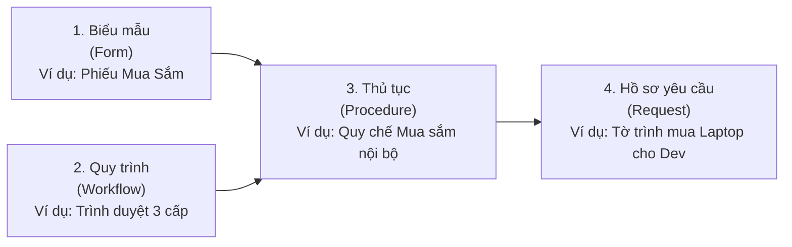

# 01 — Tổng quan Hệ thống & Các Khái niệm Cơ bản

**Dành cho:** Toàn bộ Người dùng mới của Gafood E-Office  
**Mục tiêu:** Giúp người dùng nắm vững cấu trúc hệ thống, hiểu mối quan hệ giữa các thành phần và làm quen với giao diện làm việc hàng ngày.

---

## 1. Hệ thống Gafood E-Office là gì?

**Gafood E-Office** là phần mềm Văn phòng số thế hệ mới, thay thế toàn bộ quy trình trình ký, phê duyệt văn bản giấy tờ truyền thống trong doanh nghiệp bằng quy trình số hóa 100%:
* **Không in ấn — Không giấy tờ:** Toàn bộ đề xuất, tờ trình, hợp đồng được điền, gửi và lưu trữ trực tuyến.
* **Tự động hóa luồng duyệt:** Hệ thống tự động xác định ai là người cần duyệt (Trưởng phòng, Kế toán, Giám đốc) dựa trên nội dung tờ trình mà người nộp không cần phải cầm giấy tờ đi gõ cửa từng phòng.
* **Ký số điện tử trực tiếp:** Lãnh đạo có thể ký duyệt tài liệu ở bất kỳ đâu thông qua máy tính hoặc điện thoại có kết nối internet.

---

## 2. Bốn Khái niệm Cốt lõi Bạn cần Biết

Để sử dụng phần mềm dễ dàng, bạn chỉ cần ghi nhớ mối quan hệ giữa 4 khái niệm đơn giản sau:



1. **Biểu mẫu (Form):**
   * Là tờ phiếu trắng được số hóa với các ô nhập thông tin (tiêu đề, số tiền, ngày cần hàng, bảng danh mục vật tư, tệp hóa đơn đính kèm...).
2. **Quy trình (Workflow):**
   * Là sơ đồ tiến trình duyệt thể hiện qua các hình hộp và mũi tên. Sơ đồ này quy định tờ trình sẽ đi qua những bước nào, rẽ nhánh ra sao (ví dụ: nếu số tiền dưới 20 triệu thì chỉ cần Trưởng phòng duyệt; trên 20 triệu phải qua Ban Giám đốc).
3. **Thủ tục (Procedure):**
   * Là sự kết hợp chính thức của công ty giữa: **Một Biểu mẫu cụ thể** + **Một Sơ đồ quy trình** + **Quy định Người có thẩm quyền phê duyệt**. Khi doanh nghiệp xuất bản một Thủ tục, nhân viên toàn công ty sẽ thấy thủ tục này trong danh mục để sử dụng.
4. **Hồ sơ yêu cầu (Request / Tờ trình):**
   * Là một trường hợp cụ thể khi bạn chọn một Thủ tục, điền đầy đủ dữ liệu thực tế và bấm nút gửi đi phê duyệt. Mỗi hồ sơ sẽ có một mã số định danh riêng để theo dõi.

---

## 3. Hướng dẫn Giao diện Chính của Ứng dụng

Khi đăng nhập thành công vào hệ thống, giao diện làm việc chuẩn của bạn sẽ bao gồm 2 khu vực chính: **Thanh điều hướng bên trái (Sidebar)** và **Thanh tác vụ trên cùng (Header)**.

```
┌──────────────────────────────────────────────────────────────────────────────────────────────────┐
│  [Logo] gaFood E-OFFICE    [🔍 Tìm kiếm nhanh...]                 [+ Tạo mới v]  [🔔]  [Avatar]  │
├────────────────────┬─────────────────────────────────────────────────────────────────────────────┤
│ TỔNG QUAN          │                                                                             │
│  📊 Tổng quan      │                                                                             │
│                    │                                                                             │
│ YÊU CẦU            │                           KHÔNG GIAN LÀM VIỆC CHÍNH                         │
│  📥 Công việc của tôi│                                                                           │
│  📝 Tạo bởi tôi     │            (Hiển thị danh sách hồ sơ, biểu mẫu hoặc sơ đồ duyệt)            │
│  👁️ Danh sách theo dõi│                                                                          │
│                    │                                                                             │
│ QUY TRÌNH & THỦ TỤC│                                                                             │
│  📋 Biểu mẫu       │                                                                             │
│  🔄 Luồng quy trình│                                                                             │
│  📁 Thủ tục        │                                                                             │
│                    │                                                                             │
│ QUẢN LÝ NHÂN SỰ    │                                                                             │
│  👥 Tài khoản      │                                                                             │
│  🏢 Tổ chức        │                                                                             │
└────────────────────┴─────────────────────────────────────────────────────────────────────────────┘
```

### 3.1 Thanh điều hướng bên trái (Sidebar)
* **📥 Công việc của tôi:** Nơi cấp quản lý tiếp nhận toàn bộ các hồ sơ đang chờ mình xem xét và ký duyệt.
* **📝 Tạo bởi tôi:** Nơi nhân viên theo dõi toàn bộ các hồ sơ do chính mình đã tạo, xem hồ sơ đang ở bước nào hoặc có bị trả về sửa đổi hay không.
* **📁 Thủ tục (Procedures):** Danh mục các thủ tục hành chính hiện có trong công ty (dành cho việc tạo mới đơn hoặc quản trị thiết lập).
* **🏢 Tổ chức (Organizations):** Sơ đồ cây phòng ban và danh sách nhân sự của toàn công ty.

### 3.2 Thanh công cụ phía trên (Header)
* **🔍 Tìm kiếm nhanh (Ctrl + K):** Cho phép bạn gõ tìm kiếm nhanh bất kỳ hồ sơ, thủ tục hoặc mã yêu cầu nào chỉ trong vài giây.
* **[+ Tạo mới]:** Nút tắt tiện lợi giúp bạn bấm tạo nhanh một tờ trình mới mà không cần chuyển trang.
* **🔔 Chuông thông báo:** Báo cáo thời gian thực mỗi khi có hồ sơ mới cần bạn duyệt, hoặc khi hồ sơ của bạn vừa được cấp trên phê duyệt/trả về.
* **Avatar & Tên người dùng:** Nơi xem thông tin cá nhân, cập nhật Chữ ký hình ảnh cá nhân và nút Đăng xuất an toàn.

