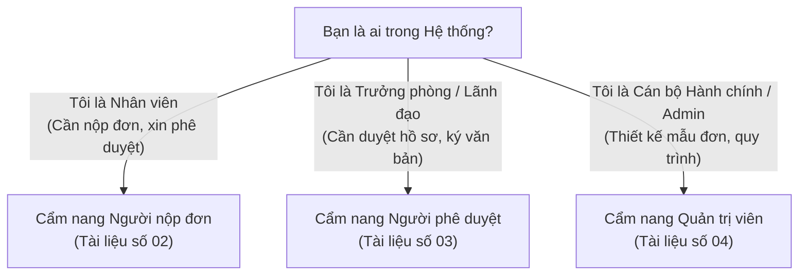

# Cổng Hướng Dẫn Sử Dụng Phần Mềm Gafood E-Office (Customer & User Guide)

**Dành cho:** Quý Khách hàng, Toàn thể Cán bộ Nhân viên, Cấp Quản lý và Quản trị viên Doanh nghiệp.  
**Mục tiêu:** Hướng dẫn chi tiết, trực quan, dễ hiểu từng thao tác sử dụng hệ thống văn phòng số và phê duyệt quy trình điện tử Gafood E-Office mà không cần kiến thức kỹ thuật chuyên sâu.

---

## 1. Bạn là ai trong Hệ thống? (Chọn Hướng dẫn Phù hợp)

Hệ thống Gafood E-Office được thiết kế tối ưu hóa theo từng vai trò nghiệp vụ. Vui lòng chọn tài liệu hướng dẫn tương ứng với vai trò của bạn dưới đây:

| Vai trò người dùng | Trách nhiệm chính | Tài liệu cần xem |
|:---|:---|:---:|
| 👤 **Nhân viên / Người trình đơn** | Nộp các đề xuất, tờ trình (mua sắm, xin nghỉ phép, thanh toán...), theo dõi tiến độ duyệt và ký tài liệu điện tử. | [02-huong-dan-nguoi-nop-don.md](./02-huong-dan-nguoi-nop-don.md) |
| 👔 **Cấp Quản lý / Người phê duyệt** | Tiếp nhận hồ sơ trong mục *"Công việc của tôi"*, xem xét nội dung, ký số điện tử trên PDF, phê duyệt hoặc yêu cầu bổ sung. | [03-huong-dan-nguoi-phe-duyet.md](./03-huong-dan-nguoi-phe-duyet.md) |
| ⚙️ **Quản trị viên / Cán bộ Quy trình** | Thiết lập cơ cấu phòng ban, tạo biểu mẫu điện tử, vẽ luồng duyệt tự động và phát hành các Thủ tục cho toàn công ty sử dụng. | [04-huong-dan-quan-tri-quy-trinh.md](./04-huong-dan-quan-tri-quy-trinh.md) |
| ❓ **Toàn bộ Người dùng** | Cần giải đáp các thắc mắc thường gặp, xử lý khi quên mật khẩu hoặc hồ sơ bị ách tắc. | [05-cau-hoi-thuong-gap-faq.md](./05-cau-hoi-thuong-gap-faq.md) |

---

## 2. Mục lục Bộ Tài liệu Hướng dẫn Khách hàng

1. [01 — Tổng quan Hệ thống & Các Khái niệm Cơ bản](./01-tong-quan-he-thong.md)  
   *Hiểu rõ 4 khái niệm nền tảng: Biểu mẫu, Quy trình, Thủ tục và Hồ sơ tờ trình; làm quen với giao diện chung.*
2. [02 — Hướng dẫn Dành cho Người Nộp Đơn (Nhân viên)](./02-huong-dan-nguoi-nop-don.md)  
   *6 bước tạo mới hồ sơ, điền biểu mẫu, xem trước tiến trình duyệt, thay đổi người duyệt khi cần và ký số tài liệu.*
3. [03 — Hướng dẫn Dành cho Người Phê Duyệt (Cấp Quản lý & Lãnh đạo)](./03-huong-dan-nguoi-phe-duyet.md)  
   *Quy trình thẩm định hồ sơ, ký số văn bản trực tuyến, thao tác Phê duyệt, Yêu cầu chỉnh sửa và Từ chối.*
4. [04 — Hướng dẫn Dành cho Quản trị viên & Cán bộ Quy trình](./04-huong-dan-quan-tri-quy-trinh.md)  
   *Cách tạo phòng ban, thiết kế biểu mẫu kéo thả, vẽ luồng quy trình BPMN trực quan và xuất bản thủ tục.*
5. [05 — Câu hỏi Thường gặp & Xử lý Tình huống (FAQ)](./05-cau-hoi-thuong-gap-faq.md)  
   *Giải đáp các sự cố phổ biến, ủy quyền khi đi công tác và mẹo sử dụng phần mềm hiệu quả.*

---

## 3. Thuật ngữ Nghiệp vụ Giải thích Đơn giản

Để quý khách hàng dễ dàng tiếp cận, hệ thống sử dụng các thuật ngữ thuần Việt quen thuộc trong đời sống công sở:

* **Biểu mẫu (Form):** Tờ phiếu điện tử chứa các ô nhập liệu (ví dụ: Phiếu yêu cầu mua sắm, Đơn xin nghỉ phép).
* **Quy trình (Workflow):** Sơ đồ đường đi của tờ trình qua các phòng ban (ví dụ: Nhân viên -> Trưởng phòng -> Kế toán trưởng -> Giám đốc).
* **Thủ tục (Procedure):** Quy định chính thức của công ty kết hợp giữa một Biểu mẫu cụ thể, Quy trình tương ứng và quy định ai là người có thẩm quyền ký duyệt.
* **Hồ sơ / Yêu cầu (Request):** Một tờ trình cụ thể do một nhân sự nộp lên hệ thống vào một ngày giờ nhất định.
* **Ký số điện tử (Digital Signing):** Thao tác đóng dấu chữ ký hình ảnh của bạn trực tiếp lên văn bản điện tử (PDF) ngay trên trình duyệt mà không cần in ra giấy.

