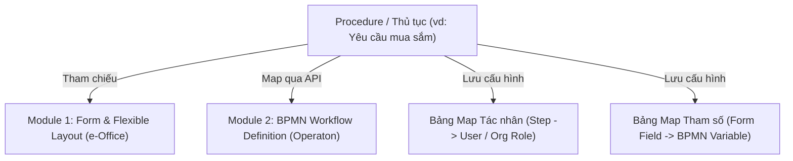
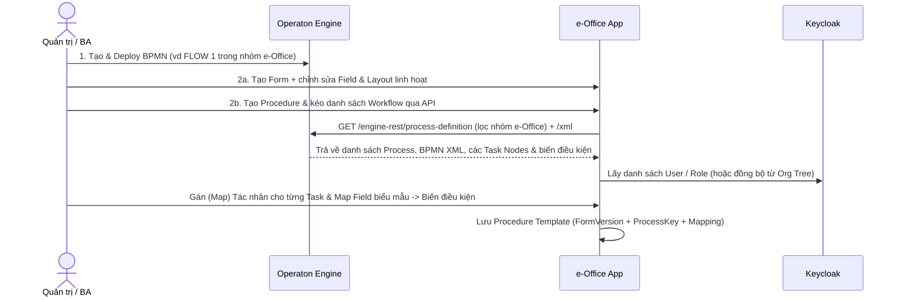
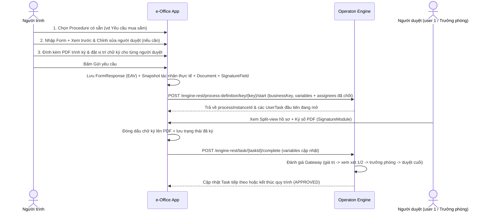

# Mô tả Toàn diện Kiến trúc Phát triển: e-Office + Operaton + Keycloak

Tài liệu này diễn giải đầy đủ về mặt kiến trúc phần mềm, dữ liệu và luồng vận hành cho định hướng phát triển mới từ sơ đồ của bạn: **tách biệt hoàn toàn Module Biểu mẫu linh hoạt (`e-Office`) và Module Quy trình (`Operaton`), đồng thời kết nối qua API và đồng bộ định danh qua `Keycloak`**.

---

## 1. Bức tranh tổng thể & Triết lý tách rời 3 trụ cột

Trong hệ thống hiện tại, `E_Office` đang tự gánh tất cả mọi thứ trong một khối backend NestJS + PostgreSQL (đăng nhập cục bộ, tạo form phẳng, tự chạy engine phê duyệt tuyến tính `FlowStep` và ký PDF). Theo sơ đồ định hướng mới, hệ thống được tách thành **3 hệ thống / trụ cột chuyên biệt**, mỗi bên làm đúng 1 việc tốt nhất:

```mermaid
flowchart LR
  KC["Keycloak (IAM / SSO)"] -->|OIDC / JWT & Danh sách User| EO["e-Office App (NestJS + Next.js)"]
  KC -->|OIDC / Group / Identity| OP["Operaton (BPMN 2.0 Workflow Engine)"]
  OP <-->|REST API (/engine-rest)| EO
```

1. **Keycloak (Identity & Access Management — Quản lý tài khoản tập trung)**
   - Nắm giữ danh tính duy nhất của nhân sự (`user 1`, `user 2`, thuộc tính phòng ban/chức danh, nhóm quyền, SSO).
   - Cung cấp nguồn user chuẩn cho `e-Office` đồng bộ và hiển thị đúng người + phòng ban + chức danh khi cấu hình/duyệt.
2. **Operaton (`github.com/operaton/operaton` — Headless Workflow Engine chuyên biệt)**
   - Là mã nguồn mở chuẩn **BPMN 2.0 / DMN** (fork kế thừa trực tiếp từ **Camunda Platform 7 Community Edition**, giữ nguyên chuẩn mô hình BPMN 2.0 XML và REST API `/engine-rest/...`).
   - Đóng vai trò **"bộ não điều phối luồng chạy ngầm phía sau (headless engine qua API)"** dùng chung cho nhiều khối nghiệp vụ trong doanh nghiệp (`e-Office`, `Sales Marketing`, `Customer Service`...). Chỉ Admin/BA vào Operaton để vẽ & deploy BPMN; nhân viên và người duyệt thao tác **100% trên giao diện `e-Office`**.
   - Chuyên xử lý các luồng phức tạp mà DB đơn giản khó tự code ổn định: **tuần tự (Sequential)**, **song song (Parallel Gateway — tách nhiều nhánh rồi hội tụ)**, **rẽ nhánh theo điều kiện (Exclusive Gateway — ví dụ xét `giá trị` để đi nhánh `xem xét 1` hoặc `xem xét 2`)**, hẹn giờ nhắc việc (Timer), leo thang quá hạn (Escalation)...
3. **e-Office (Ứng dụng Nghiệp vụ, Biểu mẫu linh hoạt & Trình ký tài liệu)**
   - Là giao diện làm việc duy nhất cho người trình và người duyệt: **xây dựng biểu mẫu với layout tùy biến**, **quản lý Procedure (Mẫu thủ tục)**, **lưu trữ hồ sơ & tài liệu đính kèm**, **kéo thả ô chữ ký & ký số PDF**, **bình luận & theo dõi hồ sơ**.

---

## 2. Hai Module cốt lõi: Độc lập nhưng Tương thích qua `Procedure`

Câu hỏi quan trọng nhất bạn đặt ra là: *"Làm sao để Module tạo biểu mẫu (`e-Office`) và Module tạo workflow (`Operaton`) độc lập và chuyên biệt nhưng tương thích tốt?"*

Câu trả lời chuẩn trong kiến trúc doanh nghiệp là **tách Schema & Engine của hai bên, sau đó nối bằng một lớp trung gian gọi là `Procedure` (Mẫu quy trình nghiệp vụ / Thủ tục)** — chính xác như khung nét đứt **"Quy trình nghiệp vụ (Yêu cầu mua sắm)"** trong sơ đồ của bạn.



### 2.1 Module 1 — Tạo Biểu mẫu & Layout linh hoạt (`e-Office`)

Hiện tại, trong [`form.prisma`](file:///f:/Downloads/Projects/Gafood/E_Office/backend/prisma/schema/form.prisma), `FormVersion` chỉ lưu danh sách phẳng `FormField[]` (`TEXT`, `NUMBER`, `DATE`, `SELECT`), nên giao diện luôn xếp các ô từ trên xuống dưới theo 1 cột duy nhất.

Để **linh hoạt layout khi tạo biểu mẫu** mà **không làm mất dữ liệu lịch sử**, cần tách rõ 2 phần trong mỗi `FormVersion`:
1. **Data Schema (Định nghĩa trường dữ liệu)**: Danh sách `fields` (`key`, `type`, `required`, `validations`, `options`) — dùng để validate backend và lưu giá trị vào `FormResponseValue` (dạng EAV key-value).
2. **Layout Schema (Định nghĩa bố cục hiển thị — JSON)**: Mô tả cách sắp xếp các `fieldKey` lên màn hình:
   - **Sections / Nhóm thông tin** (có tiêu đề, có thể thu gọn).
   - **Grid / Chia cột** (1 cột, 2 cột, 3 cột; độ rộng `colSpan` theo từng trường — ví dụ: *Số tiền* và *Đơn vị tiền* nằm chung 1 hàng ngang).
   - **Repeater / Bảng con** (ví dụ bảng *Danh sách hàng hóa cần mua* gồm nhiều dòng).
   - **Conditional UI (Ẩn/hiện có điều kiện)** (chỉ hiện ô "Lý do gấp" khi chọn mức độ = "Khẩn").
   - **Slot tài liệu đính kèm** (quy định loại tài liệu nào bắt buộc nộp cùng biểu mẫu).

> **Tính độc lập:** Khi Admin thay đổi bố cục (chuyển từ 1 cột sang 2 cột, đổi nhóm hiển thị), `fieldKey` dữ liệu không đổi nên **không cần chạm tới Operaton** và các yêu cầu cũ vẫn đọc lại được nguyên vẹn theo `FormVersion`.

### 2.2 Module 2 — Thiết kế & Vận hành Workflow (`Operaton`)

Bên `Operaton`, chuyên viên quy trình (hoặc quản trị hệ thống) chỉ quan tâm tới **logic dòng chảy công việc**:
- Tạo và phân loại workflow theo **nhóm / tenant** (nhóm `e-Office`, nhóm `Sales Marketing`, nhóm `Customer Service`...).
- Thiết kế sơ đồ **BPMN 2.0**:
  - `Start Event` (`người trình`).
  - `Exclusive Gateway` (`giá trị` / biến điều kiện) rẽ nhánh sang `UserTask: xem xét 1` hoặc `UserTask: xem xét 2`.
  - `Parallel Gateway` (duyệt song song nhiều bộ phận cùng lúc, chờ tất cả xong mới đi tiếp).
  - Các `UserTask` kế tiếp (`trưởng phòng` -> `người duyệt cuối`).
- Quy ước **hợp đồng giao tiếp tối thiểu (Contract)** giữa BPMN với bên ngoài:
  - Mỗi `UserTask` có một **`taskDefinitionKey`** rõ ràng (vd: `step_review_1`, `step_manager`, `step_final_approver`) và có thể gán biểu thức `assignee = "${assignee_step_manager}"` (hoặc `candidateUsers`).
  - Các cổng rẽ nhánh dùng tên biến rõ ràng (vd: `${amount >= 50000000}` hoặc `${gia_tri == 'cao'}`).

> **Tính độc lập:** Operaton **không cần biết** biểu mẫu bên e-Office trông đẹp hay xấu, chia mấy cột, hay file PDF ký ở đâu. Operaton chỉ nhận đầu vào là **biến số + người xử lý**, rồi trả ra **đang dừng ở Task nào và ai phải làm**.

---

## 3. Luồng hoạt động chi tiết qua 2 Giai đoạn (Theo đúng sơ đồ)

### 3.1 Giai đoạn 1 — Cấu hình (Admin / Người thiết kế quy trình)



Cụ thể 2 bước mapping trong `2b` ở sơ đồ của bạn (và lưu ý **1 Workflow trên Operaton như `FLOW 1` có thể được tái sử dụng cho nhiều `Procedure` khác nhau** bên `e-Office`):
1. **Mapping Tác nhân (Actor Mapping)**: Với mỗi `UserTask` đọc được từ `FLOW 1` (`xem xét 1`, `xem xét 2`, `trưởng phòng`, `người duyệt cuối`), Admin cấu hình **tác nhân mặc định** cho bước đó:
   - *Giai đoạn hiện tại (MVP)*: Gán đích danh từng `user` từ Keycloak / danh bạ `e-Office` (`user 1`, `user 2`...), **đồng thời hiển thị kèm Phòng ban và Chức danh** của người đó ngay tại vị trí bước để tránh nhầm người cùng tên và giúp người dùng nhận diện rõ vai trò. Cho phép đánh dấu bước nào **người trình được phép sửa/đổi người duyệt** lúc tạo yêu cầu (`allowOverride`, mặc định bật cho các trường hợp thực tế linh hoạt).
   - *Giai đoạn mở rộng sau này*: Bổ sung quy tắc **gán động theo Phòng ban / Chức danh** (ví dụ: tự động lấy *"Trưởng phòng của người trình"* dựa trên cây tổ chức `Organization` hoặc thuộc tính từ Keycloak tại thời điểm trình ký).
2. **Mapping Tham số (Parameter / Variable Mapping)**:
   - Admin nhìn thấy bên trái là các biến điều kiện của Workflow Operaton (ví dụ biến `gia_tri` tại gateway rẽ nhánh), bên phải là danh sách trường của Form vừa tạo (`field A`, `field B`...).
   - Chỉ cần chọn: **`Operaton variable "gia_tri"  <--  Form field "field A"`**.
   - Nếu sau này tạo một Procedure khác dùng lại cùng `FLOW 1` nhưng với biểu mẫu khác (`field X`), chỉ cần map lại `gia_tri <-- field X` mà không cần sửa BPMN bên Operaton.

---

### 3.2 Giai đoạn 2 — Vận hành (Người trình & Người duyệt sử dụng)



Diễn giải 3 bước người dùng cuối trên sơ đồ của bạn (đã chốt theo nhu cầu thực tế):
1. **Chọn Template `Procedure`**: Người trình không phải dựng lại cả quy trình từ đầu mà chọn sẵn thủ tục (vd: *Yêu cầu mua sắm*).
2. **Điền Form, Quan sát trước & Chỉnh sửa người duyệt phù hợp**:
   - Giao diện render Form theo layout linh hoạt đã thiết kế.
   - Hệ thống điền sẵn (pre-fill) sơ đồ các bước và danh sách **người duyệt mặc định kèm Phòng ban, Chức danh** từ `Procedure`.
   - Khi người trình nhập `field A` (vd số tiền), giao diện đánh giá điều kiện để làm nổi bật nhánh sẽ đi qua (`xem xét 1` hay `xem xét 2`).
   - **Quyền chỉnh sửa của người trình:** Vì template Admin tạo sẵn không thể phủ hết mọi tình huống thực tế, người trình **được phép thay đổi hoặc bổ sung người duyệt ở các bước** ngay trước khi gửi (e-Office sẽ truyền danh sách người duyệt cuối cùng của riêng yêu cầu này sang Operaton).
3. **Đính kèm PDF & Kéo thả vị trí chữ ký -> Khởi chạy**:
   - Đính kèm file PDF trình ký (và tài liệu phụ nếu có), kéo thả ô chữ ký tương ứng cho **đúng danh sách người duyệt thực tế đã chốt ở Bước 2**.
   - `e-Office` lưu toàn bộ dữ liệu gốc, đẩy biến điều kiện + biến `assignee` từng bước sang `Operaton` để khởi tạo `ProcessInstance`. Từ thời điểm này, **Operaton quyết định bước nào đang mở**, còn **e-Office lo toàn bộ giao diện phê duyệt, bình luận và đóng dấu chữ ký PDF**.

---

## 4. Đối chiếu Codebase `E_Office` hiện tại -> Kiến trúc mới

Dựa trên cấu trúc thực tế của dự án hiện tại, không cần đập bỏ làm lại toàn bộ mà có thể tiến hóa từng phần:

| Thành phần trong `E_Office` hiện tại | Vai trò ở kiến trúc mới | Mức độ thay đổi |
|---|---|---|
| [`auth-provider.interface.ts`](file:///f:/Downloads/Projects/Gafood/E_Office/backend/src/modules/auth/interfaces/auth-provider.interface.ts) (`AuthProvider`) | Đã chừa sẵn interface SSO-ready! Triển khai thêm `KeycloakOidcProvider` thay cho / song song `LocalAuthProvider` | **Mở rộng sạch**, guard/controller giữ nguyên |
| `User` & `Organization` (`organization.prisma`) | Giữ làm danh bạ nội bộ đồng bộ từ Keycloak (lưu `keycloakSub`) và lưu **Phòng ban / Chức danh** để hiển thị khi gán từng user hiện tại, đồng thời làm nền cho gán động ở giai đoạn sau | **Mở rộng nhẹ** (thêm `keycloakSub`, trường chức danh nếu cần) |
| `Form`, `FormVersion`, `FormField` ([`form.prisma`](file:///f:/Downloads/Projects/Gafood/E_Office/backend/prisma/schema/form.prisma)) | Nâng cấp thành **Module Form & Layout linh hoạt**: thêm `layoutSchema` (JSON) trên `FormVersion`, giữ nguyên `FormResponseValue` (EAV) | **Mở rộng** (không vỡ dữ liệu cũ) |
| **Chưa có:** `Procedure` | **Tạo mới Module `Procedure`**: nối `FormVersion` + `operatonProcessKey`/`deploymentId` + `ActorMapping` + `VariableMapping` | **Module mới trung tâm** |
| `Flow`, `FlowStep`, `ApprovalEngineService` ([`approval_flow.prisma`](file:///f:/Downloads/Projects/Gafood/E_Office/backend/prisma/schema/approval_flow.prisma)) | Chuyển trách nhiệm điều phối bước từ engine nội bộ sang **`OperatonAdapterService`** gọi REST API Operaton (giữ cache/projection bảng `Task` hoặc query Operaton để list nhanh "Công việc của tôi") | **Thay thế / Ủy quyền sang Operaton** |
| `SignatureModule` + `PdfCanvas` + `DocumentModule` | Giữ nguyên tại `e-Office`: Operaton **không** lưu file PDF hay tọa độ chữ ký; khi người dùng ký ở e-Office xong mới gọi `/task/{id}/complete` sang Operaton | **Giữ nguyên, gắn hook** |

---

## 5. 5 Điểm kỹ thuật then chốt cần lưu ý để hệ thống chạy ổn định

1. **Quản lý phiên bản (Versioning đồng bộ)**:
   - Khi một yêu cầu đã được tạo ở phiên bản `Procedure v1` (`FormVersion v1` + `Operaton ProcessDefinition v1`), nếu Admin sửa layout form hoặc sửa BPMN bên Operaton thành `v2`, các yêu cầu đang chạy dở **bắt buộc phải chạy hết trên `v1`**, không bị nhảy sang `v2`. Operaton hỗ trợ sẵn `ProcessDefinitionId` gắn theo version khi start instance.
2. **Cơ chế đồng bộ trạng thái Operaton <-> e-Office**:
   - Màn hình *"Công việc của tôi"* và danh sách yêu cầu bên `e-Office` cần lọc/phân trang nhanh theo trạng thái (`PENDING`, `APPROVED`, `REJECTED`...) kết hợp dữ liệu biểu mẫu.
   - Nên có cơ chế đồng bộ 2 chiều sạch sẽ: e-Office vừa lưu `operatonInstanceId` + trạng thái tổng quan (`FormResponse.status`) khi thực hiện hành động (`start`, `complete`, `cancel`), vừa dùng **Event/Execution Listener** (hoặc External Task / Webhook từ Operaton báo về e-Office) để trạng thái luôn khớp tuyệt đối khi BPMN tự chuyển nhánh hoặc kết thúc.
3. **Nghiệp vụ `Yêu cầu chỉnh sửa (REQUEST_CHANGES)` & `Hủy/Thu hồi` trong BPMN**:
   - Hiện tại e-Office hỗ trợ `revise` (`clone-reserve` / `clone-reset`). Khi dùng Operaton, cần quy ước rõ trên mẫu BPMN chuẩn của nhóm `e-Office`: nếu có hành động `REQUEST_CHANGES` hoặc `REJECT`, BPMN nên có đường luồng rẽ về `Requestor Revise Task` hoặc kết thúc instance (`Terminate End Event`) để e-Office tạo instance mới khi nhân bản — tránh trường hợp e-Office báo đã hủy nhưng `ProcessInstance` bên Operaton vẫn treo `ACTIVE`.
4. **Quy tắc đặt biến & Bảo mật kết nối**:
   - Giao tiếp `e-Office Backend <-> Operaton REST API` thực hiện **server-to-server** (Frontend Next.js **không** gọi trực tiếp vào Operaton để tránh lộ quyền sửa biến điều kiện hoặc tự hoàn thành task bỏ qua bước ký PDF!).
   - Đặt quy ước đặt tên biến chuẩn giữa 2 bên (ví dụ tiền tố `var_` cho tham số nghiệp vụ, `actor_` cho danh sách user từng bước) để giao diện Mapping đọc tự động được ngay mà không phải cấu hình thủ công bằng tay quá nhiều.
5. **Xem trước & Tùy biến người duyệt trên luồng BPMN (Flow Preview & Override)**:
   - Bên Operaton trả về file **BPMN XML** qua `GET /engine-rest/process-definition/{id}/xml`. Frontend/Backend e-Office parse XML này (bằng `bpmn-moddle` / `bpmn-js`) để hiển thị sơ đồ trực quan y hệt BPMN đã vẽ kèm tên, phòng ban, chức danh người duyệt ở mỗi node.
   - Để người trình **sửa/bổ sung người duyệt** mà không phá cấu trúc BPMN của Operaton:
     - Đổi người duyệt ở 1 bước: truyền biến `actor_<stepKey>` mới vào payload khi `start` instance trên Operaton.
     - Thêm/bớt *nhiều người duyệt* trong cùng 1 bước (song song hoặc tuần tự): thiết kế `UserTask` đó bên Operaton dạng **Multi-instance (`collection="${actorList_<stepKey>}"`)** hoặc `candidateUsers` — khi đó chỉ cần thay đổi mảng danh sách user bên e-Office mà không phải sửa lại sơ đồ BPMN!
